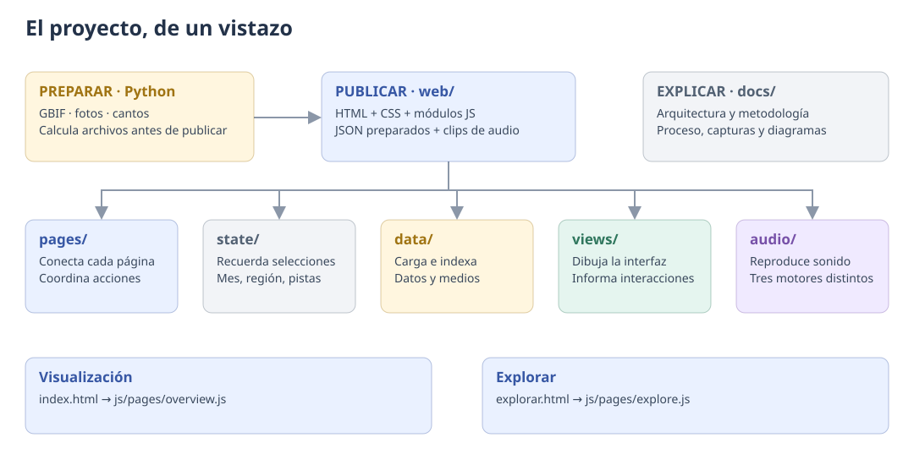
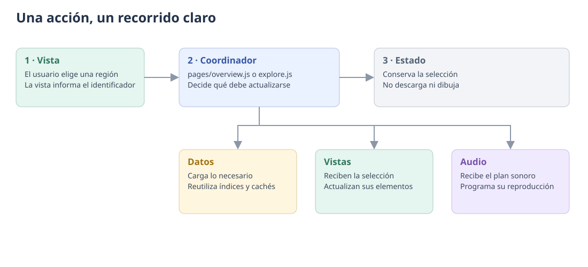
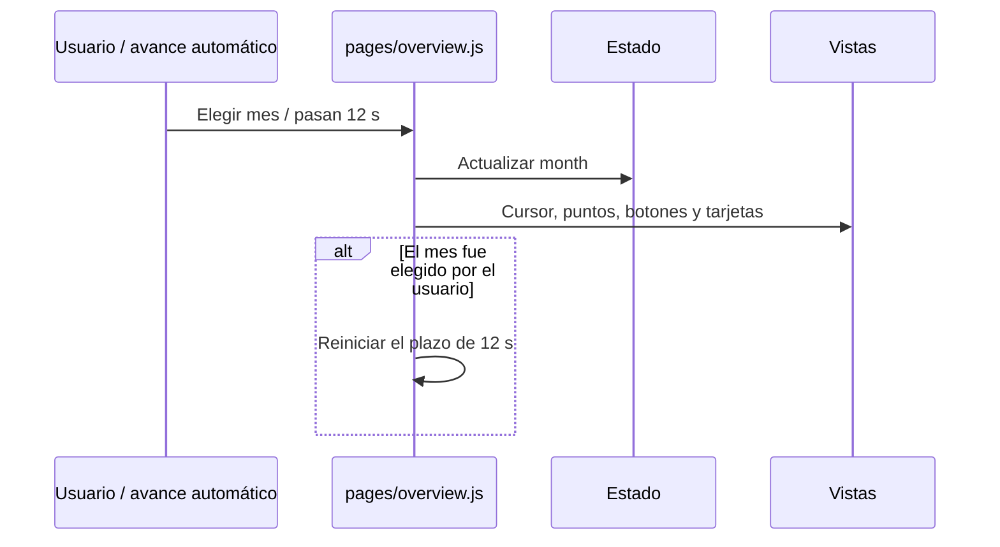
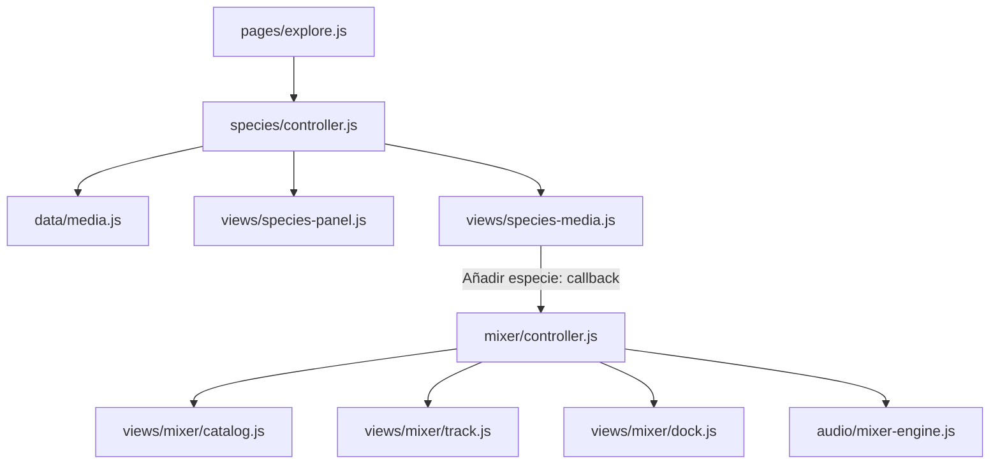
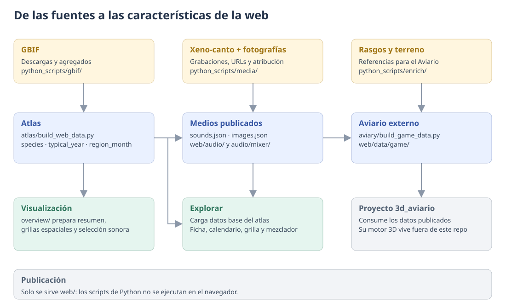

# Arquitectura del Atlas sonoro de aves de Chile

> **La regla de lectura:** Python prepara. `data` carga. `state` recuerda.
> `views` dibuja. `audio` reproduce. `pages` conecta las piezas.

Esta guía describe la **estructura implementada** en la refactorización
`huge-refactorization`, a partir de `57b6dc8`. La reorganización conserva las
páginas, los datos publicados, las fórmulas, el aspecto y las reglas de sonido.
Los nombres de funciones de dibujo existentes se mantienen para facilitar el
seguimiento del código anterior.

Para una explicación de los gráficos y controles desde la interfaz, con
capturas reales, consulta la [guía visual de uso](GUIA_INTERFAZ.md).
Las medidas que usan las vistas y el sonido se definen en el
[glosario de métricas](METRICAS.md).
La integración y revisión de la nueva ficha están registradas en
[ESTRUCTURA.md](ESTRUCTURA.md), con las responsabilidades de cada módulo.

## 1. El proyecto, de un vistazo



| Quiero trabajar en… | Empiezo aquí |
|---|---|
| La portada **Visualización** | [`web/js/pages/overview.js`](../web/js/pages/overview.js) |
| La **Ficha de métricas** | [`web/js/pages/metrics.js`](../web/js/pages/metrics.js) y [su estructura](ESTRUCTURA.md) |
| El atlas **Explorar** | [`web/js/pages/explore.js`](../web/js/pages/explore.js) |
| Un gráfico o control | [`web/js/views/`](../web/js/views/) |
| La ficha de un ave | [`web/js/species/controller.js`](../web/js/species/controller.js) y las vistas `species-*` |
| La mezcla personalizada | [`web/js/mixer/controller.js`](../web/js/mixer/controller.js) |
| Qué se escucha | Los planes de [`web/js/audio/`](../web/js/audio/) |
| Cómo se reproduce | Los motores de [`web/js/audio/`](../web/js/audio/) |
| Cómo se cargan los datos | [`web/js/data/`](../web/js/data/) |
| Cómo se calculan los datos | [`python_scripts/`](../python_scripts/) |
| Colores, tipografía o distribución | [`web/css/`](../web/css/) |
| El motor del Aviario 3D | El proyecto externo `3d_aviario` |

```text
Repositorio
├── web/                 SITIO que se publica
│   ├── index.html       Visualización
│   ├── explorar.html    Explorar
│   ├── metricas.html    Ficha de métricas
│   ├── js/              Comportamiento, separado por responsabilidad
│   ├── css/             Presentación visual
│   ├── data/            JSON públicos, incluidos los del Aviario
│   └── audio/           Clips públicos
├── python_scripts/      PREPARACIÓN de datos y medios
├── gbif/                Datos y configuración del trabajo con GBIF
├── Regiones/            Fuente geográfica original
├── docs/                EXPLICACIÓN del proyecto y su proceso
├── mineria/             INVESTIGACIÓN independiente de la web
├── scripts/             PREPARACIÓN opcional de la ficha estática
└── tests/               VERIFICACIÓN de arquitectura y equivalencia
```

La web sigue siendo estática: D3 7.9.0 dibuja SVG; Web Audio reproduce los
cantos; los módulos ES se cargan directamente desde HTML. **No hay proceso de
compilación del frontend.** Node y las dependencias de desarrollo se usan para
verificar y regenerar opcionalmente la ficha estática, no para servir el sitio.

## 2. Quién puede hacer qué



| Capa | Una responsabilidad | Su límite |
|---|---|---|
| `pages/` | Coordinar una página | Evita implementar gráficos o motores de audio |
| `state/` | Crear el estado de selección | No carga archivos ni dibuja |
| `data/` | Cargar, indexar y conservar datos | No modifica el DOM ni reproduce sonido |
| `views/` | Presentar un bloque de interfaz | No hace `fetch`, no crea audio ni modifica el estado de la página |
| `audio/` | Preparar planes o ejecutarlos | No conoce botones, nombres de elementos ni paneles |
| `mixer/` | Coordinar la mezcla y seleccionar su escena | Delega la interfaz a vistas y la reproducción al motor |
| `species/` | Coordinar la carga de detalle de especie | Delega los datos al repositorio y la presentación a vistas |
| `explore/` | Consultas y reglas del atlas | Separa selección de filas, colores y ejes de la coordinación |
| `metrics/` | Consultar las métricas y asociar conceptos con anclas | No accede al DOM ni modifica el estado |
| `shared/` | Una utilidad explícita por archivo | Evita convertirse en una colección de lógica sin dueño |

**Una responsabilidad no significa una función.** La galería puede tener
funciones para crear fotos, mostrar atribuciones y expandirse: todas presentan
la misma característica. Un motor puede cargar sus buffers y programar notas:
todas sus funciones pertenecen a la reproducción. La separación importante es
que la galería no descargue los índices ni el motor manipule la galería.

Las dependencias se entregan mediante parámetros de las fábricas
`create…`. Los módulos no importan el coordinador que los creó; una acción del
usuario vuelve a él mediante un callback. Así se evita la dependencia circular
«mapa → calendario → mapa».

Los coordinadores conservan pequeños avisos de fallo de inicio y la conexión de
los eventos del navegador. Las vistas poseen sus elementos y referencias SVG;
esas referencias no se guardan en el estado de selección.

## 3. Visualización: mapa detallado de la portada

```text
index.html
└── pages/overview.js                   Coordina la portada
    ├── state/overview.js              Mes, región, modo del mapa y avance automático
    ├── data/overview.js               overview.json
    ├── data/spatial.js                Grillas, geometría y resumen regional
    ├── views/overview/
    │   ├── pulse.js                  Áreas apiladas + tabla accesible
    │   ├── species-dots.js           Un picaflor por especie, con vuelo
    │   ├── monthly-maps.js           Doce mapas de Chile
    │   ├── region-detail.js          Selector + mapas de una región
    │   ├── map-strip.js              Tarjetas y desplazamiento de mapas
    │   └── player.js                 Meses y botón de pausa del avance
    └── (el sonido de la portada vive en pages/regional-calendar.js)
```

| Lo que aparece en pantalla | Dueño del dibujo | Datos | Actualización |
|---|---|---|---|
| [Especies presentes, mes a mes](METRICAS.md#riqueza) | `pulse.js` → `drawPulse()` | `overview.json` | El mes mueve el cursor |
| Tabla equivalente de [conteos](METRICAS.md#riqueza) | `pulse.js` → `drawTable()` | Los mismos conteos | Se dibuja al iniciar |
| Una silueta, una especie | `species-dots.js` → `drawFlock()` | Especies y [máscara de presencia](METRICAS.md#presente) | El mes hace volar a las visitantes |
| La misma ave, distintos calendarios | `views/overview/regional-calendar.js` | Perfiles regionales de `typical_year.json` (se piden al acercarse a la sección); la foto de cada ejemplo está fijada en `overview/regional-examples.js` (copiada de `images.json`, un test verifica que coincidan) | El selector cambia especie, foto, texto y matriz; ▶ de una región la recorre con [«Escuchar su año»](METRICAS.md#ano-especie) |
| La ola recorre todo el país | `monthly-maps.js` → `drawMaps()` | `grid_month.json` o `region_month.json` | Cambiar modo redibuja; cambiar mes resalta |
| Una región de cerca | `region-detail.js` | `grid_region/<código>.json` | Elegir región carga y redibuja |
| Meses y pausa | `player.js` | Estado | Acción del usuario o avance automático (12 s por mes) |

### Mes y región: dos recorridos distintos

El bloque de calendarios regionales tiene su propio coordinador
`pages/regional-calendar.js`, estado `state/regional-calendar.js`, repositorio
`data/regional-calendar.js` y consultas puras en `overview/regional-calendar.js`.
Su selección de especie y expansión no dependen del mes de la portada. Reutiliza
`data/media.js` para el índice de cantos; sus fallos de carga quedan aislados del resto de
la portada. Su botón ▶ por región usa `audio/species-year.js`. El recorrido y las reglas de lectura están en
[ESTRUCTURA.md](ESTRUCTURA.md#calendarios-regionales--14-de-octubre-de-2026).



Elegir una región actualiza el selector y solicita su archivo. Si llega tarde
una respuesta de una región anterior, el coordinador evita enviarla a
`region-detail.js`.

Los archivos regionales se conservan por código. Un fallo elimina la promesa de
esa caché para permitir otro intento.

**Los puntos significan cosas distintas:**

- `species-dots.js`: un punto = una especie.
- Mapa nacional en modo Zonas: un punto = una [celda de unos 22 km](METRICAS.md#ola-zonas).
- Detalle regional: un punto = [`perDot` especie-días](METRICAS.md#por-punto), distribuido dentro de una
  celda de unos 5 km; no representa una ubicación exacta de un ave.

La franja nacional muestra los doce meses juntos desde 760 px de ancho del
contenedor. En tamaños menores muestra menos tarjetas y permite desplazarse.
El detalle regional conserva su franja desplazable.

## 4. Explorar: mapa detallado del atlas

```text
explorar.html
└── pages/explore.js                    Coordina el atlas
    ├── state/explore.js               Región, mes, clase y especie
    ├── data/atlas.js                  Carga los cinco archivos base
    ├── explore/
    │   ├── queries.js                Consultas de región y orden mensual
    │   ├── calendar-selection.js     Selección y orden de filas
    │   ├── colors.js                 Escalas de color
    │   └── grid-axis.js              Ejes, estaciones y cursor mensual
    ├── views/explore/
    │   ├── summary.js                Resumen nacional de clases
    │   ├── region-map.js             Mapa + estadísticas del ámbito
    │   ├── calendar.js               Especie × mes
    │   ├── regional-grid.js          Región × mes
    │   ├── controls.js               Búsqueda, pestañas y botones
    │   └── methodology.js            Explicación y DOIs
    ├── species/controller.js          Coordina el detalle de un ave
    ├── mixer/controller.js            Coordina la mezcla personalizada
    └── audio/
        ├── species-year-plan.js      «Escuchar su año»: nivel y volumen por mes
        └── species-year.js           Reproduce el año de una especie
```

`data/atlas.js` transforma la matriz compacta en filas con campos nombrados y
construye `byScope`, `bySpecies`, `regionById` y `effortMean`. También calcula el
dominio de la [desviación de visitantes](METRICAS.md#desviacion);
`explore/colors.js` lo aplica a la escala con [saturación](METRICAS.md#saturacion).

Al elegir una región, el coordinador actualiza mapa, estadísticas, grilla y
pestañas. Si hay una especie abierta, vuelve a presentar su ficha con el nuevo
ámbito. Cambiar el mes mueve los cursores y actualiza el mapa; no cambia
innecesariamente la selección ni el orden de filas.

`calendar-selection.js` conserva los límites **12 / 24 / 16**, la expansión,
la especie fijada y el [orden por llegada de visitantes](METRICAS.md#llegada). La [clasificación](METRICAS.md#clases) puede
ser distinta entre Chile y una región: al abrir una especie se conserva el
cambio automático a la pestaña correspondiente.

### La ficha y la mezcla son características independientes



`species-panel.js` presenta nombre, hechos, perfil radial y mapa de frecuencia.
`species-media.js` presenta grabaciones, licencias y fotos. El controlador carga
los índices y mantiene las comprobaciones de selección para las respuestas
asíncronas. La galería muestra inicialmente una foto y permite expandir hasta
ocho.

El mezclador tiene tres vistas con límites concretos: catálogo de especies,
pista individual y barra inferior. `mixer/controller.js` coordina sus acciones;
`audio/mixer-engine.js` conserva tiempos, buffers, fuentes y ganancias.

**«Mezclar lo que se ve» añade una selección puntual de hasta seis especies.**
Cambiar después el mes, región o pestaña no reemplaza la mezcla personalizada.
Minimizar la barra tampoco la pausa: se conserva el comportamiento anterior.

## 5. Audio: qué suena y cómo suena

| Sistema | Plan / selección | Motor | Duración y comportamiento |
|---|---|---|---|
| Mezcla personalizada | Pistas del usuario | `mixer-engine.js` | [Esperas aleatorias de 0,2–5,2 s o ciclos comunes de 6 s](METRICAS.md#mezclador) |
| Escuchar su año (calendarios regionales y ficha) | `species-year-plan.js` | `species-year.js` | [1,5 s por mes; una especie, volumen = perfil × años/8](METRICAS.md#ano-especie) |

Un **plan** describe eventos: muestra, volumen, posición estéreo y momento.
Un **motor** ejecuta esos eventos con Web Audio. Cambiar un motor no modifica
los otros sistemas.

**Un sonido a la vez.** `shared/audio-focus.js` emite el evento de documento
`audio:claim` con el nombre de quien empieza a sonar por un gesto del usuario
(`species-year`, `mixer`, `clip`). Cada coordinador decide qué pausar: «Escuchar
su año» pausa la mezcla y el clip, y se detiene si alguno de ellos se reanuda.
Las páginas no se importan entre sí.

`buffers.js` es el mecanismo de carga de «Escuchar su año»; cada página crea su
propio reproductor, caché y contexto. El mezclador conserva su carga por pista,
porque su ciclo de vida incluye añadir y retirar pistas durante una descarga.

El recorrido sonoro de la portada (`year-loop.js`, `overview-plan.js`,
`data/loop.js`) y la sonificación mensual de Explorar (`atlas-sonifier.js`,
`atlas-plan.js`) se retiraron; `loop.json` y los granos `audio/*-g.mp3` siguen
publicados sin uso. En Explorar, el parlante silencia la mezcla; los volúmenes
de sus pistas se recuerdan mientras esa página siga abierta.

## 6. Datos: fuentes, preparación y publicación



| Archivos públicos en `web/data/` | Productor principal | Consumidor |
|---|---|---|
| `meta`, `species`, `typical_year`, `region_month`, `regions.min.geojson` | `atlas/build_web_data.py` | Atlas y partes de la portada |
| `overview.json` | `overview/build_overview_data.py` | Pulso y puntos por especie |
| `grid_month.json`, `grid_region/` | `overview/build_grid_data.py` | Mapas de la portada |
| `loop.json` | `overview/build_loop_data.py` | Sin uso: era el recorrido sonoro de portada, ya retirado |
| `sounds.json`, `audio/clips.json` | Preparación de audio + constructor del atlas | Ficha, mezclador y planes sonoros |
| `images.json` | Recolección y ordenación de imágenes | Ficha y catálogo del mezclador |
| `game/` | `aviary/build_game_data.py` + `enrich/` | Proyecto externo `3d_aviario` |

```text
python_scripts/
├── atlas/                 Año típico y clasificación
├── overview/              Resumen, grillas y selección sonora de portada
├── media/                 Preparación y revisión de fotos y cantos
├── aviary/                Exportación de datos para el Aviario
├── gbif/                  Descarga, join y agregación de registros
├── enrich/                Rasgos, referencias, paletas y terrenos del Aviario
├── audio_review/          Resultados y decisiones de revisión sonora
├── python_historicos/     Scripts conservados como evidencia del proceso
├── _compat.py             Reenvío de los comandos e imports existentes
└── *.py                   Entradas antiguas de compatibilidad
```

Las implementaciones reorganizadas están en las subcarpetas. Los scripts
pequeños con los nombres antiguos **solo reenvían al archivo correspondiente**;
no contienen una segunda implementación. Por ejemplo:

```text
python_scripts/build_web_data.py          Comando compatible
                    ↓
python_scripts/atlas/build_web_data.py    Implementación real
```

Ambos comandos funcionan desde cualquier directorio:

```bash
python3 python_scripts/build_web_data.py
python3 python_scripts/atlas/build_web_data.py
```

Las rutas de fuentes, cachés, revisiones y salidas se conservan. `gbif/`,
`sounds/`, `cache_images/`, `cache_xenocanto/` y los cachés de `enrich/` siguen
siendo datos de preparación. Los originales y cachés siguen excluidos de Git
según `.gitignore`. Las fotos de la web siguen siendo URLs del proveedor; los
clips publicados sí viven en `web/audio/`.

El sitio no descarga `observations-*.json`, `metadata.json` ni el GeoJSON
original para dibujar sus vistas. Esos archivos son entradas del constructor.

## 7. Estilos sin cambiar la cascada

`css/site.css` solo declara los imports, **en el orden original**. La portada
añade `css/overview.css` después. Esto evita que la reorganización altere la
prioridad de las reglas.

| Archivo | Responsabilidad |
|---|---|
| `base.css` | Variables de diseño, tema y elementos generales |
| `header.css` | Cabecera y tipografía del título |
| `controls.css` | Botones y barra de controles |
| `mixer.css` | Catálogo, pistas y barra inferior |
| `explore.css` | Layout, calendario, grilla y leyendas del atlas |
| `species-panel.css` | Ficha, perfil y galería |
| `methodology.css` | Pie y textos explicativos |
| `tooltip.css` | Globo de información |
| `responsive.css` | Adaptaciones de tamaño y movimiento reducido |
| `navigation.css` | Navegación entre páginas |
| `overview.css` | Gráficos y layout propios de Visualización |

Concatenar los archivos de `site.css` recupera exactamente los bytes del
`styles.css` original. `overview.css` conserva los bytes de `inicio.css`.

## 8. Utilidades compartidas y reglas del atlas

| Archivo en `js/shared/` | Responsabilidad única |
|---|---|
| `calendar.js` | Meses, orden austral y tramos estacionales |
| `classes.js` | Nombres y etiquetas de las [clases estacionales](METRICAS.md#clases) |
| `format.js` | Formatos numéricos y descripción de [frecuencia](METRICAS.md#frecuencia) |
| `random.js` | Generador con semilla fija |
| `css.js` | Lectura de variables de diseño |
| `d3.js` | Acceso explícito a la versión de D3 cargada por HTML |
| `tooltip.js` | Presentación y posición del tooltip |
| `chile-map.js` | Dibujo reutilizable del contorno regional |
| `legend.js` | Dibujo reutilizable de escalas de color |

Las reglas específicas de Explorar permanecen en `js/explore/`:
`queries.js` consulta el ámbito; `calendar-selection.js` elige y ordena filas;
`colors.js` configura escalas; `grid-axis.js` dibuja ejes y actualiza cursores.

## 9. Qué se guarda y durante cuánto tiempo

| Información | Dueño | Duración |
|---|---|---|
| Mes de portada | Estado de Visualización | Mientras la página esté abierta |
| Región y modo de mapas | Estado de mapas de portada | Mientras la página esté abierta |
| Pausa del avance automático | Estado de portada | Mientras la página esté abierta |
| Región, mes, clase y especie de Explorar | Estado del atlas | Mientras la página esté abierta |
| Pistas, volúmenes y sincronización | Estado del mezclador | Mientras Explorar esté abierto |
| JSON cargados y promesas en curso | Repositorios de datos | Sesión de la página |
| Audio decodificado | Motor correspondiente | Sesión de la página |
| Datos públicos | `web/data/` y `web/audio/` | Archivos versionados |

Visualización y Explorar continúan siendo dos documentos HTML independientes:
la navegación entre ellos no transfiere las selecciones de una página a otra.

## 10. Publicar y verificar

Para abrir el sitio basta un servidor estático:

```bash
cd web
python3 -m http.server 8000
```

GitHub Pages sigue subiendo `web/` mediante el workflow existente. Cloudflare
sigue sirviendo esa misma carpeta. El despliegue no ejecuta los scripts de
preparación; hay que generar y revisar los datos antes de publicarlos.

Las herramientas de verificación son dependencias de desarrollo:

```bash
npm ci
npm run check
npm test
python3 tests/python-invariance.py
npx playwright install chromium
npm run test:browser
```

`test:browser` exporta automáticamente el commit de referencia `57b6dc8` a una
carpeta temporal, sirve ambas versiones y compara sus interacciones. Las
capturas y los informes se guardan en un directorio temporal indicado al
terminar; puede fijarse con `REGRESSION_OUTPUT`. Si se quiere usar Chrome ya
instalado, puede indicarse su ruta en `CHROME_PATH`.

**Qué comprueba cada prueba:**

- Arquitectura: imports válidos, ausencia de ciclos y límites entre capas.
- Reglas: índices del atlas, selección de filas y selección de la escena del
  mezclador contra el código original, para regiones y meses.
- Audio: plan y motor de «Escuchar su año» (niveles, frase, tiempos, detención)
  y motor del mezclador.
- Datos: igualdad byte por byte de cinco generadores y sus entradas compatibles;
  las grillas usan un fixture controlado porque los crudos no están versionados.
- Navegador: contenido y SVG exactos, capturas comparadas perceptualmente,
  controles, ficha, búsqueda, mezcla, silencio y tamaños de pantalla.
- Cargas asíncronas: fallo de inicio, región lenta, reintento de cantos y retirada
  de una pista mientras se descarga.
- Reproducción real: decodificación y arranque con Web Audio del navegador.

Las comparaciones visuales aíslan fuentes e imágenes remotas para que la red
no introduzca diferencias. Los SVG y el DOM se comparan exactamente; la imagen
usa un umbral perceptual para ignorar pequeñas variaciones de antialiasing.
Las comprobaciones no sustituyen una evaluación subjetiva del sonido ni una
nueva descarga completa de GBIF o medios externos.

### Resultado de la validación local · 14 de octubre de 2026

Referencia: `57b6dc8`. Entorno: Chrome en macOS, Node 24.21.0 y Python 3.9.6.

| Comprobación | Resultado |
|---|---|
| Análisis estático y formato | Sin errores |
| Pruebas de arquitectura, reglas, carga y motores | 17 pruebas aprobadas |
| Comparación de interfaz y SVG | 16 escenarios con DOM idéntico |
| Comparación de capturas | 16 escenarios sin diferencias perceptuales; en la ejecución final, también sin diferencias de píxeles |
| Cargas fallidas o lentas | 4 escenarios equivalentes al original |
| Audio real de navegador | Los tres sistemas decodifican y reproducen en ambas versiones |
| Generadores Python | 5 generadores producen los mismos bytes; también funcionan las nuevas rutas directas |
| Datos, audios publicados y configuración de despliegue | Sin modificaciones |

Las verificaciones comparan las características ejercitadas, no constituyen una
prueba formal de todos los estados posibles del navegador. Las dependencias
remotas conservan sus URLs y las fuentes de datos crudas no se volvieron a descargar.

## 11. Cómo mantener esta organización

1. **Cambiar una vista:** editar su módulo en `views/`; conservar sus callbacks.
2. **Añadir una interacción:** conectar la acción en el coordinador de página.
3. **Cambiar una regla de selección:** editar el módulo de consultas o el plan;
   no esconder la regla dentro de un manejador de botones.
4. **Añadir un dato:** modificar su productor Python y su repositorio de lectura.
5. **Modificar el sonido:** distinguir selección de eventos y reproducción.
6. **Cambiar el diseño:** editar la hoja del bloque correspondiente, respetando
   el orden de `site.css`.

Evitar imports desde las vistas hacia `pages/`, usar selectores DOM desde
`data/` o `audio/`, y duplicar el estado en varios módulos. La fábrica recibe
solo las dependencias que necesita; las referencias SVG y los detalles de
reproducción permanecen junto a su dueño.


## 12. Integración de la ficha de métricas

La revisión del 14 de octubre de 2026 movió la presentación que inicialmente
estaba en `pages/metrics*.js` a vistas con responsabilidades propias. El estado
de mes y ámbito vive en `state/metrics.js`; el repositorio indexa datos en
`data/metrics.js`; las reglas derivadas están en `metrics/queries.js`.
Los coordinadores conectan esas piezas mediante parámetros y callbacks, sin
construir HTML. El detalle de archivos, los incumplimientos corregidos y las
comprobaciones están en [ESTRUCTURA.md](ESTRUCTURA.md).

La definición breve de la web se edita en `scripts/metrics-content.mjs`.
`npm run build:metrics` prepara el HTML versionado usando los JSON públicos.
No convierte `METRICAS.md`, no cambia los productores Python y no agrega un
paso al despliegue. `npm run test:metrics` verifica las interacciones de la ficha;
`npm test` comprueba también sus límites de arquitectura.
