# Guía visual de la interfaz · Atlas sonoro de aves de Chile

**Esta guía explica la web tal como la ve quien la usa:** qué muestra cada
gráfico, cómo leerlo y qué cambia al pulsar sus controles.

Las medidas están enlazadas a sus definiciones en el [glosario de métricas](METRICAS.md):
puedes consultar su cálculo, unidad y ejemplo sin perder el contexto de la vista.

Las capturas se tomaron de la rama local `huge-refactorization`, servida en
`http://127.0.0.1:8001`, el 14 de octubre de 2026. Son imágenes reales de la
interfaz, en escritorio y tema claro. La portada se pausó para mantener fijo el
mes durante las capturas. Los ejemplos usan enero y, en el detalle, la Región
Metropolitana.

## 1. Cómo se divide la experiencia

| Sección de la barra superior | Para qué sirve |
|---|---|
| **Visualización** | Entender el patrón general: residentes, visitantes y variación estacional en Chile |
| **Explorar** | Investigar una región, un mes o una especie y construir una mezcla de cantos |
| **Aviario 3D ↗** | Abrir el proyecto externo del aviario; no es otra vista de estos gráficos |

Al pasar de Visualización a Explorar se abre otra página. Las selecciones de
mes, región y sonido de una no se transfieren a la otra.

**Tres ideas para interpretar todo el sitio:**

- El [«año típico»](METRICAS.md#contexto) resume registros de **2017–2024**; no es una transmisión en
  vivo ni un único año observado.
- **Verde** identifica residentes, **naranja** visitantes de verano y **azul**
  visitantes de invierno en las vistas por clase. La grilla regional de
  Explorar usa una escala distinta: **verde–violeta**.
- [Conteos de especies](METRICAS.md#riqueza), [frecuencia](METRICAS.md#frecuencia),
  [especie-días](METRICAS.md#dias-especie) y [perfil relativo](METRICAS.md#perfil) son medidas diferentes. El significado de un punto o un color depende del gráfico.

## 2. Visualización: leer el ciclo anual

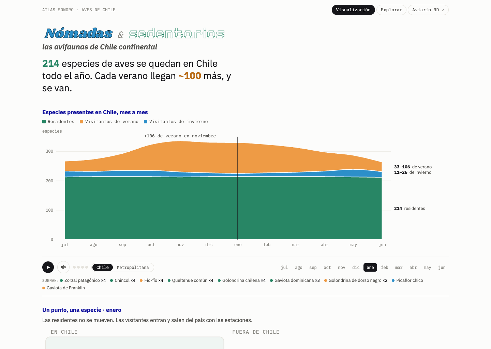

La portada va de lo general a lo geográfico: primero compara las clases,
después representa qué especies están presentes y finalmente muestra cómo
cambia el patrón por el país y dentro de una región.

### 2.1. «Especies presentes en Chile, mes a mes»

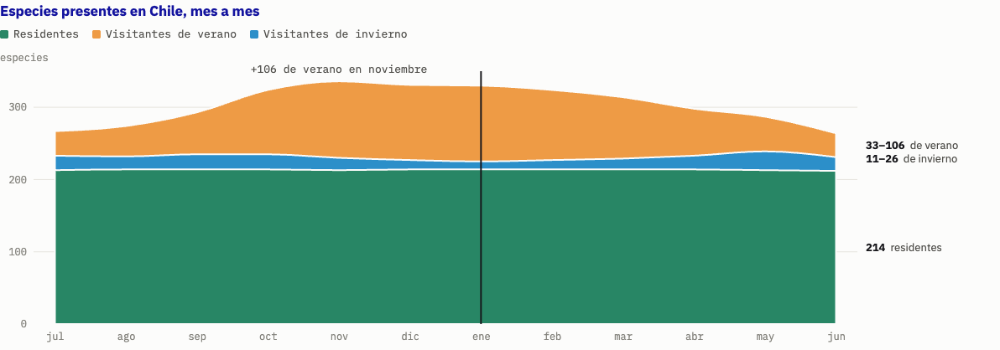

**Qué muestra.** El [número de especies presentes](METRICAS.md#riqueza) en cada mes,
separado en tres bandas apiladas de [clases estacionales](METRICAS.md#clases):
residentes, visitantes de invierno y visitantes de verano. «[Presente](METRICAS.md#presente)»
exige registro en al menos cuatro años y un perfil de al menos 20 % del pico.

| Elemento visible | Cómo leerlo |
|---|---|
| Eje horizontal | Los meses van de **julio a junio**, para dejar el verano en el centro |
| Eje vertical | [Número de especies](METRICAS.md#riqueza) |
| Grosor de cada banda | Cuántas especies de esa clase están [presentes](METRICAS.md#presente) en ese mes |
| Borde superior de las tres bandas | [Riqueza mensual](METRICAS.md#riqueza): total de los tres grupos presentes ese mes |
| Línea vertical | Mes seleccionado |
| Leyenda y rótulos | Identifican las clases y resumen sus conteos |

En enero, los datos actuales suman **214 residentes + 105 visitantes de verano
+ 11 de invierno = 330 especies**. El título resume 214 especies clasificadas
como residentes; el [conteo de presencia](METRICAS.md#riqueza) del gráfico se calcula mes a mes y
puede variar ligeramente: en julio registra 213 residentes.

**Qué puedes hacer.** Al pasar el cursor por un mes aparecen sus conteos. Al
hacer clic se selecciona ese mes para la portada y el recorrido sonoro salta a
él en el siguiente compás. Pasar el cursor, por sí solo, no cambia la selección.

### 2.2. El reproductor y los meses: los controles compartidos

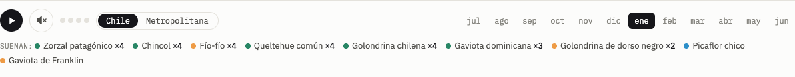

| Control | Qué hace | Qué controla |
|---|---|---|
| **❚❚ / ▶** | Pausa o reanuda el recorrido del año | Sonido y avance automático del mes |
| **Parlante** | Silencia o activa el sonido | El volumen del recorrido; el mes sigue avanzando si no está pausado |
| **Cuatro pequeñas barras** | Indican el [compás actual](METRICAS.md#tiempo-sonoro) | Son un indicador, no un selector |
| **Chile** | Escucha especies seleccionadas para el país | El ámbito sonoro |
| **Nombre de la región** | Escucha especies de la región elegida abajo | El ámbito sonoro; no transforma los gráficos nacionales en gráficos regionales |
| **Botones jul…jun** | Seleccionan un mes | Cursor del pulso, posición de las especies, resaltado de mapas y recorrido sonoro |
| **«Suenan»** | Enumera las especies y sus [copias](METRICAS.md#copias) | Describe la composición; no es una lista de botones para activar pistas |

Cada mes dura [**12 segundos**](METRICAS.md#tiempo-sonoro): cuatro compases de tres segundos. El año completo
dura **2 minutos y 24 segundos** y vuelve a empezar. Se seleccionan hasta seis
especies muy extendidas según sus [lugar-días](METRICAS.md#lugar-dias) y hasta tres visitantes adicionales; cada canto puede
aparecer entre una y cuatro veces por compás. [«×4»](METRICAS.md#copias) significa cuatro copias
sonoras, no cuatro individuos observados.

La preferencia del parlante se recuerda para la próxima visita. Si el navegador
bloquea el arranque, el primer clic o tecla habilita el sonido. La barra
espaciadora también pausa o reanuda cuando el foco no está en otro control.

### 2.3. «Un punto, una especie»

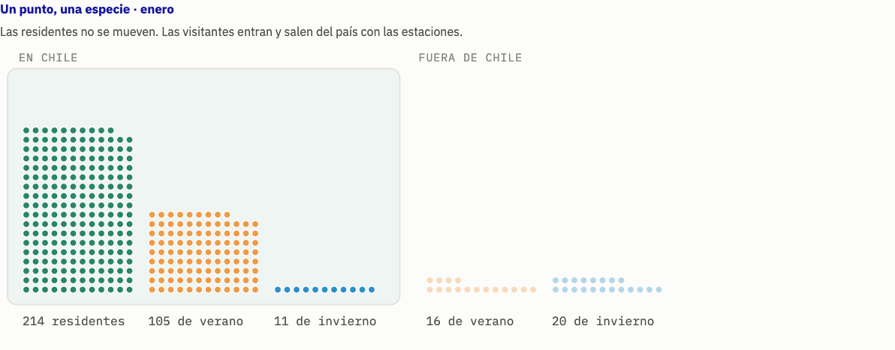

**Qué muestra.** Cada punto representa **una especie**, no un ave individual.
Las residentes se mantienen en su columna; las visitantes cambian entre «EN
CHILE» y «FUERA DE CHILE» según su [presencia mensual](METRICAS.md#presente).

El color distingue la [clase](METRICAS.md#clases). Los números bajo las columnas [cuentan especies](METRICAS.md#riqueza).
Las posiciones son una disposición gráfica: no corresponden a coordenadas de
observación ni a rutas de viaje medidas. «Fuera» representa la ausencia en la
[máscara de presencia](METRICAS.md#presente) del año típico. Las residentes se mantienen
dentro por diseño; sus puntos no siempre coinciden con el conteo mensual del pulso.

**Qué puedes hacer.** Pasar el cursor por un punto muestra el nombre, la clase
y los [meses de presencia](METRICAS.md#presente). Cambiar el mes desde los controles o el pulso anima
las visitantes. Este gráfico no abre la ficha de especie al hacer clic; las
fichas se consultan en Explorar.

### 2.4. «La ola recorre todo el país»: modo Zonas

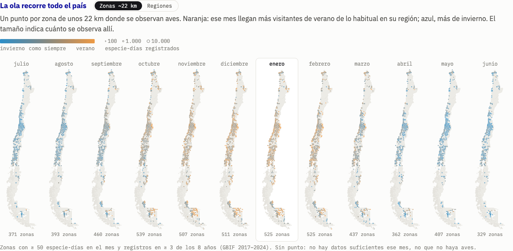

**Qué muestra.** Un mapa de Chile por mes, de julio a junio. Cada punto es una
[**celda de 0,2°, unos 22 km**](METRICAS.md#dias-especie) con suficientes registros.

| Elemento | Significado |
|---|---|
| Punto | Una zona geográfica con datos suficientes ese mes |
| Tamaño | [Cantidad de especie-días](METRICAS.md#dias-especie) registrados: indica cuánto se registró allí |
| Naranja | [Índice de ola positivo](METRICAS.md#ola-zonas): balance estival mayor que la referencia regional |
| Azul | [Índice de ola negativo](METRICAS.md#ola-zonas): balance invernal mayor que la referencia regional |
| Color cercano al centro de la escala | Equilibrio cercano al patrón de referencia |
| Marco del mes | Mes seleccionado en la portada |

Un [**especie-día espacial**](METRICAS.md#dias-especie) cuenta una especie registrada en una fecha dentro de una
celda; varios registros de la misma especie ese día no representan varios
individuos en esta medida. Estos mapas suman los ocho años; no muestran una
media anual. La unidad espacial difiere de los días regionales de la ficha.

Solo se dibujan zonas con [al menos 50 especie-días y registro en tres años](METRICAS.md#ola-zonas)
en ese mes, acumulando el periodo. Es una regla distinta de la presencia de una especie. La falta de un punto significa datos insuficientes
para esa vista; no demuestra ausencia de aves.

**Qué puedes hacer.** Pasar el cursor por un punto muestra región, mes,
[cantidad registrada y composición](METRICAS.md#ola-zonas). Pulsar una tarjeta mensual selecciona su
mes para toda la portada. En escritorio amplio caben los doce mapas; en tamaños
menores aparecen controles para desplazarse por la franja.

### 2.5. El mismo bloque, modo Regiones

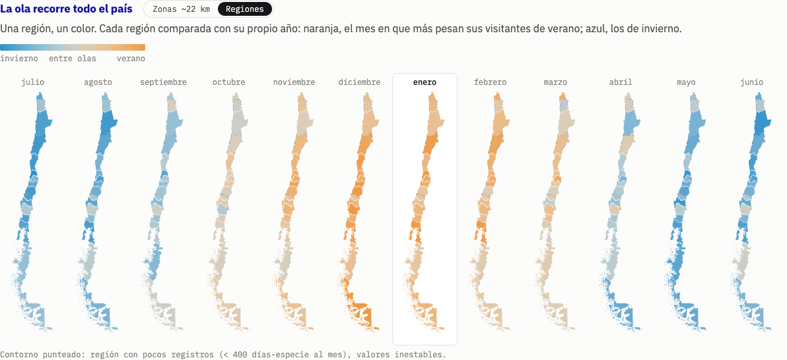

El botón **Regiones** reemplaza los puntos por un color para cada región.
Compara [los niveles de riqueza de verano e invierno](METRICAS.md#ola-regiones),
llevando cada serie al rango anual de esa misma región. **No es exactamente la misma medida del modo Zonas.**

Naranja indica predominio relativo de la ola estival; azul, de la invernal.
Un tono neutro indica equilibrio entre ambas olas. No representa directamente
abundancia de individuos ni el porcentaje de residentes.

**Qué cambia el interruptor.** Cambia solo esta representación nacional y su
leyenda. Conserva el mes, el detalle regional, los otros gráficos y el ámbito
del sonido. Un contorno punteado señala regiones con [poco esfuerzo de registro](METRICAS.md#esfuerzo).

### 2.6. «Una región de cerca»

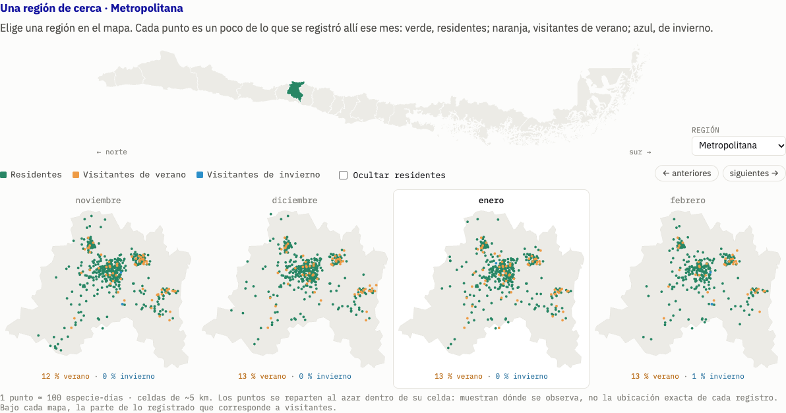

**Qué muestra.** Una ampliación de la región seleccionada, repetida para sus
meses. Aquí los puntos significan otra cosa: **cada punto equivale a una cantidad
de especie-días**, según el [factor por punto](METRICAS.md#por-punto) indicado debajo de la franja.

Los puntos verdes, naranjas y azules muestran registros de cada clase. Se
reparten dentro de [celdas de 0,05°, unos 5 km](METRICAS.md#dias-especie); su posición no es la coordenada exacta
de un registro. El [factor de especie-días por punto](METRICAS.md#por-punto) se adapta a la región.

Bajo cada mapa se muestran las [proporciones de días-especie de visitantes](METRICAS.md#proporciones-espaciales)
de verano e invierno para ese mes. Usan las tres clases regulares como denominador;
no son el peso ponderado de visitantes que aparece en Explorar.

| Control | Qué cambia |
|---|---|
| Clic en Chile horizontal | Selecciona una región; el norte está a la izquierda y el sur a la derecha |
| Lista **Región** | Hace la misma selección mediante un menú |
| **← anteriores / siguientes →** | Desplaza los meses visibles sin cambiar el mes seleccionado |
| Clic en una tarjeta mensual | Selecciona ese mes para toda la portada |
| **Ocultar residentes** | Oculta los puntos verdes solo en este detalle |

Elegir una región también cambia el nombre del botón regional del reproductor.
Si se está escuchando ese ámbito regional, cambia su selección de cantos. Si
el sonido está en Chile, sigue en Chile.

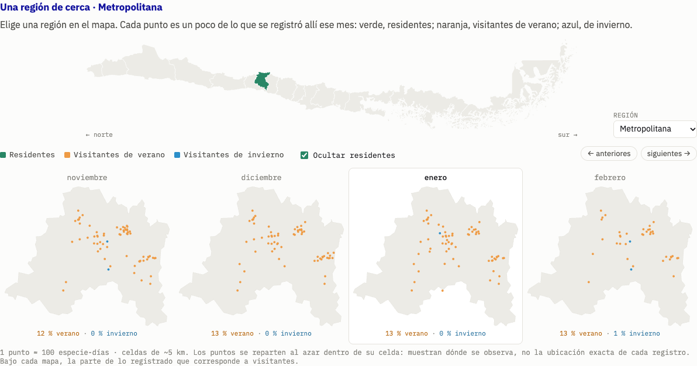

Ocultar residentes permite ver mejor las visitantes. **No elimina especies de
los datos, no recalcula los porcentajes y no quita sus cantos del recorrido.**
El pulso nacional y el gráfico «Un punto, una especie» conservan sus valores.

### 2.7. La tabla y la explicación del sonido

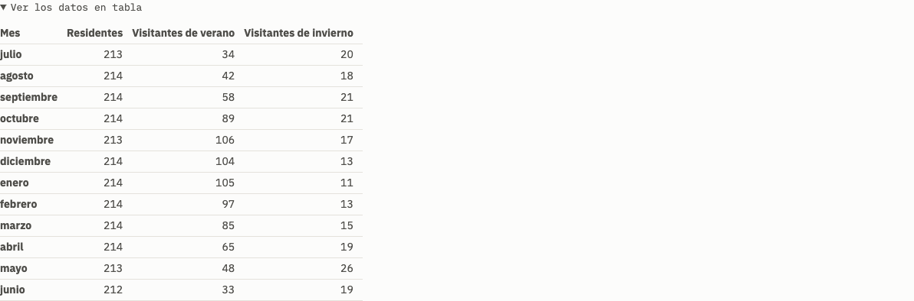

**Ver los datos en tabla** despliega los mismos [conteos nacionales de presencia](METRICAS.md#riqueza) del pulso.
Sirve para leer cifras exactas por mes y clase. Abrirla o cerrarla no cambia los
filtros ni el sonido.

**Cómo se compone el sonido**, al final de la página, explica selección de
especies, [copias](METRICAS.md#copias), [tiempos y posición estéreo](METRICAS.md#tiempo-sonoro) y controles. Es información
explicativa; no configura la composición.

## 3. Explorar: comparar regiones y consultar especies

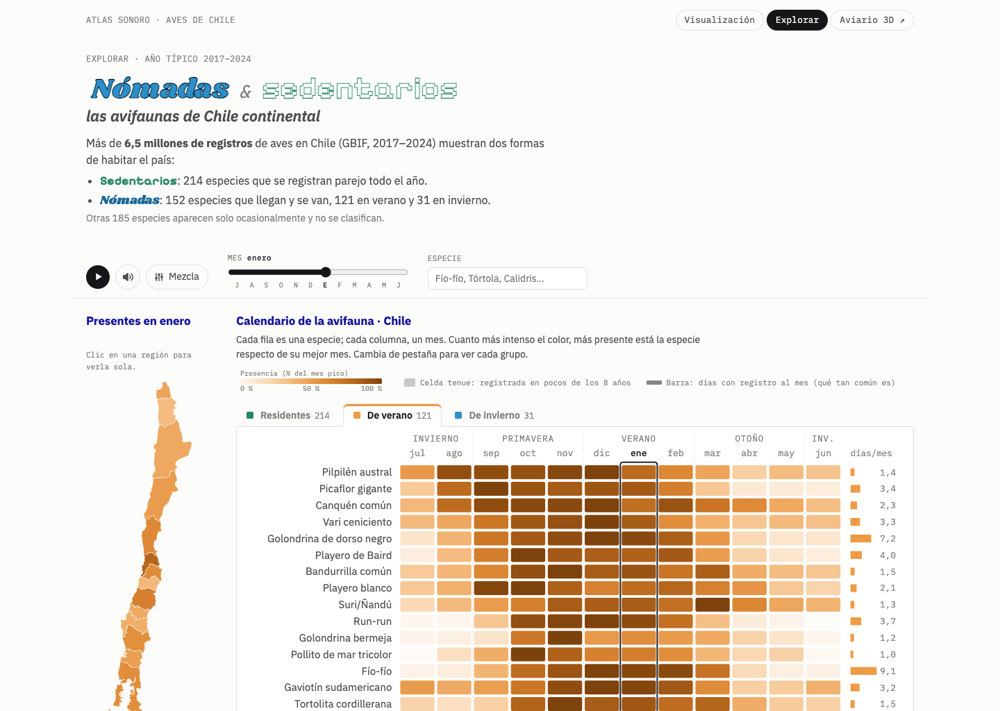

Esta página combina tres vistas: un mapa del mes elegido, un calendario de
especies y una grilla de comparación regional. El resumen superior cuenta las
[especies por clase nacional](METRICAS.md#riqueza); sigue siendo un resumen de Chile aunque después filtres una
región.

### 3.1. La barra de controles de Explorar

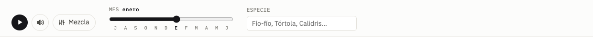

| Control | Qué hace |
|---|---|
| **▶ / ❚❚** | Inicia o pausa la [sonificación mensual del atlas](METRICAS.md#sonificacion-atlas), de 2,4 segundos por mes |
| **Parlante** | Silencia la sonificación y la mezcla personalizada, sin borrar sus selecciones |
| **Mezcla** | Abre o minimiza el mezclador inferior; el número indica sus pistas |
| **Deslizador Mes** | Cambia el mapa, las estadísticas y el mes resaltado de las grillas y el perfil de especie |
| **Buscador Especie** | Abre una ficha al elegir una sugerencia o confirmar un nombre común o científico |

El deslizador recorre julio–junio. Durante la reproducción, el reloj sonoro
sigue avanzando y puede volver a mover el marcador: **pausa primero si quieres
examinar un mes fijo**. A diferencia de la portada, arrastrar el deslizador no
reinicia el reloj sonoro en ese mes.

El buscador admite una coincidencia exacta o el inicio de un nombre. Una especie
seleccionada puede cambiar automáticamente la pestaña para mostrar su clase en
el ámbito elegido.

### 3.2. «Presentes en [mes]»: mapa y estadísticas

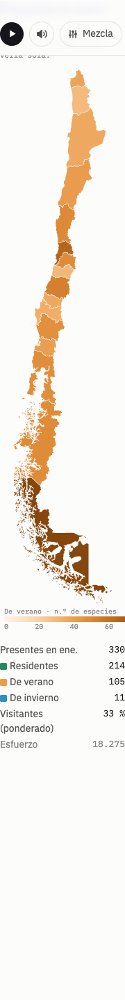

**Qué muestra.** Para cada región, el [número de especies presentes](METRICAS.md#riqueza) de la
**pestaña activa** en el mes seleccionado. La leyenda indica clase y número de
especies. Una región más intensa tiene más especies de esa clase presentes,
no necesariamente más individuos.

Al pasar el cursor aparecen el [total presente y los conteos por clase](METRICAS.md#riqueza),
el [peso ponderado de visitantes](METRICAS.md#peso-visitantes), su [desviación anual](METRICAS.md#desviacion)
y el [esfuerzo de registro](METRICAS.md#esfuerzo). Debajo del mapa, las estadísticas resumen
el ámbito actual: Chile o la región seleccionada.

| Acción | Resultado |
|---|---|
| Clic en una región | Filtra calendario y estadísticas a esa región y cambia el ámbito del recorrido sonoro |
| Clic de nuevo en la misma región | Vuelve a Chile |
| **← Chile** | Restablece el ámbito nacional |
| Cambiar de pestaña | Cambia la clase representada por el color del mapa |
| Cambiar de mes | Cambia los conteos y las estadísticas |

La ficha abierta se actualiza al cambiar de región. La mezcla personalizada
conserva las pistas que ya elegiste.

### 3.3. «Calendario de la avifauna»

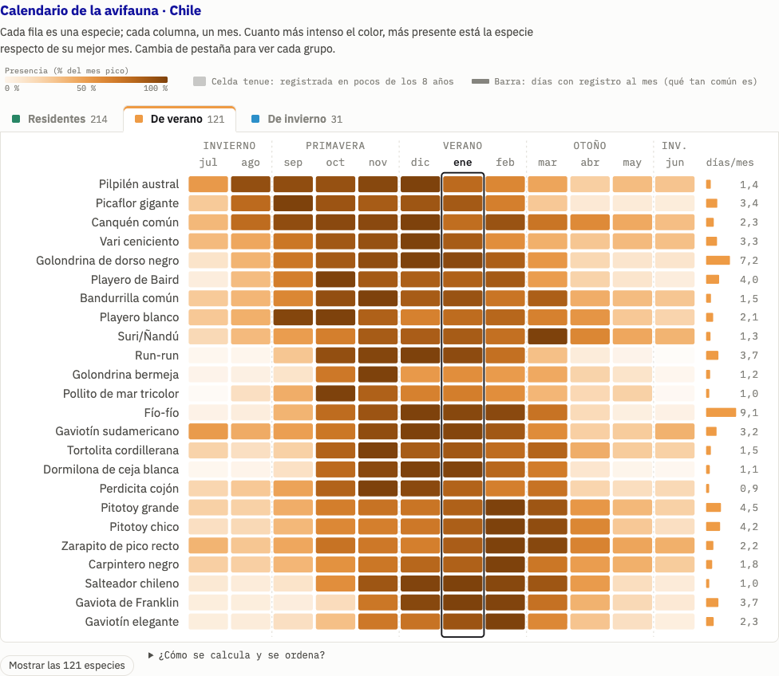

**Qué muestra.** Una fila por especie y una columna por mes, dentro de la región
y clase elegidas.

| Elemento | Cómo leerlo |
|---|---|
| Fila | Una especie |
| Columna | Un mes |
| Color más intenso | Mayor [perfil relativo](METRICAS.md#perfil) de esa especie respecto de su mejor mes |
| [**100 %**](METRICAS.md#perfil) | El [mes pico](METRICAS.md#pico) de esa especie; cada fila tiene su propia referencia |
| Celda más tenue | Menos [años con registro](METRICAS.md#anios-registro) de la especie en ese mes |
| Barra y cifra [**días/mes**](METRICAS.md#dias-mes), a la derecha | [Frecuencia de registro](METRICAS.md#frecuencia), convertida a días por mes promedio |
| Marco vertical | Mes seleccionado |
| Fila resaltada | Especie cuya ficha está abierta |

El color usa un [perfil corregido por esfuerzo de registro](METRICAS.md#perfil). Permite comparar
la **forma del ciclo de una especie**, mientras la barra ayuda a distinguir
especies frecuentes de poco registradas. Dos celdas igualmente intensas en
filas distintas no significan igual número de registros.

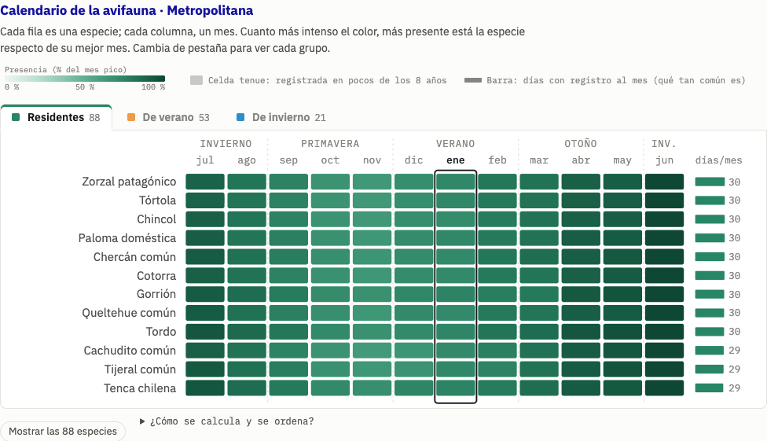

| Control o interacción | Qué cambia |
|---|---|
| **Residentes / De verano / De invierno** | Cambia el grupo de filas, su color y el mapa principal |
| Número de la pestaña | [Cuenta especies clasificadas](METRICAS.md#riqueza) en esa clase del ámbito; no solo las presentes este mes |
| **Mostrar las … especies** | Expande todas las filas de la clase actual |
| **Mostrar solo las … más frecuentes** | Recupera la ventana reducida |
| Pasar el cursor por una celda | Muestra nombre, mes, [frecuencia](METRICAS.md#frecuencia), [perfil](METRICAS.md#perfil) y [años con registro](METRICAS.md#anios-registro) |
| Clic en una fila o celda | Abre la ficha de esa especie; no selecciona el mes de la celda |
| **¿Cómo se calcula y se ordena?** | Despliega explicación y fórmulas, sin cambiar la vista |

Por defecto se muestran hasta **12 residentes, 24 visitantes de verano o 16 de
invierno**. Las residentes se ordenan por [frecuencia media](METRICAS.md#frecuencia);
las visitantes, por un [periodo de llegada y salida usado para ordenar](METRICAS.md#llegada).
Este periodo usa perfil ≥ 50 % y no equivale a fechas observadas de migración. La especie seleccionada puede añadirse
a la ventana aunque esté fuera de ese conjunto inicial.

El orden de meses depende de la pestaña: julio–junio para residentes y verano;
enero–diciembre para invierno. Así la estación principal queda centrada.

### 3.4. «¿Cuándo pesan más las visitantes? Por región y mes»

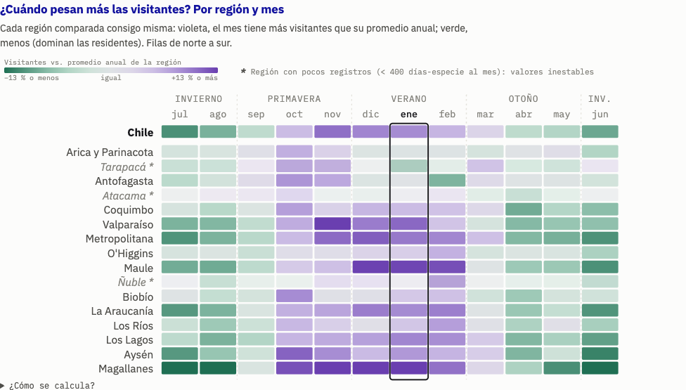

**Qué muestra.** Una fila por región, de norte a sur, más Chile; una columna por
mes, de julio a junio. Compara el [peso de las visitantes](METRICAS.md#peso-visitantes)
con el promedio anual **de esa misma región**, mediante una [desviación](METRICAS.md#desviacion).

| Elemento | Significado |
|---|---|
| Violeta | [Desviación positiva](METRICAS.md#desviacion): más peso de visitantes que el promedio anual regional |
| Verde | [Desviación negativa](METRICAS.md#desviacion): menos peso que ese promedio |
| Tono neutro | Un valor cercano al promedio |
| Marco vertical | Mes seleccionado |
| Fila resaltada | Región seleccionada |
| Asterisco junto al nombre | [Esfuerzo medio anual menor que 400 días-especie por mes](METRICAS.md#esfuerzo) |

El [peso de visitantes](METRICAS.md#peso-visitantes) combina las clases de verano e invierno
y pondera sus perfiles relativos y años con registro. **Violeta no significa necesariamente
que haya más visitantes que residentes:** significa más peso de visitantes
respecto de lo habitual en esa región. La escala [satura en el percentil 95](METRICAS.md#saturacion) de las desviaciones absolutas.
Las diferencias entre porcentajes del tooltip se leen en [puntos porcentuales](METRICAS.md#desviacion),
aunque se rotulen con «%».

**Qué puedes hacer.** El cursor sobre una celda revela sus datos. Hacer clic en
una fila o en sus celdas selecciona la región para el atlas; no cambia el mes.
Pulsar de nuevo la región seleccionada vuelve a Chile. La explicación
**¿Cómo se calcula?** despliega la metodología.

## 4. La ficha de especie: perfil, distribución y medios

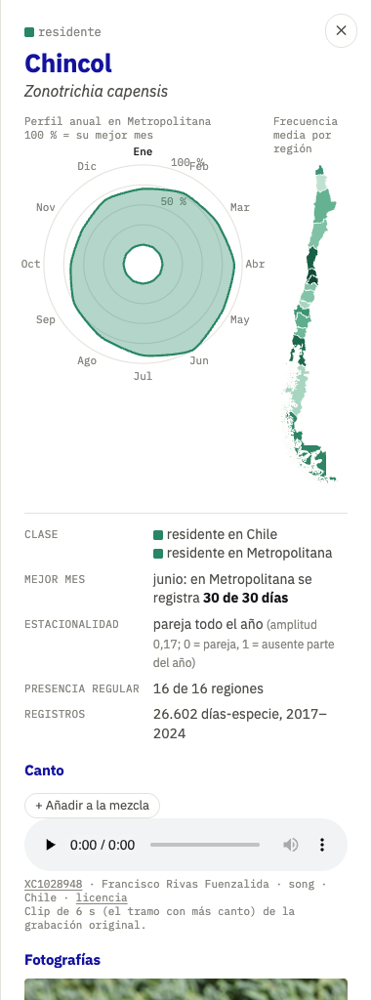

La ficha aparece al seleccionar una especie desde el calendario o el buscador.
Su **✕** la cierra y elimina la selección de especie del calendario, conservando
región, mes y clase. El cierre no quita esa especie de una mezcla ya creada.

### 4.1. Perfil anual radial

El gráfico circular muestra el mismo [perfil estacional normalizado](METRICAS.md#perfil): enero está
arriba y los meses avanzan en sentido horario. Cuanto más lejos del centro
queda el perfil, mayor presencia relativa en ese mes; 100 % es su mes pico.

Se calcula para la región seleccionada. Si no hay una fila de la
especie allí, usa Chile y lo indica en el título. El cursor sobre los puntos
muestra mes, perfil y frecuencia. Cambiar el mes resalta su etiqueta; no cambia
la curva anual completa.

### 4.2. Frecuencia media por región

El mapa pequeño muestra la [frecuencia media anual](METRICAS.md#frecuencia) de
**esa especie** en cada región, promediando sus doce meses. Su escala es propia de la especie, distinta
del mapa principal de conteos.

Pasar el cursor muestra frecuencia y clase regional. Pulsar una región cambia
el ámbito del atlas y actualiza la ficha. Los territorios sin datos
no equivalen a una frecuencia medida de cero.

### 4.3. Los datos cortos de la ficha

| Dato | Qué explica |
|---|---|
| [Clase](METRICAS.md#clases) | Clasificación nacional y, cuando corresponde, clasificación regional |
| [Mejor mes](METRICAS.md#pico) | Pico del perfil y [conversión a días de registro](METRICAS.md#dias-mes) en la región indicada |
| [Estacionalidad](METRICAS.md#amplitud) | Amplitud del perfil nacional, incluso al elegir una región |
| [Presencia regular](METRICAS.md#regiones-regulares) | Número de regiones donde la especie no se clasifica como ocasional |
| [Registros](METRICAS.md#dias-especie) | Días-especie regionales acumulados en 2017–2024, no número de individuos |

### 4.4. Grabación y «Añadir a la mezcla»

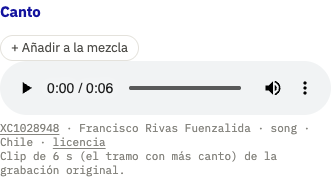

El reproductor permite escuchar el clip de la especie: **▶, posición de
reproducción y volumen**, según los controles nativos del navegador. La ficha
incluye autor, licencia y enlace a la grabación original.

**+ Añadir a la mezcla** agrega esa especie al mezclador inferior. Si ya está,
el botón muestra **✓ En la mezcla** y evita duplicarla.

El reproductor del clip tiene controles propios: el parlante general de
Explorar actúa sobre el recorrido sonoro y el mezclador, no sobre este
reproductor nativo. Abrir una ficha, además, enfoca en esa especie el recorrido
mensual si este está reproduciéndose. Si no hay grabación, la ficha lo indica.

### 4.5. Fotografías

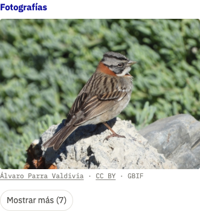

La galería muestra inicialmente una foto. **Mostrar más** despliega las restantes
hasta un máximo de ocho; **Mostrar menos** vuelve a la primera. Cada fotografía
incluye autor, licencia y fuente enlazados.

Estos botones solo cambian la galería. Las fotografías se sirven desde sus
proveedores originales; si una especie no tiene fotos o el índice falla, no
aparece la galería habitual.

## 5. Mezclador: construir una combinación propia

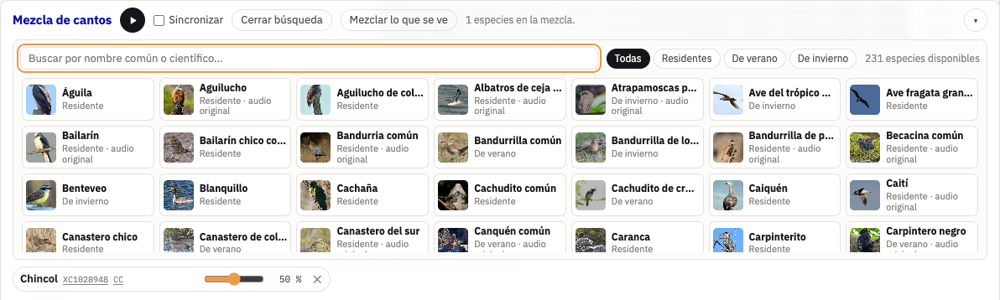

El mezclador es una barra inferior independiente del recorrido mensual. Puede
reunir especies de distintas clases o regiones; no es necesario que todas estén
en el calendario visible.

### 5.1. Buscar y añadir especies

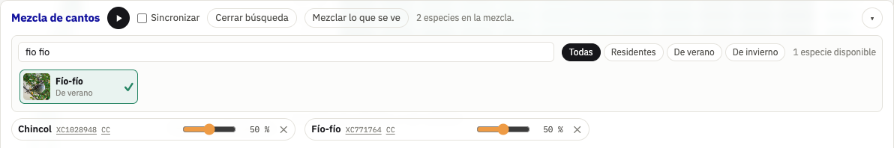

| Control | Qué hace |
|---|---|
| **+ Especies / Cerrar búsqueda** | Abre o cierra el catálogo |
| Buscador del catálogo | Filtra nombres comunes o científicos; admite búsquedas sin tildes |
| **Todas / Residentes / De verano / De invierno** | Filtra las tarjetas por [clase nacional](METRICAS.md#clases) |
| Tarjeta de un ave | Añade una pista y la marca como seleccionada |
| [Conteo de resultados](METRICAS.md#riqueza) | Indica cuántas especies con grabación coinciden con los filtros |
| **Mezclar lo que se ve** | [Selecciona hasta seis especies por frecuencia mensual](METRICAS.md#mezclador), con canto y en el ámbito y clase activos; no exige el umbral de presencia |

El catálogo muestra especies con grabación. La imagen ayuda a reconocerlas;
una marca **audio original** indica que se usa el clip sin la limpieza aplicada
a otras pistas.

**«Mezclar lo que se ve» no activa seguimiento automático.** Añade una selección
puntual; cambiar después el calendario no sustituye ni elimina esas pistas.
Si repites la selección, las especies ya añadidas no se duplican.

### 5.2. Reproducir y ajustar la mezcla

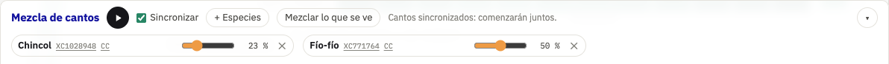

| Control | Qué hace |
|---|---|
| **▶ / ❚❚** del mezclador | Reproduce o pausa solamente la mezcla personalizada |
| **Sincronizar** desmarcado | [Espera aleatoria entre 0,2 y 5,2 segundos](METRICAS.md#mezclador), repetida entre cantos |
| **Sincronizar** marcado | Todas las pistas comienzan juntas en [ciclos comunes de seis segundos](METRICAS.md#mezclador) |
| [Volumen de una pista](METRICAS.md#mezclador) | Cambia su ganancia de reproducción; el porcentaje es un ajuste del usuario, no una métrica de presencia |
| **✕** de una pista | La retira y detiene su reproducción |
| **▾** de la barra | Minimiza el mezclador; una mezcla activa sigue sonando |
| **Mezcla** de la barra superior | Vuelve a abrirlo y muestra cuántas pistas hay |

Cambiar Sincronizar durante la reproducción reinicia la programación de la
mezcla. Retirar la última pista la deja detenida. El parlante general silencia
las pistas conservando sus volúmenes individuales.

La sonificación del atlas y la mezcla tienen botones de reproducción distintos:
pausar una no pausa automáticamente la otra. Los enlaces **XC…** y **CC** llevan
a la fuente y licencia de cada grabación.

## 6. Resumen: qué controla cada selección

| Selección | Afecta a… | Conserva… |
|---|---|---|
| Mes de Visualización | Cursor, puntos por especie, tarjeta mensual y reloj sonoro | Datos anuales completos y región elegida |
| Región de Visualización | Detalle regional y botón de ámbito; sonido si el ámbito es regional | Gráficos nacionales |
| Zonas / Regiones | Los doce mapas nacionales y su leyenda | Resto de la portada |
| Ocultar residentes | Puntos verdes del detalle regional | Datos, porcentajes y sonido |
| Región de Explorar | Calendario, estadísticas, ficha y ámbito de la sonificación | Resumen nacional, grilla comparativa y pistas de mezcla |
| Clase de Explorar | Filas, color del calendario y conteos del mapa | Región, mes y pistas de mezcla |
| Mes de Explorar | Mapa, estadísticas y marcadores mensuales | Curvas anuales, filas elegidas y pistas de mezcla |
| Especie de Explorar | Ficha, fila resaltada y foco del recorrido mensual | Pistas que ya estaban en la mezcla |
| Filtros del mezclador | Tarjetas disponibles en su catálogo | Pistas seleccionadas y filtros del atlas |
| Volumen de pista | Una sola especie del mezclador | Las demás pistas |

## 7. Tres recorridos para probar la web

**Entender las estaciones.** En Visualización, pausa el año y alterna enero y
julio. Compara el pulso y los puntos de visitantes. Cambia los mapas entre Zonas
y Regiones para distinguir detalle espacial de patrón regional.

**Investigar una región.** En Explorar, selecciona una región y cambia entre
Residentes, De verano y De invierno. Compara el calendario con la grilla. Abre
una especie y revisa su perfil, frecuencia regional y grabación.

**Construir una mezcla.** Añade una especie desde la ficha, busca otra en el
catálogo y ajusta sus volúmenes. Prueba Sincronizar y luego desmárcalo. Minimiza
la barra para comprobar que ocultarla no equivale a pausar.

---

Para revisar las definiciones, fórmulas, unidades y ejemplos, consulta el
[glosario de métricas](METRICAS.md). Para localizar los archivos que implementan estas características, consulta
[la guía de arquitectura](ARQUITECTURA.md). Este documento describe la
interfaz y sus controles; las capturas originales están en
[`interfaz/capturas/`](interfaz/capturas/).
