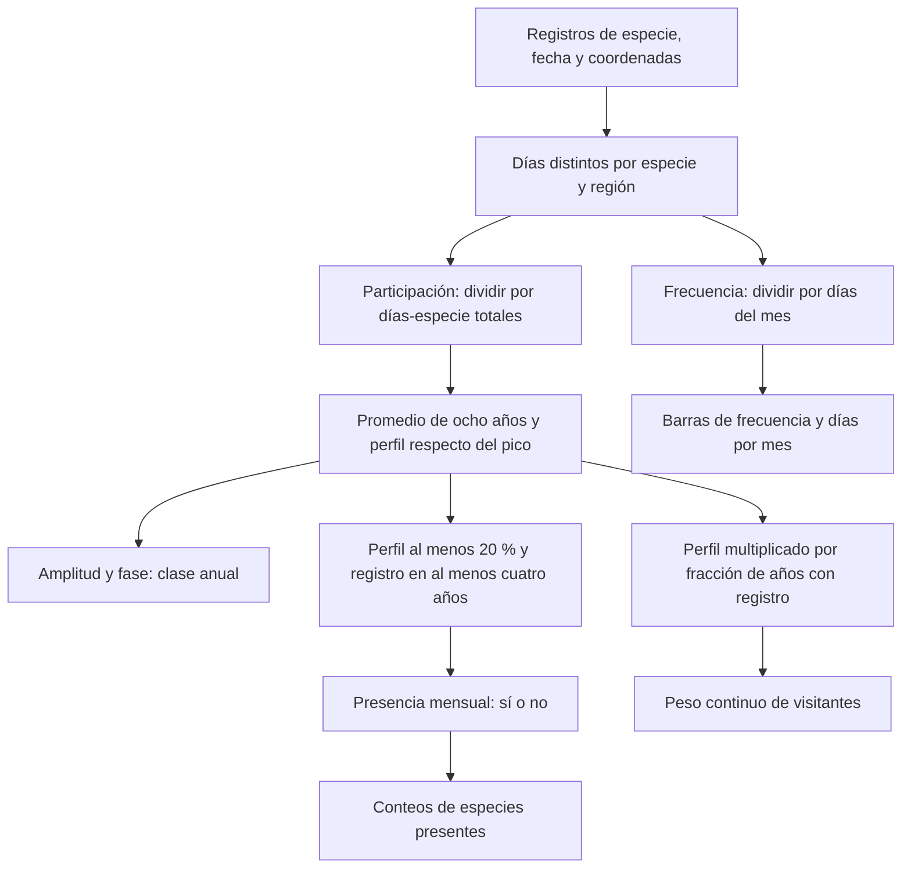

# Métricas del Atlas sonoro de aves de Chile

**Qué se cuenta, cómo se calcula y qué significa en cada vista.** Este documento
describe las fórmulas implementadas en el repositorio, revisadas el 14 de octubre
de 2026. Los ejemplos inventados se señalan como tales. Para ver cada gráfico y
sus controles, abre la [guía visual de la interfaz](GUIA_INTERFAZ.md); para
localizar sus responsabilidades, consulta la [arquitectura](ARQUITECTURA.md).

El cuerpo principal explica las medidas de Visualización y Explorar. Después
se documentan las medidas del sonido, los datos preparados para el aviario
externo, la selección de fotos y audio y el análisis independiente de minería.
Los scripts históricos archivados no definen la metodología actual.

Para ir directamente a los bloques complementarios: [sonido](#ano-especie),
[aviario](#aviario), [morfología](#rasgos), [relieve y paleta](#terreno-paleta),
[calidad de fotos](#calidad-fotos), [calidad de audio](#calidad-audio) y
[minería](#mineria).

## 1. Consulta rápida: qué significa cada cifra

| Si ves… | Está midiendo… | Definición |
|---|---|---|
| «Presente», «EN CHILE», meses de presencia | Una condición mensual de regularidad y perfil | [Presencia mensual](#presente) |
| Número de especies | Especies distintas que cumplen la condición del gráfico | [Riqueza y conteos](#riqueza) |
| Residentes / verano / invierno / ocasionales | Una clasificación anual por ámbito | [Clases estacionales](#clases) |
| «Días-especie», «especie-días», «Registros» | Combinaciones de especie y fecha, con una unidad espacial concreta | [Días-especie](#dias-especie) |
| «Frecuencia», «‰ de días» | Fracción de días con registro, promediada entre años | [Frecuencia](#frecuencia) |
| Barra «días/mes» | Conversión aproximada de la frecuencia media anual | [Días por mes](#dias-mes) |
| Color del calendario o radio de la ficha | Perfil corregido respecto del mejor mes de esa especie | [Perfil relativo](#perfil) |
| Celda más tenue, «años con registro» | Cuántos de los ocho años tienen registro en ese mes | [Años y opacidad](#anios-registro) |
| «Mejor mes» | Mes máximo del perfil corregido | [Pico mensual](#pico) |
| «Amplitud», «Estacionalidad» | Diferencia relativa entre los tres meses más bajos y los tres más altos | [Amplitud](#amplitud) |
| «Presencia regular: … regiones» | Regiones donde la clase de la especie no es ocasional | [Regularidad regional](#regiones-regulares) |
| «Visitantes (ponderado)» | Parte del peso continuo atribuida a visitantes | [Peso de visitantes](#peso-visitantes) |
| Verde / violeta en la grilla | Diferencia con el peso mensual promedio de esa misma región | [Desviación](#desviacion) |
| «Esfuerzo», asterisco, contorno punteado | Volumen de días-especie y una advertencia por pocos registros | [Esfuerzo](#esfuerzo) |
| Naranja / azul en Zonas | Diferencia de composición de registros frente a la referencia regional | [Ola por celda](#ola-zonas) |
| Naranja / azul en Regiones | Diferencia entre niveles de riqueza de verano e invierno normalizados | [Ola regional](#ola-regiones) |
| «Cada punto = … especie-días» | Un factor de representación del detalle regional | [Días-especie por punto](#por-punto) |
| Volumen del canto en «Escuchar su año» | Perfil relativo × años con registro de una especie en un lugar y mes | [Escuchar su año](#ano-especie) |

### La cadena principal



**Dos salidas distintas:** los conteos usan una decisión sí/no; el peso continuo
conserva valores pequeños que pueden no superar el umbral de presencia.

<a id="contexto"></a>
## 2. Contexto, unidades y periodo

El atlas usa los **ocho años completos de 2017 a 2024**. Un «año típico» tiene
doce meses que resumen ese periodo. No es el año 2024 ni una predicción del año
en curso. En los promedios del atlas, un año sin registro aporta cero y el
denominador sigue siendo ocho.

El **ámbito** es una región o Chile. En los archivos, `rid = 0` significa Chile
y `rid = 1…16` identifica las regiones. La clasificación y los perfiles se
calculan de nuevo en cada ámbito: una especie puede ser residente a escala
nacional y visitante en una región.

| Unidad | Lectura |
|---|---|
| Fracción `0…1` | `0,25` equivale a un cuarto de la referencia |
| Porcentaje `%` | `25 % = 0,25` |
| Por mil `‰` | `250 ‰ = 0,25 = 25 %`; `1.000 ‰ = 100 %` |
| Punto porcentual, `pp` | Diferencia entre dos porcentajes: `30 % − 20 % = 10 pp` |
| Índice sin unidad | Requiere conocer su referencia: por ejemplo, perfil, amplitud o lift |

**Un cero calculado no demuestra ausencia biológica.** Significa que no hay
registro que aporte a esa medida, o que no se cumple su umbral. Los registros
mezclan presencia, detectabilidad y actividad de observación. Ninguna medida
del atlas estima directamente cuántos individuos viven en un lugar.

El orden visual julio–junio no cambia los datos. Los arrays usan enero primero
(`m = 0`) y diciembre último (`m = 11`). Las grillas espaciales también resumen
2017–2024, pero sus cantidades son **sumas de los ocho años**, no medias: se
explica en [días-especie](#dias-especie).

Origen: [productor del atlas](../python_scripts/atlas/build_web_data.py),
[metodología y filtros](metodologia-datos.md).

<a id="dias-especie"></a>
## 3. Días-especie: la unidad espacial importa

«Días-especie» y «especie-días» se usan como nombres de la misma idea: contar
combinaciones distintas de una especie y una fecha **dentro de una unidad
espacial**. Esa unidad cambia entre el atlas y las grillas.

### 3.1. En el atlas: especie × fecha × región

Para una especie, región, mes y año, `reportDays` cuenta las fechas distintas
con registro. Diez observaciones de Chincol en la misma región el mismo día
suman **un día de registro** para esa especie. Chincol y Zorzal registrados ese
día suman **dos días-especie** al esfuerzo regional.

```text
reportDays(especie, región, año, mes)
    = número de fechas distintas con registro de esa especie en esa región
```

Las coordenadas asignan la región mediante sus polígonos. Si una especie se
registra en dos regiones el mismo día, aporta uno en cada región. Por eso el
total nacional es una **suma de regiones**, no una deduplicación de fechas de
todo Chile.

El dato «Registros» de la ficha, `species.reportDays`, suma los días regionales
de esa especie en todo 2017–2024. No es una media anual, un número de fotografías,
un número de observaciones originales ni un número de individuos. Las fusiones
de nombres taxonómicos del productor se aplican sobre los agregados de entrada.

### 3.2. En los mapas espaciales: especie × fecha × celda

Las grillas deduplican dentro de celdas de **0,2°** o **0,05°**, no dentro de toda
una región. La misma especie y fecha en tres celdas aporta tres especie-días
espaciales, aunque solo aporte un día regional al atlas.

Las cantidades de un mes espacial suman ese mes en los ocho años. Por ejemplo,
enero agrega los registros de enero de 2017, 2018, …, 2024. No se dividen por
ocho al construir `grid_month.json` o `grid_region/*.json`.

**Ejemplo inventado.** Chincol se registra el 10 de enero en tres celdas de la
Región Metropolitana y el 11 de enero en una:

| Medida de ese Chincol | Resultado |
|---|---|
| Días regionales del atlas | 2: días 10 y 11 |
| Especie-días espaciales sumados | 4: tres celdas el día 10 y una el 11 |
| Individuos | No se puede deducir de estos valores |

Los tamaños «unos 22 km» y «unos 5 km» son aproximaciones de la resolución
angular. La anchura en kilómetros cambia con la latitud. Las celdas que cruzan
un límite regional se asignan a la región con más votos de registros
deduplicados; esto también puede diferenciar los totales espaciales de los
totales por región del atlas.

Origen y almacenamiento: [agregación regional](../python_scripts/gbif/join_aggregate.py)
→ [observations-01.json](../web/data/observations-01.json) y restantes partes;
[agregación espacial](../python_scripts/gbif/grid_aggregate.py) → archivos
intermedios `gbif/staging/grid-*.json` →
[productor de mapas](../python_scripts/overview/build_grid_data.py).

<a id="esfuerzo"></a>
## 4. Esfuerzo de registro y señal de pocos datos

El «esfuerzo» del atlas es el **total de días-especie registrados** en un ámbito,
mes y año, sumando todas las especies incluidas en el agregado, también las
ocasionales. Es un indicador del volumen de registro; no cuenta horas,
observadores ni salidas de campo.

```text
E(ámbito, año, mes) = suma de reportDays de todas las especies del ámbito
esfuerzo medio mensual = suma de E en los ocho años / 8
```

En Chile, `E` suma el esfuerzo de las regiones. El mapa de Explorar y sus
estadísticas muestran el esfuerzo medio del mes seleccionado, redondeado a
entero. Cambiar de clase no restringe este denominador a esa clase.

**Ejemplo inventado.** Diez especies registradas durante tres fechas cada una
suman 30 días-especie, aunque se hayan visto en las mismas tres salidas.

La señal de **pocos registros** usa otra agregación:

```text
media de los doce esfuerzos mensuales de una región < 400 días-especie
```

Produce el asterisco en la grilla de Explorar y el contorno punteado del modo
Regiones. Se basa en el promedio anual de los meses; no pregunta únicamente si
el mes seleccionado tiene menos de 400. Explorar excluye a Chile de la marca.
El umbral es una regla del proyecto, no un intervalo de confianza estadístico.

Origen: [productor del atlas](../python_scripts/atlas/build_web_data.py),
[consultas de Explorar](../web/js/explore/queries.js),
[datos espaciales](../web/js/data/spatial.js).
Se guarda en la sexta columna de [region_month.json](../web/data/region_month.json).

<a id="frecuencia"></a>
## 5. Frecuencia de registro y frecuencia media

**Pregunta:** ¿en qué fracción de los días del mes se registra esta especie?
Primero se divide cada año por los días reales de su mes; después se promedian
las ocho fracciones. Febrero respeta los años bisiestos en este cálculo.

```text
F regional(especie, mes) = (1/8) × suma_años(reportDays / días del mes)
F Chile(especie, mes)    = (1/8) × suma_años(suma_regiones(reportDays) / (16 × días del mes))
freq guardada           = redondear(1.000 × F)
```

En Chile es la **media de las 16 regiones**, contando las que no aportan registro
como cero. No es la fracción de fechas en que se vio en cualquier parte del
país. Una especie registrada todos los días en una sola región tiene alrededor
de `62,5 ‰` nacionales, aunque tenga `1.000 ‰` en esa región.

**Ejemplo inventado.** Si una especie aparece en 15 de los 30 días de abril en
cada uno de los ocho años de una región, `F = 0,5`, `freq = 500 ‰` y la interfaz
puede explicarlo como aproximadamente 15 de 30 días.

La **frecuencia media anual** es la media simple de los doce `freq` mensuales.
Los meses pesan igual; no es una media ponderada por su duración. El calendario
y el mapa pequeño de la ficha usan la media de los enteros publicados; el
campo `species.meanFreq` redondea esa media a entero.

Frecuencia alta significa registro frecuente. Puede depender de cuánto se
observa, de lo fácil que sea detectar a la especie y de su presencia. No es una
probabilidad de encontrarla en una visita ni una estimación de densidad.

Origen: [productor del atlas](../python_scripts/atlas/build_web_data.py),
[decodificación y medias](../web/js/data/atlas.js),
[formato de frecuencia](../web/js/shared/format.js).
Se publica como los doce `freq` de [typical_year.json](../web/data/typical_year.json).

<a id="dias-mes"></a>
### 5.1. «Días/mes» y «X de Y días» en la interfaz

Son conversiones de la frecuencia, no conteos adicionales de observaciones.

| Dónde aparece | Conversión |
|---|---|
| Barra del calendario | `frecuencia media anual / 1.000 × 30,4` |
| Tooltip mensual regional | `freq del mes / 1.000 × días del mes de referencia` |
| «Mejor mes» de la ficha | La conversión mensual anterior, redondeada a días enteros |

La barra usa un mes de 30,4 días. El texto mensual usa el calendario de **2021**
como referencia visual: febrero tiene 28 días, aunque el cálculo de origen sí
considera los febreros bisiestos. A escala Chile el tooltip aclara que la
frecuencia es la media regional.

**Ejemplo inventado.** Una media de `500 ‰` se rotula como aproximadamente 15
días/mes (`0,5 × 30,4 = 15,2`; el formato puede redondear a entero). La longitud
de las barras se ajusta al máximo de las **filas visibles**: expandir el
calendario puede cambiar la escala de longitud sin cambiar la frecuencia.

Origen: [calendario](../web/js/views/explore/calendar.js),
[formato](../web/js/shared/format.js), [ficha](../web/js/views/species-panel.js).

<a id="participacion"></a>
## 6. Participación en los registros y perfil relativo

Para reducir la influencia del volumen de registros de cada mes y año, el
productor calcula la participación de una especie en el esfuerzo total:

```text
participación anual mensual = reportDays de la especie / E del ámbito-mes-año
rel(especie, ámbito, mes)   = media de esas participaciones sobre los ocho años
```

`rel` no es la frecuencia de días: el denominador suma días-especie de **todas**
las especies. La media tampoco equivale a dividir la suma de ocho años por el
esfuerzo acumulado: en `rel` cada año pesa igual, aunque tenga menos registros.

**Ejemplo inventado.** 10 días de una especie entre 100 días-especie dan una
participación de 10 %; 10 entre 1.000 dan 1 %. La frecuencia de la especie
podría ser la misma en ambos casos, pero su participación sería distinta.

<a id="perfil"></a>
### 6.1. Perfil estacional normalizado: `prof`

**Pregunta:** ¿cómo es este mes en relación con el mejor mes de esta misma
especie y ámbito?

```text
pico = máximo de los doce rel
perfil fraccional del mes = rel del mes / pico       (0 si no hay pico)
prof guardado            = redondear(100 × perfil)   (0…100)
```

Un `prof = 100` es el máximo de esa fila. Un `prof = 50` es la mitad de su pico
corregido. Puede haber varios meses con 100; dos especies con 100 no tienen por
qué ser igual de frecuentes. La división por el pico ocurre **después** de
promediar las participaciones anuales.

**Ejemplo inventado.** Si la participación típica es 2 % en enero y su máximo
es 4 % en marzo, enero tiene un perfil de 50 %, y marzo de 100 %.

Se usa como intensidad de color del calendario y distancia radial en la ficha.
La forma es relativa a la especie; para comparar cuánto se registra cada una
hay que mirar también la [frecuencia](#frecuencia).

Origen: [productor del atlas](../python_scripts/atlas/build_web_data.py),
[colores](../web/js/explore/colors.js), [ficha radial](../web/js/views/species-panel.js).
`rel` se calcula durante la preparación; `prof` se publica en
[typical_year.json](../web/data/typical_year.json).

<a id="anios-registro"></a>
## 7. Años con registro, regularidad y opacidad

`years[mes]` es cuántos de los ocho años tienen registro de la especie en ese
mes y ámbito. Sus valores van de **0 a 8**. Un registro en enero de cuatro años
da `years[enero] = 4`, independientemente de cuántos días se registró en cada año.

La fracción `years / 8` expresa **repetición entre años**. Se usa en el peso
continuo y en el foco sonoro de una especie.

En el calendario, la transparencia se calcula así:

```text
opacidad = 0,3 + 0,7 × years / 8
```

| Años con registro | Fracción | Opacidad |
|---|---|---|
| 0 | 0 | 0,30 |
| 4 | 0,50 | 0,65 |
| 8 | 1 | 1 |

La palabra «confianza» del comentario del código describe esta consistencia.
No es una probabilidad de presencia ni una confianza estadística con un
intervalo calculado. El tono de la celda viene del perfil; la opacidad viene de
los años. Se combinan visualmente, pero son dos medidas diferentes.

Origen: [productor](../python_scripts/atlas/build_web_data.py),
[calendario](../web/js/views/explore/calendar.js).
Almacenamiento: doce `years` en [typical_year.json](../web/data/typical_year.json).

<a id="presente"></a>
## 8. Qué significa estar «presente»

Una especie está presente en un mes del año típico cuando cumple **las dos
condiciones** en el ámbito consultado:

```text
años con registro en ese mes ≥ 4 de 8
Y
perfil relativo de ese mes ≥ 20 % del pico
```

Es una decisión **sí/no**. No basta con un registro aislado ni se exige registro
todos los días. El umbral de 20 % corresponde al perfil corregido, no a 20 % de
los días del mes.

| Ejemplo inventado | ¿Presente? | Motivo |
|---|---|---|
| 6 años y perfil 35 % | Sí | Cumple ambos umbrales |
| 3 años y perfil 100 % | No | No llega a cuatro años |
| 8 años y perfil 10 % | No | Perfil inferior a 20 % |
| 4 años y perfil 20 % | Sí | Los límites son inclusivos |

La decisión se toma con el perfil **antes de redondearlo**. Un 19,6 % se puede
mostrar como 20 % y seguir sin superar el umbral real. El archivo guarda el
resultado en `present`, una máscara de doce bits: bit 0 = enero, bit 11 =
diciembre. La interfaz consulta ese resultado; no lo recalcula desde el entero
de `prof`.

**«FUERA DE CHILE» en los puntos** significa que una visitante no supera esta
regla nacional en ese mes. No es un seguimiento de su ubicación fuera del país.
En ese gráfico, las residentes se mantienen dentro por decisión de diseño,
aunque alguna no cumpla presencia en un mes. Por eso su columna no tiene por
qué coincidir exactamente con el conteo mensual del pulso.

Origen: [regla de presencia](../python_scripts/atlas/build_web_data.py),
[datos de la portada](../python_scripts/overview/build_overview_data.py),
[puntos por especie](../web/js/views/overview/species-dots.js).
Almacenamiento: `present` en [typical_year.json](../web/data/typical_year.json)
y su máscara derivada en [overview.json](../web/data/overview.json).

<a id="riqueza"></a>
## 9. Riqueza mensual, conteos por clase y conteos del catálogo

La **riqueza mensual** del atlas es el número de especies presentes de las tres
clases regulares. Cada especie aporta como máximo uno al conteo de un ámbito
y mes:

```text
riqueza = residentes presentes + visitantes de verano presentes + visitantes de invierno presentes
```

Las ocasionales no entran en este total. El pulso y su tabla usan Chile; el
mapa de Explorar colorea por el conteo de la **clase activa** en cada región;
las estadísticas inferiores usan el ámbito seleccionado.

**Ejemplo real de los datos publicados.** Enero en Chile suma
`214 + 105 + 11 = 330 especies`. En julio el conteo de residentes presentes es
213, aunque haya 214 especies con clase nacional residente.

Chile se calcula desde sus propios perfiles nacionales: **no suma las riquezas
regionales**, lo que duplicaría especies, ni toma necesariamente su unión.

Hay otros conteos que responden a preguntas diferentes:

| Dónde aparece | Qué cuenta |
|---|---|
| Resumen nacional superior de Explorar | Todas las especies por clase nacional, sin filtrar por mes o región |
| Número de la pestaña del calendario | Especies clasificadas en esa clase del ámbito, aunque no estén presentes en el mes seleccionado |
| Filas visibles | Subconjunto elegido para mostrar, con posible especie fijada |

El color del mapa principal usa un máximo compartido de la clase entre las
regiones y los doce meses. Su referencia se conserva al mover el mes y puede
cambiar al cambiar de clase. El mapa pequeño de una ficha, en cambio, representa
la frecuencia media de una sola especie y usa su propio máximo regional.

Origen: [region_month.json](../web/data/region_month.json),
[mapa de conteos](../web/js/views/explore/region-map.js),
[resumen](../web/js/views/explore/summary.js),
[selección de filas](../web/js/explore/calendar-selection.js).

<a id="amplitud"></a>
## 10. Estacionalidad, fase, pico y clases

### 10.1. Amplitud estacional: `amp` / `seasonality`

**Pregunta:** ¿cuánto cae el perfil en sus meses más bajos respecto de sus meses
más altos?

```text
H = media de los tres valores mensuales más altos de rel
L = media de los tres valores mensuales más bajos de rel
amplitud = 1 − L/H          (0 si H = 0)
```

Va de 0 a 1. Una curva plana da 0; si sus tres meses más bajos tienen cero,
da 1. Usar tres meses reduce la dependencia de un único máximo o mínimo.
No es simplemente `máximo − mínimo`. Se calcula con valores sin redondear y
se publica con tres decimales.

**Ejemplo inventado.** Si los tres meses altos promedian 10 y los tres bajos
promedian 4, `amp = 1 − 4/10 = 0,6`.

Los textos de la ficha usan la amplitud **nacional**, aunque se seleccione una
región: por debajo de 0,3, «pareja todo el año»; de 0,3 a menos de 0,6, «varía
con las estaciones»; desde 0,6, «se ausenta parte del año». Son etiquetas del
perfil de registros, no pruebas independientes de ausencia.

<a id="fase"></a>
### 10.2. Fase: centro circular del ciclo

`phase` resume dónde se concentra el perfil en el círculo de meses. Enero y
diciembre son vecinos en ese círculo. No se calcula como una media lineal de
los números de mes.

```text
X = suma_meses(rel[m] × cos(2πm/12))
Y = suma_meses(rel[m] × sin(2πm/12))
fase = (atan2(Y, X) × 12/(2π)) módulo 12
```

Se guarda entre 0 y menos de 12, con dos decimales: 0 = enero, 6 = julio.
Puede ser fraccional. Una curva plana o equilibrada entre estaciones no tiene
un centro fuerte; su fase no debe leerse como una fecha precisa de migración.

<a id="pico"></a>
### 10.3. Pico: «Mejor mes»

`peak` es el mes de mayor `rel`. En empate se elige el primero en el calendario
enero–diciembre. Es distinto de la fase circular. El pico tampoco tiene por
qué ser el mes con más días crudos registrados.

La ficha toma el pico regional si existe una fila de esa especie en la región
elegida. En Chile, o si no hay fila regional, toma el pico nacional y describe
la región con mayor frecuencia en ese mes. Los días que muestra son la
[conversión de frecuencia](#dias-mes). La amplitud y las regiones regulares de
la ficha siguen siendo atributos nacionales.

<a id="clases"></a>
### 10.4. Residente, visitante de verano, de invierno y ocasional

La clase es anual y se aplica en este orden, para cada especie y ámbito:

| Paso | Condición | Clase |
|---|---|---|
| 1 | Ningún mes tiene registro en al menos cuatro años | Ocasional |
| 2 | Si supera el paso 1 y `amp < 0,6` | Residente |
| 3 | Si `amp ≥ 0,6` y `cos(2π × fase/12) ≥ 0` | Visitante de verano / estival |
| 4 | Si `amp ≥ 0,6` y el coseno es negativo | Visitante de invierno / invernal |

Las mitades estacionalmente opuestas se centran en enero y julio. La regla usa
la fase continua, no un listado de meses de llegada ni el mes pico aislado.
«Residente» no significa automáticamente presente en los doce meses.
«Ocasional» significa regularidad insuficiente para estas reglas; puede haber
una curva llamativa con pocos años de datos.

La web usa «sedentarios» y «nómadas» como presentación de estas clases. No son
mediciones individuales de migración, ni la categoría de migración de AVONET
incluida en el enriquecimiento del aviario.

Origen de amplitud, fase, pico y clase:
[amplitude(), phase_month(), classify() y build_typical_year()](../python_scripts/atlas/build_web_data.py).
Datos: [species.json](../web/data/species.json) para los atributos nacionales;
[typical_year.json](../web/data/typical_year.json) para cada ámbito.

<a id="regiones-regulares"></a>
### 10.5. «Presencia regular» por regiones

`species.regions` cuenta las regiones cuya fila de esa especie tiene una clase
**distinta de ocasional**, entre 0 y 16. No cuenta los meses ni exige cumplir
presencia en todos los meses. Una región con registros puede quedar fuera por
no alcanzar cuatro años en ningún mes.

Origen: [construcción de species.json](../python_scripts/atlas/build_web_data.py).
El equivalente del aviario se llama `regionsPresent`.

<a id="llegada"></a>
### 10.6. Llegada y salida usadas para ordenar el calendario

El ordenador busca la secuencia contigua más larga de meses cuyo **perfil
publicado sea al menos 50 %** del pico. Su inicio y final ordenan las visitantes.
En empate de longitud conserva la primera secuencia encontrada en el orden de
la pestaña; después ordena por inicio, final y frecuencia media.

Esto usa julio–junio en verano y enero–diciembre en invierno. No une extremos
del array como una secuencia circular. Son referencias de orden visual;
**no son primeras y últimas fechas observadas**, y su umbral de 50 % es distinto
del umbral de 20 % de «presente».

Antes de ordenar se seleccionan las más frecuentes: hasta 12 residentes,
24 visitantes de verano o 16 de invierno. Al expandir se muestran todas.
Una especie seleccionada puede fijarse y añadirse a la ventana inicial.

Origen: [arrival() y selectRows()](../web/js/explore/calendar-selection.js).

<a id="peso-visitantes"></a>
## 11. Peso continuo y proporción ponderada de visitantes

Cada especie aporta un peso mensual continuo:

```text
peso especie = perfil fraccional del mes × min(1, años con registro/8)
W residente, W verano, W invierno = sumas de pesos por clase del ámbito
q = (W verano + W invierno) / (W residente + W verano + W invierno)
```

Si el denominador es cero, el productor guarda `q = 0`. Las ocasionales no
entran en ese cociente. Se publica con tres decimales como `visitantes_prop` y
se muestra como «Visitantes (ponderado)» o porcentaje «de la presencia».

**No se filtran los pesos por el sí/no de presencia mensual.** Una especie de
clase regular puede aportar un peso pequeño aunque ese mes no cumpla alguno de
los dos umbrales. Una ocasional no aporta al cociente aunque tenga un perfil
alto. La clase utilizada es la del ámbito correspondiente.

**Ejemplo inventado.** Una residente con perfil 100 % y ocho años aporta 1.
Una visitante con perfil 80 % y cuatro años aporta 0,4. Con solo esas dos,
`q = 0,4/1,4 = 28,6 %`, aunque entre las especies presentes la visitante fuera
una de dos y su proporción por conteo fuese 50 %.

Esta medida permite comparar la composición estacional de los perfiles.
No es porcentaje de individuos, porcentaje de especies presentes ni proporción
de los días-especie crudos. Estas últimas usan otros denominadores.

Origen: [pesos y region_month](../python_scripts/atlas/build_web_data.py).
Datos: quinta columna mensual de [region_month.json](../web/data/region_month.json).

<a id="desviacion"></a>
### 11.1. Desviación frente al promedio anual y puntos porcentuales

La grilla verde–violeta usa:

```text
q medio del ámbito = media simple de los doce q mensuales
desviación mensual = q del mes − q medio del ámbito
```

Violeta significa más peso de visitantes que el promedio de esa fila; verde,
menos. No indica por sí solo que las visitantes superen a las residentes.
El promedio da el mismo peso a los doce meses, no pondera por esfuerzo.

**Ejemplo inventado.** Con `q mes = 0,30` y `q medio = 0,20`, la desviación
es `+0,10`, es decir, **+10 puntos porcentuales**. El tooltip actual la presenta
con «%» después de convertir la fracción a porcentaje. No significa un aumento
relativo del 10 %: el aumento relativo sería `(30 − 20)/20 = 50 %`.

<a id="saturacion"></a>
### 11.2. Saturación de color y percentil 95

Para que valores extremos no apaguen el resto, la grilla toma el percentil 95
de las **desviaciones absolutas** de todos los ámbitos y meses, incluido Chile,
y lo redondea hacia arriba a centésimas. Ese límite `S` define una escala
simétrica `[-S, 0, S]` con recorte de color.

Más allá de `S` los colores ya no se intensifican, pero los valores del tooltip
conservan sus diferencias. El percentil es un parámetro visual de distribución
de los valores, no un nivel de confianza del 95 %.

Origen: [dominio de desviación](../web/js/data/atlas.js),
[escala](../web/js/explore/colors.js),
[grilla](../web/js/views/explore/regional-grid.js).

## 12. Mapas espaciales: tres medidas que conviene distinguir

| Representación | Unidad del conteo | Medida del color o porcentaje | Referencia |
|---|---|---|---|
| Zonas nacionales | Especie-días por celda, sumados en ocho años | Índice de composición estival menos invernal | Composición anual de la región |
| Regiones nacionales | Especies presentes | Nivel de verano menos nivel de invierno | Rango anual de cada clase en la región |
| Detalle regional | Especie-días por celda, sumados en ocho años | Clase de cada punto; porcentajes crudos bajo el mapa | Total de las tres clases regulares |
| Grilla de Explorar | Pesos de perfiles | Desviación de q | Media de q de esa región |

<a id="ola-zonas"></a>
### 12.1. Modo Zonas: índice de ola por celda

Para una celda y mes:

```text
T = especie-días de todas las clases, incluidas ocasionales
v = especie-días de visitantes de verano / T
i = especie-días de visitantes de invierno / T
V = proporción de verano en la región, acumulando todas sus celdas y meses
I = proporción de invierno en la región, acumulando todas sus celdas y meses
ola = (v − V) − (i − I)
```

La referencia regional usa todos los registros de la grilla de 0,2°, antes de
filtrar qué celdas se dibujan; pondera por cantidad de especie-días, no da igual
peso a cada mes. La clase de los registros espaciales es la **nacional**.

**Ejemplo inventado.** Si en la celda verano representa 30 % e invierno 10 %,
y en su región representan 20 % y 15 %, la ola es
`(0,30 − 0,20) − (0,10 − 0,15) = +0,15`. Un valor positivo significa mayor
balance estival respecto de la referencia; también puede subir porque baje la
proporción invernal. No implica necesariamente más registros absolutos de verano.

Se almacena como `redondear(ola × 1.000)` y se divide por 1.000 al cargar.
Naranja es positivo, azul negativo. La saturación usa el percentil 95 de
`|ola|` de las celdas-meses admitidas; este productor toma un elemento de la
lista ordenada en el índice `floor(0,95 × (n−1))` y lo redondea a tres decimales.
Es un cálculo de límite distinto del interpolado usado en la grilla de Explorar.

Solo se admite un punto si ese mes acumula **al menos 50 especie-días y
registros en al menos tres años**. Los años son años con algún registro de
cualquier especie en la celda-mes. No es el umbral de cuatro años por especie
del atlas. La vista además deja fuera los centros de celdas al oeste de −76°.

El tamaño aumenta con una escala de raíz cuadrada del total. No debe leerse
como una cantidad proporcional al radio. El rótulo «N zonas» cuenta las celdas
visibles del mes. Los porcentajes del tooltip usan `T`: como incluyen
ocasionales en el denominador, las tres clases mostradas pueden no sumar 100 %.

Origen: [agregador](../python_scripts/gbif/grid_aggregate.py),
[productor](../python_scripts/overview/build_grid_data.py),
[carga y filtro continental](../web/js/data/spatial.js),
[mapas y tooltips](../web/js/views/overview/monthly-maps.js).
Datos: [grid_month.json](../web/data/grid_month.json).

<a id="ola-regiones"></a>
### 12.2. Modo Regiones: niveles anuales de riqueza

Usa los **conteos de especies presentes** del atlas. Para cada región, normaliza
por separado la serie de verano y la de invierno entre su mínimo y su máximo:

```text
nivel verano(m) = (conteo verano(m) − mínimo verano) / (máximo verano − mínimo verano)
nivel invierno(m) = la misma operación con la serie de invierno
índice regional(m) = nivel verano(m) − nivel invierno(m)
```

Si una serie es constante, su nivel se define como cero. El índice va de −1 a
1. Cada clase tiene su propio rango: una clase con pocas especies puede alcanzar
nivel 1 en su máximo igual que una clase con muchas especies.

**Ejemplo inventado.** Si verano oscila entre 10 y 30 y este mes tiene 25,
su nivel es 0,75. Si invierno oscila entre 5 y 15 y este mes tiene 10,
su nivel es 0,5. El color representa `0,75 − 0,5 = +0,25`, no la diferencia
bruta de 15 especies.

Naranja indica mayor nivel estival relativo; azul, invernal. La escala usa
`[-1, 0, 1]`, sin el percentil 95 del modo Zonas. No representa directamente
`q` ni la desviación de la grilla de Explorar.

Origen: [regionWave en spatial.js](../web/js/data/spatial.js).
Entrada: [region_month.json](../web/data/region_month.json).

<a id="por-punto"></a>
### 12.3. Detalle regional: especie-días por punto

El detalle toma la grilla fina de 0,05° y conserva residentes, verano e invierno.
Elige un factor `perDot` por región para representar aproximadamente 1.200
puntos en el mes con más especie-días de esas tres clases:

```text
perDot = redondeo hacia arriba de (máximo total mensual / 1.200)
         a un número de la forma 1, 2 o 5 × 10ⁿ
```

**Ejemplo inventado.** Con un máximo de 180.000 especie-días, el cociente es
150 y el factor se redondea a 200. El máximo equivale aproximadamente a 900
puntos. Los 1.200 son un objetivo visual, no un número fijo ni un umbral de datos.

Por celda y clase, el dibujo toma la parte entera de `días/perDot` y añade un
punto más con una probabilidad igual a la parte fraccional, usando una semilla
reproducible. Por ello los puntos son una representación aproximada. Se
distribuyen dentro de la celda y no marcan coordenadas exactas de observaciones.

El factor se conserva al cambiar de mes dentro de una región y puede cambiar
al seleccionar otra. No se aplica aquí el filtro 50 días / tres años del modo
Zonas: se conservan las celdas-meses con registros de las tres clases.

<a id="proporciones-espaciales"></a>
### 12.4. Porcentajes bajo los mapas del detalle

```text
porcentaje verano = días-especie de verano / suma de las tres clases regulares × 100
porcentaje invierno = días-especie de invierno / esa misma suma × 100
```

Se calculan sumando las celdas de la región del mes. Excluyen ocasionales del
denominador, a diferencia del tooltip del modo Zonas. No son el porcentaje de
especies ni el peso ponderado `q`. Ocultar residentes solo oculta sus puntos:
no cambia el denominador ni los porcentajes.

Origen: [productor fino](../python_scripts/overview/build_grid_data.py),
[dibujo del detalle](../web/js/views/overview/region-detail.js).
Datos: [directorio grid_region](../web/data/grid_region/).

## 13. Medidas y parámetros del sonido

La web suena en un solo tipo de lugar: [Escuchar su año](#ano-especie), en los
calendarios regionales de la portada y en la ficha de especie, además del clip
de cada especie en su ficha. El recorrido sonoro de la portada, la
sonificación mensual de Explorar y el mezclador se retiraron (ver
[CAMBIOS](../CAMBIOS.md), entradas 27 y 28): había que reconocer qué ave
cantaba y varias variables sonaban a la vez. Sus datos (`loop.json` y los
granos `audio/*-g.mp3`) siguen publicados, pero la web ya no los usa; las pistas
limpiadas de `audio/mixer/` sí se usan como clip de «Escuchar su año».

<a id="ano-especie"></a>
### 13.1. Escuchar su año: una especie, un lugar, un dato

Está en «La misma ave, distintos calendarios» (un botón ▶ por región) y en la
ficha de especie de Explorar (bajo el perfil radial). A diferencia de las
sonificaciones retiradas, **no hay que reconocer qué ave canta**: la persona
ya eligió la especie y ve avanzar un cursor sobre el gráfico. El sonido
codifica **una sola variable**: qué tan presente está la especie cada mes. Se
oye de tres maneras a la vez, todas en la misma dirección (codificación
redundante): **volumen**, **densidad** (cuántas aves cantan) y **distancia**
(un ave lejana suena apagada y con eco).

```text
nivel(m)     = perfil(m)/100 × años con registro(m)/8      (0…1)
silencio       si nivel(m) < 0,05
volumen(m)   = nivel(m)                         (0,5 ≈ −6 dB; 0,25 ≈ −12 dB)
aves(m)      = 1 si nivel < 0,4 · 2 si nivel < 0,75 · 3 en otro caso
pasa-bajos   = 1500 Hz × (16000/1500)^(nivel^1,5)   (lejos 1,5 kHz → cerca 16 kHz)
eco (envío)  = 0,55 × (1 − nivel)                (lejos 0,55 → cerca 0)
```

| Parámetro | Valor | Interpretación |
|---|---|---|
| Duración de un mes | 1,5 s; el año completo, 18 s | Tiempo de reproducción |
| Frase | El tramo de 1,35 s con más energía del clip, en todos los meses | La comparación entre meses es directa: no cambia la grabación |
| Voces del coro | La 2.ª entra 0,17 s después, 3 % más aguda y a la izquierda; la 3.ª, 0,34 s después, 3 % más grave y a la derecha; cada una desde un punto algo posterior del canto | Suenan como aves distintas, no como un eco de la primera; todas terminan antes del mes siguiente |
| Volumen del coro | Cada voz lleva `volumen / √aves` | El coro suma energía como voces independientes: el volumen total sigue al nivel |
| Igualación | Cada clip se lleva a un RMS común antes de aplicar el nivel | Una grabación más fuerte no parece una especie más presente |
| Eco | Ruido estéreo que decae en 1,6 s (respuesta al impulso sintética) | Sugiere espacio abierto; se apaga en 0,15 s al detener |
| Exponente 1,5 del pasa-bajos | Nivel 0,33 ≈ 2,4 kHz; 0,68 ≈ 5,3 kHz | Los cantos suelen estar entre 2 y 8 kHz: los meses intermedios también suenan algo lejanos |
| Orden | Julio a junio en la matriz regional; enero a diciembre en la ficha (la aguja gira desde arriba) | Sigue el orden de cada gráfico |
| Clip | Pista con menos ruido de fondo (`audio/mixer/`) si existe; si no, el clip de la ficha | Misma grabación que se puede oír en la ficha |
| Salida | Ganancia 0,9 y solo un limitador (−3 dBFS, 20:1) | Sin compresor: el volumen es el dato y no se aplana |

Medido al renderizar el Fío-fío en Metropolitana: febrero (nivel 1, tres aves,
seco) suena a −25 dB; abril (nivel 0,33, un ave, filtrada a 2,4 kHz y con eco)
a −35 dB, con una cola de eco de −27 dB respecto del canto; julio, en silencio.

`años con registro / 8` (la misma ponderación que usaba la sonificación
retirada de Explorar para una especie) evita que un registro aislado, que en el perfil relativo puede
valer 100 %, suene como un mes de presencia regular. Por eso una celda intensa
sin punto de presencia puede sonar más bajo de lo que sugiere su color.

Un sonido a la vez: en Explorar, al empezar se pausa el clip de la ficha; si el
clip se reanuda, la escucha se detiene.

Origen: [plan](../web/js/audio/species-year-plan.js),
[motor](../web/js/audio/species-year.js).

<a id="aviario"></a>
## 14. Medidas de los datos preparados para el aviario externo

Este repositorio prepara [web/data/game/](../web/data/game/), pero el renderer
del aviario enlazado en la navegación está en otro proyecto. Las siguientes
definiciones describen los archivos preparados aquí, no confirman qué controles
o cifras muestra la interfaz externa.

<a id="share-lift"></a>
### 14.1. `share`, `lift`, mejor año y regiones características

| Campo | Fórmula / criterio | Cómo leerlo |
|---|---|---|
| `share‰` por mes-año | `1.000 × reportDays / esfuerzo del ámbito-mes-año` | Participación de una especie en los días-especie de ese mes |
| `share‰` típico mensual | Media de los ocho shares, con ceros para años sin registro | Equivale a `1.000 × rel` del atlas |
| `lift` mensual | Share típico regional / share típico nacional de ese mes | 2 = participación regional doble de la nacional; 0 si no hay denominador |
| Lift anual para `characteristic` | Media mensual de share regional / media mensual de share nacional | Prioriza especies características; exige clase regular y share regional medio ≥ 1 ‰ |
| Share anual de un año | Días-especie de la especie en ese año / esfuerzo de ese año × 1.000 | Usa el total anual, no la media de shares mensuales |
| `yearIndex` | Share anual nacional / media de los ocho shares anuales × 100 | 100 = año promedio; 150 = 1,5 veces la participación promedio |
| `bestYear` | Año con mayor share anual nacional | En empate toma el año más antiguo |
| `topRegions` | Tres regiones con mayor media mensual de share típico | Mayor participación en registros, no mayor conteo crudo |

**Ejemplo inventado.** Share regional 20 ‰ y nacional 5 ‰ dan `lift = 4`.
No significa cuatro veces más aves ni cuatro veces más registros absolutos.

### 14.2. Riqueza de un año, elencos y límites de presentación

En cada mes de un año real, `richness` cuenta las especies con registros,
**incluidas ocasionales**, antes de recortar el elenco. No aplica la regla del
año típico. `effort` es el total observado de ese mes-año, sin dividir por ocho.

`yearRichness` en el índice es el **máximo de las doce riquezas mensuales** de
ese año. Su nombre no debe interpretarse como la unión de todas las especies
observadas durante el año.

El elenco típico incluye hasta 40 especies regulares presentes y seis
ocasionales con registro, ordenadas por frecuencia. El elenco de un mes-año
incluye hasta 30 especies ordenadas por `reportDays`. Aunque una nota del
productor dice «por share», dentro de un mismo ámbito-mes-año ambos rankings
coinciden porque comparten denominador. Los límites de elenco son parámetros
de presentación; no son la riqueza total.

`profile`, `monthsPresent`, `seasonality`, `phase` y `regionsPresent` reutilizan
las reglas del atlas explicadas arriba.

Origen: [build_game_data.py](../python_scripts/aviary/build_game_data.py).
Datos: [index.json](../web/data/game/index.json) y archivos `region-<CODE>.json`.

<a id="rasgos"></a>
### 14.3. Morfología, escala, hábitat y estratos

Las medidas crudas de AVONET incluyen longitudes de pico, ancho y alto del pico,
tarso, ala, distancia de Kipp, primera secundaria y cola en **milímetros**;
masa en **gramos** y `Hand-Wing Index` como índice de forma alar.

El productor conserva el HWI de la fuente y lo divide por 100 para `prop.hwi`.
Para construir proporciones del modelo usa:

| Campo | Cálculo |
|---|---|
| `beak` | Longitud del pico por culmen / longitud del ala |
| `beakDepth` | Alto del pico / longitud del pico por culmen |
| `beakWidth` | Ancho del pico / longitud del pico por culmen |
| `tarsus` | Longitud del tarso / longitud del ala |
| `tail` | Longitud de cola / longitud del ala |
| `scale` | Raíz cúbica de `masa especie / masa chucao` |

La escala 1 corresponde al chucao de referencia. Una especie con ocho veces
su masa obtiene escala 2. Es una regla de tamaño para el modelo 3D, no una
longitud corporal observada. Los valores faltantes se mantienen como `null`.

EltonTraits aporta porcentajes de **estrato de forrajeo**: suelo, sotobosque,
medio/alto, dosel, aire y agua; agua suma las categorías bajo la superficie y
alrededor de ella. No son alturas en metros. Dieta, hábitat, estilo de vida y
migración son categorías de las fuentes; los biomas de escenas y sus ajustes
manuales son decisiones del proyecto, no índices derivados de GBIF.

Origen: [join_traits.py](../python_scripts/enrich/join_traits.py).
Datos detallados: [morphology.json](../web/data/game/enrich/morphology.json),
[habitat.json](../web/data/game/enrich/habitat.json).
Versiones compactas: [build_game_data.py](../python_scripts/aviary/build_game_data.py).

<a id="terreno-paleta"></a>
### 14.4. Relieve, resolución y colores del modelo

| Campo | Unidad / significado |
|---|---|
| `hMin`, `hMax` | Límites inferior y superior de la elevación de la escena en metros, redondeados hacia fuera |
| `height` | Metros sobre `hMin`, redondeados a entero; elevación reconstruida = `hMin + height` |
| `km` | Anchura elegida para la escena |
| `cellM` | `km × 1.000 / número de celdas por lado`, en metros |
| `cover` | Índice de una clase de cobertura, no un porcentaje continuo |
| Porcentajes de cobertura del informe | Celdas asignadas a una clase / total de celdas × 100 |
| Paleta RGB por zona corporal | Tres canales de color cuantizados a pasos de 8, entre 0 y 248 |

El relieve se obtiene de Terrain Tiles y la cobertura de ESA WorldCover. El
productor aplana las elevaciones negativas a −1 m para el mar. Los ríos usan
coordenadas locales de grilla, no métricas de abundancia.

La paleta usa colores dominantes muestreados en zonas anotadas de fotos y la
mediana por canal entre referencias, con posibles ajustes manuales y valores
de respaldo. «RGB 5 bits» en las notas describe los 32 niveles posibles por
canal; el archivo los representa como múltiplos de 8, no enteros 0…31. El color
no es una medida calibrada de reflectancia del plumaje. `pattern` y las escenas
destacadas son categorías descriptivas.

Origen: [bake_terrain.py](../python_scripts/enrich/bake_terrain.py),
[extract_palette.py](../python_scripts/enrich/extract_palette.py).
Datos: `terrain-<CODE>.json` y [palette.json](../web/data/game/enrich/palette.json).

## 15. Medidas de preparación de fotografías y grabaciones

Son medidas de calidad de los materiales. No modifican la definición de
presencia, la riqueza ni la clasificación de las especies.

<a id="calidad-fotos"></a>
### 15.1. Fotos: detección, nitidez y puntuación

El ordenador automático toma detecciones de ave con confianza ≥ 0,25, elige la
de mayor área y usa la confianza para desempatar. Si no detecta ave válida,
marca `bird = false` y puntuación 0.

| Medida | Cálculo / significado |
|---|---|
| `area` | Área de la caja del ave / área de imagen; coordenadas normalizadas |
| `confidence` | Puntuación del detector; no es confianza ecológica ni validación de la especie |
| `sharpness` | `min(1, log(1 + varianza del Laplaciano) / log(601))`, sobre el recorte del ave redimensionado a 128 × 128 |
| Proximidad | `min(1, raíz(area)/0,55)`; premia que el ave ocupe más espacio |
| Exposición | `max(0, min(1, brillo/75, (255−brillo)/50))` sobre el recorte |
| Centrado | `max(0, 1 − distancia del centro de la caja al centro de la imagen / 0,7)` |
| `score` | `100 × (0,58 proximidad + 0,19 confianza + 0,13 nitidez + 0,07 exposición + 0,03 centrado)` |

La puntuación es una heurística para ordenar fotos, con prioridad a las que
tienen ave detectada. Las selecciones revisadas a mano pueden reemplazar ese
orden. La galería muestra fotos y atribución; no muestra estos scores como
datos de las aves.

Origen: [ordenar_imagenes_web.py](../python_scripts/media/ordenar_imagenes_web.py).
Las puntuaciones se guardan en la caché de preparación; el índice publicado
es [images.json](../web/data/images.json).

<a id="calidad-audio"></a>
### 15.2. Audio: selección de fuente y análisis del clip

La selección inicial de grabación usa una puntuación de preferencias:

| Factor | Aporte |
|---|---|
| País | Chile +4; Argentina +1,5; otros 0 |
| Tipo | Canto (`song`) +2; llamada (`call`) +1 |
| Sonido no vocal detectado en la descripción | −5 |
| Calidad declarada | A +2; B +1,2; C 0; otras −3 |
| Licencia con restricción ND | −0,5 |
| Duración conocida menor que 4 s o mayor que 180 s | −1 |

Es un ranking de candidatos para el proyecto; no mide presencia ni calidad
acústica de forma objetiva por sí solo.

El análisis del clip trabaja con espectros y compara bandas grave (250–1.000
Hz), media (800–3.000), aves (1.500–9.000) y aguda (3.000–11.000). Escoge la banda
con mayor contraste:

| Métrica | Fórmula / interpretación |
|---|---|
| Energía de banda | Suma de cuadrados de las magnitudes espectrales en cada cuadro |
| Nivel de banda | `10 × log10(energía)`; referencia numérica del clip, no presión sonora calibrada |
| `contrast` | Percentil 95 del nivel menos percentil 20, en dB relativos |
| Planitud espectral | Media geométrica / media aritmética de las magnitudes de banda; favorece distinguir tonos de ruido distribuido |
| `activity` | Porcentaje de cuadros cuyo nivel supera el percentil 20 en más de 10 dB |
| `rumble` | `10 × log10(energía acumulada de 40–200 Hz / energía acumulada de la banda elegida)` |
| Puntuación de tramo | `energía × (1 − planitud)²`, acumulada en ventanas |
| `windows` | Inicios en segundos de hasta tres ventanas de 2 s, sin solaparse |
| `seconds` | Duración del audio decodificado |

El corte inicial de audio usa la misma idea de energía y planitud para encontrar
un tramo útil. La limpieza de las pistas de `audio/mixer/` (preparadas para el
mezclador, hoy retirado, y usadas por «Escuchar su año») estima el ruido con el percentil 25
de la magnitud en cada frecuencia y lo suaviza entre frecuencias. Su ganancia
es `1 − 1,6 × ruido/magnitud`, limitada entre 0,08 y 1 y suavizada; atenúa
además las frecuencias graves con `clip((Hz−120)/230, 0,12, 1)`. Son parámetros
de filtrado, no medidas biológicas. Una revisión humana puede excluir el clip
o preferir su original.

Origen: [selección y cortes](../python_scripts/media/preparar_audio_web.py),
[análisis](../python_scripts/media/analizar_audio_loop.py),
[limpieza](../python_scripts/media/preparar_audio_mixer.py).
Resultados de revisión: [analisis.json](../python_scripts/audio_review/analisis.json)
y el archivo opcional `python_scripts/audio_review/decisiones.json`, cuando se
guarden decisiones humanas. Ese segundo archivo no está presente en esta copia.

<a id="mineria"></a>
## 16. Métricas del análisis independiente de minería

[mineria/](../mineria/) estudia los ciclos de **2024**. No se ejecuta en la web
ni sustituye sus clases. Emplea una unidad de esfuerzo distinta de la del atlas.

### 16.1. Salidas, tasa de detección y forma del ciclo

Una «salida» se aproxima como **celda de 0,05° × fecha con algún registro**.
No representa necesariamente una salida real identificada de un observador.
La misma celda-fecha se cuenta una vez en el esfuerzo, aunque incluya muchas
especies.

```text
esfuerzo mensual de minería = número de celdas-fechas distintas con algún registro
tasa de detección especie   = salidas con esa especie / salidas totales del mes
forma del ciclo             = tasa mensual / máximo de las doce tasas de la especie
```

Por ejemplo, 20 salidas con Chincol entre 100 salidas dan tasa 0,20. Esto no
equivale a 20 % de los días regionales ni a 20 % de los días-especie. Se conservan
especies con al menos 30 salidas con registro en el año.

### 16.2. Silueta, BIC, ARI, centroides y varianza PCA

| Medida | Qué significa | Uso aquí |
|---|---|---|
| `k` | Número de grupos propuesto; parámetro, no resultado ecológico observado | Se comparan 2…8 grupos; las figuras detalladas usan 5 |
| Silueta | Media de `(b−a)/max(a,b)`; `a` es distancia media al propio grupo y `b` al grupo alternativo más cercano; va de −1 a 1 | Mayor valor indica mejor separación; selecciona el k de máximo score de K-means |
| BIC | Criterio que combina ajuste del modelo y penalización de complejidad; menor es preferible | Evalúa mezclas gaussianas, no el score de K-means |
| ARI | Acuerdo entre agrupaciones corregido por azar; 1 es coincidencia, alrededor de 0 es acuerdo esperado por azar; puede ser negativo | Compara grupos con las clases nacionales por reglas |
| Centroide | Media de los perfiles de las especies asignadas a un grupo | Describe el ciclo medio del grupo, no el de un ave individual |
| Tabla de contingencia | Número de especies en cada cruce grupo × clase por reglas | Permite ver qué clases se mezclan en los grupos |
| Varianza explicada PCA | Fracción de variación de los perfiles retenida en cada componente | Indica cuánto resume la proyección de doce meses en dos ejes |
| Cargas PCA | Coeficientes de los doce meses en cada componente | Indican qué meses participan en cada eje; no son tasas ni porcentajes de presencia |

El orden visual de los grupos usa la diferencia `máximo − mínimo` de cada
centroide y luego su mes pico. Esa amplitud de ordenación es distinta de la
amplitud `1 − L/H` que clasifica las especies del atlas. El ARI se informa
tanto con todas las especies como excluyendo las de clase nacional ocasional.

Definiciones de las funciones empleadas: [silueta](https://scikit-learn.org/stable/modules/generated/sklearn.metrics.silhouette_score.html),
[BIC de GaussianMixture](https://scikit-learn.org/stable/modules/generated/sklearn.mixture.GaussianMixture.html#sklearn.mixture.GaussianMixture.bic),
[ARI](https://scikit-learn.org/stable/modules/generated/sklearn.metrics.adjusted_rand_score.html)
y [PCA](https://scikit-learn.org/stable/modules/generated/sklearn.decomposition.PCA.html).

Los resultados guardados incluyen 66.064 salidas y 321 especies. La silueta
elige dos grupos; la exploración visual conserva cinco. Estos scores comparan
modelos y reglas; no validan por sí solos una categoría biológica de migración.

Origen: [fenologia_2024.py](../mineria/fenologia_2024.py),
[resultados_2024.json](../mineria/resultados_2024.json),
[explicación del estudio](../mineria/README.md).

## 17. Guía para evitar comparaciones equivocadas

| Comparación | Lectura correcta |
|---|---|
| 100 % en dos filas del calendario | Ambas están en su propio máximo; no necesariamente son igual de frecuentes |
| Una clase residente frente a «presente este mes» | La clase resume el año; la presencia aplica dos umbrales mensuales |
| Días-especie de ficha frente a detalle espacial | Usan región y celda como unidades de deduplicación distintas |
| Esfuerzo alto frente a riqueza alta | Uno cuenta días-especie; la otra cuenta especies presentes |
| Visitantes ponderados frente a porcentaje de visitantes del detalle | Uno usa perfiles × años; el otro usa días-especie espaciales |
| +10 % frente al promedio en el tooltip | Leer como +10 puntos porcentuales cuando procede de restar dos proporciones |
| Naranja en Zonas frente a naranja en Regiones | Comparten idea estacional y color, pero sus índices y denominadores cambian |
| Menos puntos al ocultar residentes | Solo cambia la visibilidad; los porcentajes conservan el denominador |
| Poco color o ningún punto | Puede ser perfil bajo, pocos años, falta de datos o filtro de presentación |
| ×4 cantos frente a cuatro aves | Son cuatro copias de audio seleccionadas por un peso de datos |
| `yearRichness` frente a especies distintas de todo un año | El campo guarda el máximo mensual, no la unión anual |

## 18. Dónde vive cada familia de medidas

| Archivo de datos | Medidas principales | Quién las calcula / representa |
|---|---|---|
| `observations-*.json` | `reportDays` regionales por mes-año-especie | `gbif/join_aggregate.py` |
| `typical_year.json` | Clase, pico, fase, amplitud, máscara de presencia, freq, prof, years por ámbito | `atlas/build_web_data.py` → calendario, ficha y audio de Explorar |
| `species.json` | Atributos nacionales, días acumulados, frecuencia media y regiones regulares | `atlas/build_web_data.py` → resumen, ficha y catálogos |
| `region_month.json` | Riqueza, conteos por clase, q y esfuerzo | `atlas/build_web_data.py` → pulso, mapa, grilla y ola regional |
| `overview.json` | Subconjunto de especies regulares y conteos nacionales | `overview/build_overview_data.py` → pulso y puntos por especie |
| `grid_month.json` | Cantidades espaciales de 0,2°, índice de ola y límite de color | `overview/build_grid_data.py` → modo Zonas |
| `grid_region/*.json` | Cantidades finas de 0,05° y factor perDot | `overview/build_grid_data.py` → detalle regional |
| `loop.json` | Especies elegidas, copias, tiempos y ventanas de audio | `overview/build_loop_data.py` → sin uso en la web desde que se retiró el recorrido sonoro |
| `game/index.json`, `game/region-*.json` | Shares, lifts, índices anuales, riqueza y elencos | `aviary/build_game_data.py` → datos para proyecto externo |
| `game/enrich/*.json`, `game/terrain-*.json` | Rasgos, proporciones, paletas, relieve y cobertura | Scripts `enrich/` → preparación de modelos y escenas |
| Cachés y `audio_review/*.json` | Scores de fotos, medidas de audio y decisiones de revisión | Scripts `media/` → selección de materiales |
| `mineria/resultados_2024.json` | Scores y resumen del estudio de agrupamientos | `mineria/fenologia_2024.py` → figuras de investigación |

Los paths de los productores de esta tabla parten de `python_scripts/`, salvo
`mineria/`. Los entrypoints antiguos en la raíz de `python_scripts/` son
compatibilidad; las implementaciones están en las carpetas indicadas.

Para navegar por lo que ve el usuario, vuelve a la [guía con capturas y
controles](GUIA_INTERFAZ.md). Para el procesamiento desde la fuente, consulta
[metodologia-datos.md](metodologia-datos.md).
