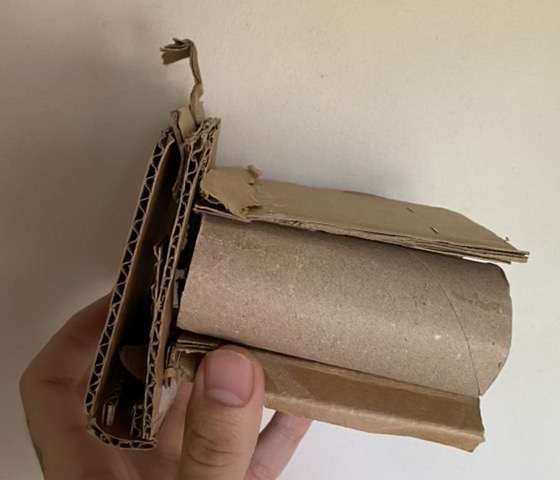

# Entrega 2 — El proceso de diseño: la visualización salta al mundo físico

**Proyecto de Visualización de Información · IIC2026 (2026-2)**

> **Borrador (14 de noviembre de 2026, con la R2 del 12 de noviembre incorporada).** Sigue la estructura de `entrega_1.md` y el orden de la
> [pauta](https://infovis.alessiobellino.com/e2). Lo que está entre _\[corchetes\]_ falta: son datos que solo
> tiene el grupo (revisiones, fotos, videos) o trabajo que aún no ocurre. La lista de pendientes está al
> final. Borrar esta nota antes de exportar el PDF.

---

## 1. Portada

- **Título del proyecto:** Mirador · binoculares para escuchar y coleccionar las aves de Chile
- **Grupo:** _\[Número de grupo\]_
- **Integrantes:**
  - Joaquín Andrés Bächler Díaz (`@canija2000`)
  - Matías Valentín Morales Apablaza
  - Franco Andrés Moya Aravena
- **Enlaces obligatorios:**
  - **Parte digital (GitHub Pages):** <https://canija2000.github.io/infovis_2026-2/mirador/>
  - **Repositorio (GitHub):** <https://github.com/canija2000/infovis_2026-2>
  - **Video demostrativo (interacción física y sonora completa):** _\[enlace público\]_

---

## 2. Contexto general

### Propósito de la fisicalización

En la Entrega 1 el mensaje era que Chile tiene dos avifaunas, las **sedentarias** y las **nómadas**, y que el
pulso migratorio transforma a la vez la composición y el paisaje sonoro del país. Ese mensaje se leía en una
pantalla, desde afuera. La fisicalización lo convierte en una experiencia en primera persona: quien visita
toma unos **binoculares de madera**, elige una región con un código QR y una de sus zonas, y queda de pie en
ese lugar. Gira el cuerpo para buscar aves; cuando una queda en la mira, **canta** y dice quién es: residente,
visitante de verano o visitante de invierno. El año avanza mes a mes y las aves llegan y se van: lo que en la
portada era una curva, aquí es un lugar que se vacía o se llena alrededor de uno. El gesto físico (levantar
los binoculares, girar, sostener la mirada) es el mismo de quien sale a observar aves, y de ese gesto vienen
los datos.

### Procesamiento de los datos

Se usan los mismos registros de la Entrega 1 (GBIF, 91–98 % de eBird), pero de **un solo año, 2024**, para
que cada mes sea un hecho y no un promedio. De cada región se toman las 30 especies con más días con registro
por mes (`years['2024'][m].cast`), y de ellas las destacadas de cada zona (4 a 9 por zona, 5 regiones, 19
zonas). La clase de cada especie (residente, estival, invernal) es la calculada en la Entrega 1 con el año
típico 2017–2024 corregido por esfuerzo. Cada ave tiene un lugar fijo en la zona todo el año; si ese mes no
se registra, su lugar queda vacío. El terreno de cada zona viene de AWS Terrain Tiles, ESA WorldCover y
OpenStreetMap; los cantos, de Xeno-canto.

---

## 3. V1 — La idea completa, simulada (antes del 5 de noviembre)

| Campo                         | Detalle                                                                                                                              |
| ----------------------------- | ------------------------------------------------------------------------------------------------------------------------------------ |
| **Versión**                   | V1 · «Los que llegan y los que se quedan»                                                                                            |
| **Fecha**                     | 2026-10-29 al 2026-11-02 (estado presentado en la R1 del 5 de noviembre)                                                             |
| **Commit / Tag**              | `dbc424e` (prueba de servos), `301a6ac` (sketch perilla → servos, maqueta, mapa STL), `5e71daa` (pestaña «Propuesta física») · PR #33 |
| **Evidencia visual y sonora** | Video de la maqueta simulada (30 s, con sonido): `web/video/propuesta-maqueta-v1.mp4`, publicado en [Propuesta física](https://canija2000.github.io/infovis_2026-2/propuesta.html) · Fotos del estado físico: _\[fotos del Leonardo con los dos servos y la perilla\]_ |

### Qué cambió (decisiones iniciales)

1.  Un **Chile de cartón** con dos brazos: una bandada de visitantes de verano a un lado y una de invierno al otro.
2.  Una **perilla** recorre el año; cada brazo entra al mapa según cuántas especies de su clase hay ese mes.
3.  Los dos servos usan **la misma escala** (0 a 106 especies), para que verano e invierno sean comparables.
4.  Los **residentes no se mueven**: son aves verdes fijas sobre el mapa.
5.  Sonido: el coro de cantos reales de la Entrega 1, con residentes al centro, verano a la izquierda e invierno a la derecha.
6.  Electrónica: Arduino Leonardo con Protobject por WebUSB (`web/fisico/`), y un sketch que mueve los brazos directo con la perilla (`arduino/perilla_servos`).
7.  La V1 se presentó **simulada en Blender**, con los datos reales del año típico.

### Por qué cambió — el rationale

- **Continuidad con el mensaje de la Entrega 1:** la maqueta fisicaliza el mismo gráfico de la portada («especies presentes en Chile, mes a mes»), ahora como movimiento.
- **Misma escala para comparar:** el pulso de invierno (11 a 26 especies) es mucho menor que el de verano (hasta 106); con escalas distintas ese contraste, que es parte del mensaje, se perdía.
- **Los residentes quietos como codificación:** lo que no cambia no se mueve; el piso estable se ve por contraste con los brazos.
- **Simular primero:** la pauta admite V1 simulada; Blender permitió probar proporciones, sonido y recorrido de los brazos antes de cortar cartón.
- _\[Completar con lo que el grupo discutió al elegir esta idea.\]_

### Qué se descartó

- **Un servo para los residentes:** no aporta, porque casi no varían en el año.
- _\[Otras alternativas que el grupo consideró para la V1.\]_

---

## 4. R1 — Revisión con el equipo docente

- **Fecha:** jueves 5 de noviembre de 2026
- **Síntesis de lo discutido y decisiones tomadas:**
  - Se presentó la V1: la maqueta de «Los que llegan y los que se quedan», con la perilla y los dos servos,
    simulada en Blender.
  - _\[Qué observó el equipo docente sobre la maqueta: completar con las notas de la revisión.\]_
  - **Qué adoptamos:** dejar la versión de los servos y desarrollar la de los binoculares, en la que el
    visitante observa las aves de una zona en primera persona. Toda la V2 es esa iteración.
  - **Qué descartamos y por qué:** _\[sugerencias de la revisión que no tomamos, con su argumento.\]_

---

## 5. V2 — Giro: de la maqueta a los binoculares (5 al 12 de noviembre)

Esta versión es un **cambio de rumbo**, no un ajuste: después de la R1 se abandona la maqueta de servos y se
construye el Mirador. Se documenta completa, con sus pasos internos, porque la pauta pide registrar los desvíos.

| Campo                         | Detalle                                                                                                                                                                                             |
| ----------------------------- | --------------------------------------------------------------------------------------------------------------------------------------------------------------------------------------------------- |
| **Versión**                   | V2 · Mirador con binoculares                                                                                                                                                                        |
| **Fecha**                     | 2026-11-05 al 2026-11-12 (después de la R1; los commits son del 10 y 11 de noviembre; estado presentado en la R2)                                                                             |
| **Commit / Tag**              | `e579a5d` (Mirador, PR #34), `9f8fd02` (pantalla completa, PR #35), `258a3b1` (selector de niveles, diálogo y modo Caminar, PR #36), `ec79fd8` (foto más rápida y sin aviso, PR #37) |
| **Evidencia visual y sonora** | Sitio: <https://canija2000.github.io/infovis_2026-2/mirador/> · Fotos del visor de cartón presentado en la R2 (abajo) · Capturas: _\[inicio y visor\]_ · Video con manipulación y sonido: _\[enlace\]_ |

|  |  |
| :---: | :---: |
| Lado por donde se mira: un tubo por ojo | De lado: los tubos y el bolsillo donde entra el teléfono |

_Prototipo de la V2 (12 de noviembre de 2026): dos tubos de cartón pegados a un bolsillo de cartón corrugado._

### Qué cambió

1.  **De mirar un mapa a estar en un lugar:** en vez de un Chile de cartón visto desde arriba, unos binoculares con el teléfono adentro y una zona real en primera persona.
2.  **Datos de un solo año (2024)** y cinco regiones con sus zonas ya modeladas; un **QR por región** abre su selector.
3.  **Aves fijas en un círculo:** no se camina; se gira, y una mira elige el ave más cercana al centro, que canta.
4.  **Solo el teléfono:** el giroscopio da la mirada; sostenerla abre la ficha y toma la foto; mirar al cielo cambia de mes y mirar al suelo abre la libreta.
5.  **Interfaz de videojuego:** inicio como selector de niveles (región = mundo, zonas = niveles con un sello por ave) y diálogo del ave con pestaña «nombre | clase» y frases sacadas de los datos.
6.  **Segundo modo, Caminar:** caminar en el lugar avanza hacia donde se mira (el acelerómetro cuenta pasos).
7.  **Visor de cartón:** dos tubos, uno por ojo, pegados a un bolsillo de cartón corrugado donde entra el teléfono; la pantalla muestra dos círculos, uno frente a cada tubo.

### Por qué cambió — el rationale

- **El gesto es el dato:** observar aves es levantar binoculares, girar y esperar; la interacción física reproduce la práctica que generó los registros de eBird, en vez de una perilla abstracta.
- **Del agregado al caso:** la maqueta mostraba cuántas especies hay; el Mirador muestra cuáles, dónde y cuándo, y deja oír cada una. Responde a la misma tensión que la R1 de la Entrega 1 (exploración frente a mensaje).
- **Un solo año para ser concreto:** «en enero de 2024 me vieron 18 de 31 días» es verificable; el promedio de ocho años no.
- **Aves fijas para sostener la comparación entre meses:** como cada especie tiene siempre el mismo lugar, su ausencia se nota (_eyes beat memory_).
- **Sin Arduino por robustez:** el primer diseño usaba un Leonardo como teclado con botones y rueda; se quitó porque sumaba cable, alimentación y puntos de falla sin dar información que el teléfono no tuviera.
- **Sostener la mirada en vez de apretar:** sin botones, el tiempo de permanencia sobre un ave es la única confirmación disponible; un anillo muestra el avance para que no sorprenda.
- **Diseño, no paleta:** la primera propuesta de interfaz solo cambiaba colores; se rehízo con lógica de juego: la zona es la decisión principal, el modo es un interruptor y el progreso (aves por fotografiar) es el gancho.
- **Cartón antes que madera:** un prototipo de material reutilizado y costo cero permitió probar el tamaño, el peso y la visión por dos tubos con otras personas antes de cortar el MDF.
- **Dos tubos y dos círculos por parecido:** se buscó que el objeto se reconociera de inmediato como unos binoculares; la R2 mostró que ese parecido no alcanza si cuesta enfocar (ver R2).

### Qué se descartó

- **Maqueta de servos y perilla (V1):** comunicaba el agregado nacional, pero no dejaba escuchar ni reconocer especies.
- **Una versión de mapa completo con años 2017–2024:** más datos de los que la experiencia podía mostrar; se redujo a un año y a zonas existentes.
- **Botones y rueda con Arduino:** el teléfono ya entrega la misma información con sus sensores.
- **Tres variantes de color** de la misma pantalla, presentadas como propuestas.

---

## 6. R2 — Revisión entre pares

- **Fecha:** jueves 12 de noviembre de 2026
- **Quién revisó:** _\[grupo que nos evaluó\]_, según la pauta de revisión entre pares.
- **Qué se presentó:** el visor de cartón de dos tubos con el Mirador en el teléfono (V2).
- **Síntesis de lo discutido y decisiones tomadas:**
  1.  **Los dos círculos incomodan.** Con un círculo por ojo, en la pantalla y en el aparato, cuesta enfocar y la imagen no se funde en una sola: no se siente como mirar por unos binoculares. **Adoptado:** una sola imagen vista con los dos ojos, en un visor de caja única (el de MDF).
  2.  **Hay aves que no se ven.** Varias quedan detrás de árboles u otros objetos, y desde un punto fijo no hay cómo rodearlos. **Adoptado:** redistribuir las aves para que todas se vean desde el punto de observación.
  3.  **Caminar no funciona bien.** El avance no responde de forma confiable a los pasos. _\[Por decidir: corregirlo o retirarlo; ver el plan de la V3.\]_
  4.  **Cambiar de región es engorroso.** Con el teléfono dentro del visor, hay que sacarlo para elegir otra región. **Adoptado:** que el cambio de zona y de región se haga sin sacar el teléfono.
  5.  **Qué descartamos y por qué:** _\[sugerencias del otro grupo que no tomamos, con su argumento.\]_

---

## 7. V3 — Segunda iteración de diseño (después del 12 de noviembre)

| Campo                         | Detalle       |
| ----------------------------- | ------------- |
| **Versión**                   | V3            |
| **Fecha**                     | 2026-11-12 al _\[fecha de la R3\]_  |
| **Commit / Tag**              | _\[commit\]_  |
| **Evidencia visual y sonora** | Plano de corte: `fisico/visor_laser/visor_guia.png` · _\[fotos del visor de MDF armado · video con manipulación y sonido\]_ |

> **Plan de trabajo (borrador; lo confirma el grupo).** Cada punto responde a una observación de la R2.
>
> 1.  **Visor de MDF de caja única**, ya armado: fotografiarlo y probar la distancia de enfoque con el teléfono adentro.
> 2.  ~~Una sola imagen en la pantalla por defecto~~ (hecho el 14 de noviembre).
> 3.  ~~Aves siempre a la vista~~ (hecho el 14 de noviembre).
> 4.  **Viajar sin sacar el teléfono:** elegir zona y región desde dentro del visor, con la mirada.
> 5.  **Caminar:** decidir si se corrige o se retira.
> 6.  **Sonificación:** que algún dato se oiga en el ritmo o el tono, no solo en el timbre (ver «Riesgos»).

### Qué cambió

- **Del cartón al MDF cortado en láser:** una caja con careta de dos ventanas octogonales y un solo espacio interior; el teléfono entra por una ranura lateral. Plano: `fisico/visor_laser/` (`f89910c`, dibujado el 11 de noviembre; cortado y armado _\[fecha\]_).
- **Una sola imagen:** el Mirador ya no dibuja un círculo por ojo; muestra una imagen única que se mira con los dos ojos (14 de noviembre, `15a1025`).
- **Aves siempre a la vista:** cada ave se ubica en un punto que se ve desde el centro; antes solo se comprobaba el relieve, ahora también árboles, arbustos y edificios (14 de noviembre, `15a1025`).
- _\[pendiente: el resto de los cambios, a medida que se hagan\]_

### Por qué cambió — el rationale

- **Una caja y no dos tubos (R2, punto 1):** sin lentes, dos imágenes separadas obligan a mirar en paralelo y enfocar de cerca a la vez; una sola imagen vista con los dos ojos se comporta como cualquier objeto cercano.
- **Ranura lateral:** con la ranura arriba el visor dependía del largo de cada teléfono; por el costado solo importan el ancho y el grosor, que varían mucho menos.
- **Restricción material:** la plancha de MDF disponible mide 335 × 365 mm, lo que fija el tamaño de la caja (120 × 90 × 122 mm) y la distancia del ojo a la pantalla (unos 12 cm).
- **Lo que no se puede ver no se puede leer (R2, punto 2):** quien observa está fijo y no puede rodear un árbol. Al revisar las 19 zonas en los 12 meses, 127 de 1303 apariciones de aves quedaban tapadas; después del cambio, ninguna.
- _\[pendiente\]_

### Qué se descartó

- **Visor de dos tubos** (el de cartón de la V2) y **ranura superior** para el teléfono.
- _\[pendiente\]_

---

## 8. R3 — Revisión con el equipo docente

- **Fecha:** _\[por confirmar; si sigue el ritmo semanal, jueves 19 de noviembre de 2026\]_
- **Síntesis de lo discutido y decisiones tomadas:** _\[pendiente\]_

---

## 9. V4 — La experiencia final

| Campo                         | Detalle       |
| ----------------------------- | ------------- |
| **Versión**                   | V4            |
| **Fecha**                     | _\[después de la R3\]_ al 2026-11-26 (entrega) |
| **Commit / Tag**              | _\[commit\]_  |
| **Evidencia visual y sonora** | _\[fotos · video demostrativo\]_ |

### Qué cambió (máx. 8 líneas)

_\[pendiente\]_

### Por qué cambió — el rationale (máx. 12 líneas)

_\[pendiente\]_

### Qué se descartó (máx. 5 líneas)

_\[pendiente\]_

### Balance: qué mejoró desde V1 y qué decidimos no cambiar

_\[pendiente\]_

---

## 10. El feedback al otro grupo (dado en la R2)

- **Proyecto evaluado (máx. 5 líneas):** _\[pendiente\]_
- **Feedback que dimos (máx. 12 líneas):** _\[pendiente\]_
- **Lo que nos llevamos para nuestro proyecto (máx. 5 líneas):** _\[pendiente\]_

---

## 11. Evaluación con usuarios — La hoja del observador

### Ronda 1 (idealmente entre V3 y V4, es decir, después del 12 de noviembre)

- **Quién fue el pensador y cuándo (máx. 2 líneas):** _\[persona externa al grupo, que no haya visto el prototipo\]_

#### Bitácora de observación (`tiempo · cita literal · acción`)

_\[pendiente\]_

#### Qué dijo del sonido

_\[pendiente\]_

#### Heurísticas del curso (Zuk-Carpendale) que fallaron en la sesión

_\[pendiente\]_

#### Las tres preguntas de cierre

1.  **¿Dónde se atascó?** _\[pendiente\]_
2.  **¿Qué hipótesis nuestra resultó errónea?** _\[pendiente\]_
3.  **¿Qué cambio concreto sale de esto?** _\[pendiente\]_

#### Efecto en el proceso

_\[pendiente\]_

---

## Pendientes de este borrador

**Decisiones del grupo**

- [x] Reparto de versiones: V1 es lo anterior a la R1 (5 de noviembre), V2 lo hecho entre la R1 y la R2
      (12 de noviembre), V3 lo que salga de la R2 y V4 lo que salga de la R3.
- [ ] Confirmar la fecha de la R3.
- [ ] Decidir si hay que **reenviar el formulario** de cambio de idea: la pauta lo exige cuando cambia «la idea
      de fondo», y pasar de la maqueta a los binoculares puede contar como eso. Consultarlo con el profesor.

**Evidencia que falta**

- [ ] **Fotos del estado físico de cada versión**, tomadas en días distintos. De la V1: el Leonardo con los
      servos. De la V3: el visor de MDF armado, con y sin teléfono.
- [x] Fotos de la V2: visor de cartón del 12 de noviembre (`docs/proceso/fotos/`).
- [ ] Video corto de la V2 con manipulación y sonido, y el video demostrativo final.
- [ ] Capturas del Mirador (inicio y visor) en `docs/proceso/capturas/`.
- [x] Commit del plano del visor (`fisico/visor_laser/`): `f89910c`, PR #37.

**Contenido que solo tiene el grupo**

- [ ] Contenido de R1 (qué observó el equipo docente el 5 de noviembre) y de R3 (máx. 10 líneas cada
      una; cada sugerencia, adoptada o descartada con argumentos).
- [x] Contenido de la R2 (12 de noviembre). Falta el nombre del grupo que revisó, qué se descartó y la
      decisión sobre el modo Caminar.
- [ ] Feedback al otro grupo.
- [ ] Ronda de evaluación con una persona externa.
- [ ] Número de grupo.

**Riesgos frente a la rúbrica**

- [ ] **Sonificación:** la pauta pide parámetros efectivos (tono, ritmo, timbre), «no solo volumen». Hoy el
      canto identifica la especie (timbre) y su posición (de dónde viene), pero ningún dato numérico se oye.
      Una mejora posible para V3: que la frecuencia con que canta un ave dependa de cuántos días se registró
      ese mes.
- [ ] **Límites de líneas:** «qué cambió» máx. 8, «por qué» máx. 12, «qué se descartó» máx. 5. La V2 está
      escrita para caber, pero hay que revisarlo en el PDF.
