# Entrega 2 — El proceso de diseño: la visualización salta al mundo físico

**Proyecto de Visualización de Información · IIC2026 (2026-2)**

> **Borrador (23 de noviembre de 2026, con la R3 del 19 de noviembre y la V4 incorporadas).** Sigue la estructura de `entrega_1.md` y el orden de la [pauta](https://infovis.alessiobellino.com/e2). Lo que está entre _\[corchetes\]_ falta: son datos que solo tiene el grupo (revisiones, fotos, videos) o trabajo que aún no ocurre. La lista de pendientes está al final. Borrar esta nota antes de exportar el PDF.

---

## 1. Portada

- **Título del proyecto:** Mirador · binoculares para escuchar y coleccionar las aves de Chile
- **Grupo:** 17
- **Integrantes:**
  - Joaquín Andrés Bächler Díaz (`@canija2000`)
  - Matías Valentín Morales Apablaza
  - Franco Andrés Moya Aravena
- **Enlaces obligatorios:**
  - **Parte digital (GitHub Pages):** <https://canija2000.github.io/infovis_2026-2/mirador/>
  - **Repositorio (GitHub):** <https://github.com/canija2000/infovis_2026-2>
  - **Video demostrativo (interacción física y sonora completa):** <https://youtu.be/1lQ4klvdpVs>

---

## 2. Contexto general

### Propósito de la fisicalización

En la Entrega 1 el mensaje era que Chile tiene dos avifaunas, las **sedentarias** y las **nómadas**, y que el pulso migratorio transforma a la vez la composición y el paisaje sonoro del país. Ese mensaje se leía en una pantalla, desde afuera. La fisicalización lo convierte en una experiencia en primera persona: quien visita mira por un **visor de madera** con el teléfono adentro y queda de pie en una torre, al centro de una región hecha maqueta. En 72 segundos pasa el año 2024: las bandadas de verano llegan desde el norte y las de invierno desde el sur, se posan en la zona de su hábitat, cantan con su voz real y se van. Al girar el visor se recorre la región, y en las manos vibra la zona por donde pasa cada migración. Lo que en la portada de la Entrega 1 era una curva, aquí es un lugar que se llena y se vacía alrededor de uno, y que se oye y se siente.

### Procesamiento de los datos

Se usan los registros de la Entrega 1 (GBIF, 91–98 % de eBird), pero solo de **2024**, para que cada mes sea un hecho y no un promedio. Por región y mes se toman las especies registradas al menos 3 días de ese mes; su clase (residente, visitante de verano o de invierno) es la del año típico 2017–2024 de la Entrega 1. Las que aparecen o desaparecen respecto del mes anterior son las bandadas que llegan o se van, y su tamaño crece con la fracción de días con registro. `scripts/bandadas.mjs` deja todo en `bandadas-2024.json` y `.csv`, que leen la pantalla y la vibración. Cada especie se posa en la zona de su hábitat (AVONET). El terreno viene de AWS Terrain Tiles, ESA WorldCover y OpenStreetMap; los cantos, de Xeno-canto.

---

## 3. V1 — La idea completa, simulada (antes del 5 de noviembre)

+-------------------------------+--------------------------------------------------------------------------------------------------------------------------------------------------------------------------------------------------------------------------------------------------------------------------------+
| Campo | Detalle |
+===============================+================================================================================================================================================================================================================================================================================+
| **Versión** | V1 · «Los que llegan y los que se quedan» |
+-------------------------------+--------------------------------------------------------------------------------------------------------------------------------------------------------------------------------------------------------------------------------------------------------------------------------+
| **Fecha** | 2026-10-29 al 2026-11-02 (estado presentado en la R1 del 5 de noviembre) |
+-------------------------------+--------------------------------------------------------------------------------------------------------------------------------------------------------------------------------------------------------------------------------------------------------------------------------+
| **Commit / Tag** | `dbc424e` (prueba de servos), `301a6ac` (sketch perilla → servos, maqueta, mapa STL), `5e71daa` (pestaña «Propuesta física») · PR #33 |
+-------------------------------+--------------------------------------------------------------------------------------------------------------------------------------------------------------------------------------------------------------------------------------------------------------------------------+
| **Evidencia visual y sonora** | Video de la maqueta simulada (30 s, con sonido): `web/video/propuesta-maqueta-v1.mp4`, publicado en [Propuesta física](https://canija2000.github.io/infovis_2026-2/propuesta.html) · Un cuadro del video y las conexiones (abajo): la V1 no se construyó, se presentó simulada |
+-------------------------------+--------------------------------------------------------------------------------------------------------------------------------------------------------------------------------------------------------------------------------------------------------------------------------+

+-----------------------------------------------------------------------------------------------------------------+-------------------------------------------------------------------------------------------------------+
| 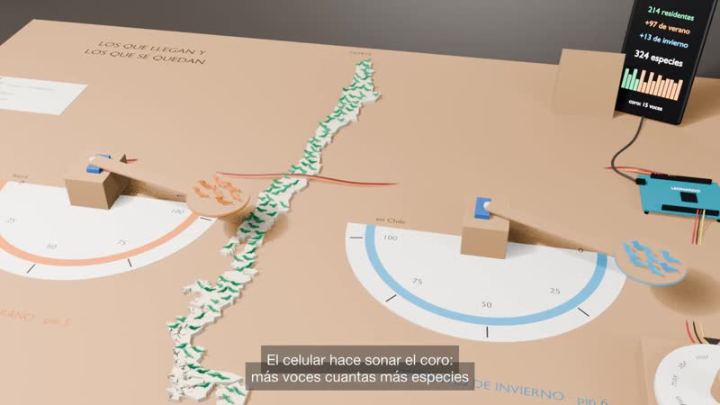 | 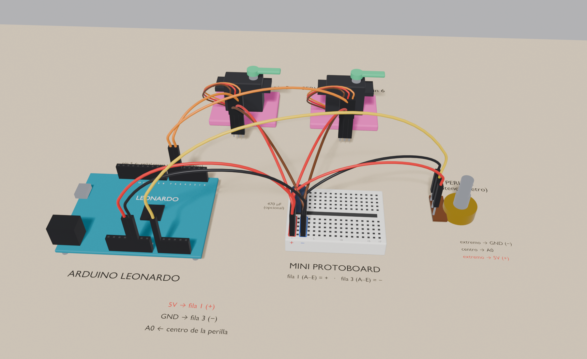 |
+:===============================================================================================================:+:=====================================================================================================:+
| Cuadro del video de la maqueta simulada: los brazos de verano e invierno sobre el mapa y el coro en el teléfono | Las conexiones del Leonardo con los dos servos y la perilla |
+-----------------------------------------------------------------------------------------------------------------+-------------------------------------------------------------------------------------------------------+

_Maqueta de la V1, simulada en Blender con los datos del año típico, tal como se presentó en la R1 (5 de noviembre de 2026)._

### Qué cambió (decisiones iniciales)

1.  Un **Chile de cartón** con dos brazos: verano a un lado e invierno al otro.
2.  Una **perilla** recorre el año; cada brazo entra según las especies de su clase ese mes.
3.  Los dos servos usan **la misma escala** (0 a 106 especies), para comparar verano e invierno.
4.  Los **residentes no se mueven**: son aves verdes fijas sobre el mapa.
5.  **Sonido:** el coro de la Entrega 1, con residentes al centro y verano e invierno a los lados.
6.  **Electrónica:** un Leonardo con Protobject por WebUSB y un sketch que mueve los brazos.
7.  Se presentó **simulada en Blender**, con los datos reales del año típico.

### Por qué cambió — el rationale

- **Continuidad con el mensaje de la Entrega 1:** la maqueta fisicaliza el mismo gráfico de la portada («especies presentes en Chile, mes a mes»), ahora como movimiento.
- **Misma escala para comparar:** el pulso de invierno (11 a 26 especies) es mucho menor que el de verano (hasta 106); con escalas distintas ese contraste, que es parte del mensaje, se perdía.
- **Los residentes quietos como codificación:** lo que no cambia no se mueve; el piso estable se ve por contraste con los brazos.
- **Simular primero:** la pauta admite V1 simulada; Blender permitió probar proporciones, sonido y recorrido de los brazos antes de cortar cartón.

### Qué se descartó

- **Un servo para los residentes:** no aporta, porque casi no varían en el año.

---

## 4. R1 — Revisión con el equipo docente

- **Fecha:** jueves 5 de noviembre de 2026 · **Se presentó:** la V1, la maqueta «Los que llegan y los que se quedan» (dos servos y una perilla), simulada en Blender.
- **Síntesis:** el equipo docente observó que la maqueta no aportaba nada a lo que ya mostraba la página de la Entrega 1. En efecto, los brazos sobre el mapa contaban lo mismo que la curva de especies por mes de la portada.
- **Adoptado:** cambiar de idea por una que solo tenga sentido en lo físico: unos binoculares para observar, en primera persona, las aves de un lugar (la V2).
- **Descartado:** nada; la observación se tomó entera. Corregir la maqueta no bastaba: seguiría contando lo mismo que la página.

---

## 5. V2 — Giro: de la maqueta a los binoculares (5 al 12 de noviembre)

Esta versión es un **cambio de rumbo**, no un ajuste: después de la R1 se abandona la maqueta de servos y se construye el Mirador. Se documenta completa, con sus pasos internos, porque la pauta pide registrar los desvíos.

| Campo                         | Detalle                                                                                                                                                                                                |
| ----------------------------- | ------------------------------------------------------------------------------------------------------------------------------------------------------------------------------------------------------ |
| **Versión**                   | V2 · Mirador con binoculares                                                                                                                                                                           |
| **Fecha**                     | 2026-11-05 al 2026-11-12 (después de la R1; los commits son del 10 y 11 de noviembre; estado presentado en la R2)                                                                                      |
| **Commit / Tag**              | `e579a5d` (Mirador, PR #34), `9f8fd02` (pantalla completa, PR #35), `258a3b1` (selector de niveles, diálogo y modo Caminar, PR #36), `ec79fd8` (foto más rápida y sin aviso, PR #37)                   |
| **Evidencia visual y sonora** | Sitio: <https://canija2000.github.io/infovis_2026-2/mirador/> · Fotos del visor de cartón presentado en la R2 (abajo) |

| 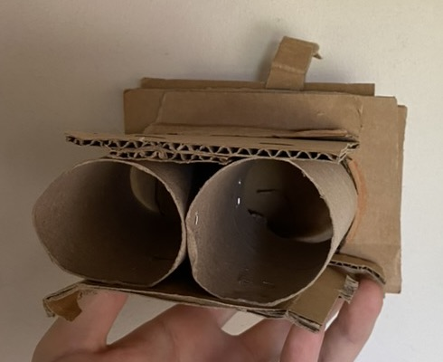 |  |
| :-------------------------------------------------------------------: | :-----------------------------------------------------------------------------------------: |
|                Lado por donde se mira: un tubo por ojo                |                  De lado: los tubos y el bolsillo donde entra el teléfono                   |

_Prototipo de la V2 (12 de noviembre de 2026): dos tubos de cartón pegados a un bolsillo de cartón corrugado._

### Qué cambió

1.  **De un mapa a un lugar:** binoculares con el teléfono adentro y una zona real alrededor.
2.  **Un solo año (2024)**, cinco regiones con sus zonas y un **QR por región** que abre su selector.
3.  **Aves fijas en un círculo:** se gira y la mira elige el ave más cercana al centro, que canta.
4.  **Solo el teléfono:** la mirada sostenida abre la ficha y saca la foto; arriba pasa de mes.
5.  **Interfaz de videojuego:** selector de niveles y diálogo del ave con frases de los datos.
6.  **Modo Caminar:** caminar en el lugar avanza hacia donde se mira (cuenta los pasos).
7.  **Visor de cartón** de dos tubos, uno por ojo, con un círculo por ojo en la pantalla.

### Por qué cambió — el rationale

- **El gesto es el dato:** observar aves es levantar los binoculares, girar y esperar; el gesto reproduce la práctica que generó los registros de eBird.
- **Del agregado al caso (R1):** la maqueta repetía lo que ya mostraba la página; el Mirador muestra cuáles especies, dónde y cuándo, y deja oír cada una.
- **Un solo año para ser concreto:** «en enero de 2024 me vieron 18 de 31 días» es verificable; un promedio de ocho años no.
- **Aves fijas para comparar meses:** cada especie tiene su lugar, y su ausencia se nota.
- **Sin Arduino por robustez:** botones y rueda sumaban cables y fallas sin dar nada que el teléfono no tuviera.
- **Sostener la mirada en vez de apretar:** sin botones, la permanencia confirma la acción.
- **Cartón primero:** probar tamaño, peso y visión con otras personas, a costo cero, antes de cortar madera.

### Qué se descartó

- **Maqueta de servos y perilla (V1):** mostraba el total nacional, pero no dejaba oír ni reconocer especies.
- **Mapa completo con los años 2017–2024:** más datos de los que la experiencia podía mostrar.
- **Botones y rueda con Arduino:** el teléfono ya entrega lo mismo con sus sensores.
- **Tres variantes de color** de la misma pantalla, presentadas como propuestas.

---

## 6. R2 — Revisión entre pares

- **Fecha:** jueves 12 de noviembre de 2026 · **Revisó:** el grupo 27 · **Se presentó:** el visor de cartón (V2).
- **Les gustaron los binoculares, pero con dos agujeros no se veía bien** (incomoda y cuesta enfocar). **Adoptado:** una sola imagen, en un visor de una caja: de ahí sale el visor de la V3.
- **Hay aves que no se ven** (detrás de árboles u objetos). **Adoptado:** ubicar cada ave donde se vea.
- **Caminar no responde bien a los pasos.** **Adoptado:** deja de ser el modo principal (queda en Explorar).
- **Cambiar de región es engorroso** con el teléfono adentro. **Adoptado:** viajar sin sacarlo.
- **Descartado:** los dos tubos como binoculares, porque dificultan ver el espacio.

---

## 7. V3 — Segunda iteración: un año de bandadas (12 al 19 de noviembre)

+-------------------------------+---------------------------------------------------------------------------------------------------------------------------------------------------------------------------------------------------------------------+
| Campo | Detalle |
+===============================+=====================================================================================================================================================================================================================+
| **Versión** | V3 · Un año de bandadas, con sonido y vibración |
+-------------------------------+---------------------------------------------------------------------------------------------------------------------------------------------------------------------------------------------------------------------+
| **Fecha** | 2026-11-12 al 2026-11-19 (estado presentado en la R3) |
+-------------------------------+---------------------------------------------------------------------------------------------------------------------------------------------------------------------------------------------------------------------+
| **Commit / Tag** | `15a1025`, `fc8ed16` (14 nov) · `a536e26`, `e1fc858` (16 nov) · `46ed6be`, `ca018dc`, `fc4ac5e`, `2fcf43c`, `430c5b2`, `803d79b` (18–19 nov) · PR #39 a #49 |
+-------------------------------+---------------------------------------------------------------------------------------------------------------------------------------------------------------------------------------------------------------------+
| **Evidencia visual y sonora** | Fotos del prototipo presentado en la R3 (abajo) · Sitio: <https://canija2000.github.io/infovis_2026-2/mirador/> · Plano del visor: `fisico/visor_laser/` |
+-------------------------------+---------------------------------------------------------------------------------------------------------------------------------------------------------------------------------------------------------------------+

|                      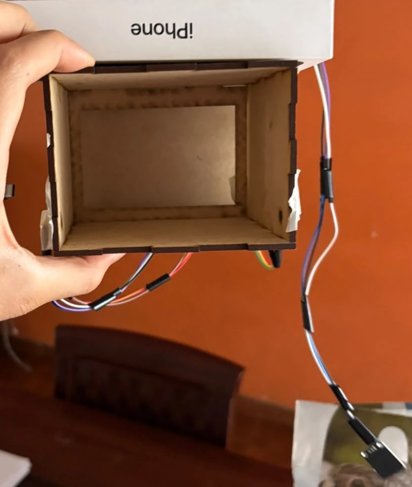                      | 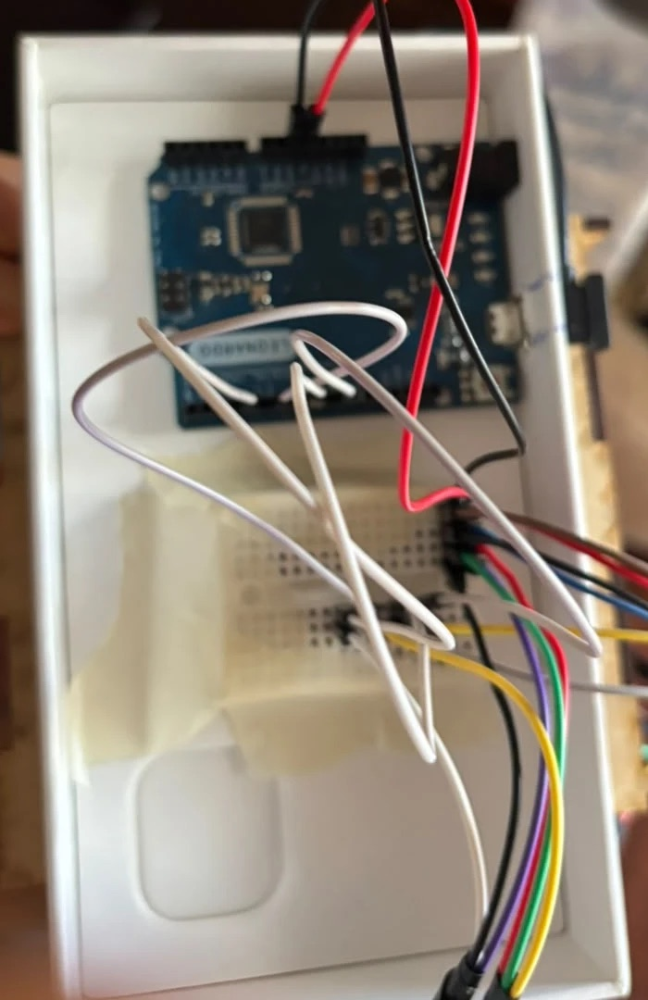 | 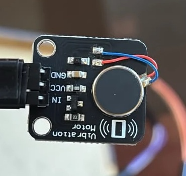 |
| :-------------------------------------------------------------------------------------------------------------------------: | :---------------------------------------------------------------------------------------: | :-----------------------------------------------------: |
| El visor de MDF, abierto del lado de los ojos, con la caja del circuito encima y los cables de los motores por los costados |                 El Leonardo y la protoboard dentro de la caja provisoria                  |         Uno de los cuatro módulos de vibración          |

_Prototipo presentado en la R3 (19 de noviembre de 2026)._

### Qué cambió

1.  **Visor de MDF** de una caja; el teléfono entra por el costado y no lleva careta (`f89910c`).
2.  **Vista inmersiva:** el año 2024 en 72 s; cada especie es una bandada (`a536e26`).
3.  **Toda la región** como maqueta, vista desde una torre al centro (`46ed6be`).
4.  **Aves a la vista:** ningún árbol ni edificio las tapa (`15a1025`).
5.  **Sonido:** el coro de cantos reales, más denso cuantas más especies hay (`ca018dc`).
6.  **Vibración:** un motor por zona; vibra la zona que cruza cada oleada (`2fcf43c`).
7.  **Explorar** (la V2) queda como segunda vista, con letreros para viajar (`fc8ed16`).

### Por qué cambió — el rationale

- **Una sola imagen (R2, punto 1):** sin lentes, una imagen por ojo obliga a mirar en paralelo y enfocar de cerca; una imagen única se mira como cualquier objeto cercano.
- **Lo que no se ve no se lee (R2, punto 2):** desde un punto fijo no se rodea un árbol; de 1303 apariciones de aves, 127 quedaban tapadas, y después ninguna.
- **Del caso a la ola:** mirar ave por ave no mostraba el mensaje de la Entrega 1, que el pulso migratorio vacía y llena el lugar; un año en 72 s sí.
- **Por región y no por zona:** las zonas (\~1,4 km) casi no tienen registros; la región trae 100 a 150 especies por mes (en la Metropolitana, las de verano bajan de 43 en enero a 6 en junio).
- **Sonido con dato:** los tonos por bandada sonaban artificiales; el timbre es la especie y el ritmo, cuántas hay.
- **Vibración con lugar:** la primera casi no se sentía y la segunda vibraba siempre; vibrar donde pasa una migración une lo que se siente con lo que se ve.

### Qué se descartó

- El **visor de dos tubos**, la **careta de dos ventanas** (incómoda) y la ranura superior; las **vistas cenital y de horizonte**; los **datos por zona**.
- El **servo** al costado del visor (un motor por zona da lugar además de tiempo), vibrar en cada **cambio de mes** y el **zumbido continuo**, que saturaban la señal.
- Los **tonos** por bandada y **Caminar** como modo principal.

---

## 8. R3 — Revisión con el equipo docente

- **Fecha:** jueves 19 de noviembre de 2026 · **Se presentó:** la V3 funcionando: visor de MDF, vista inmersiva con el coro y los cuatro motores, con el circuito en una caja provisoria sobre el visor.
- **Síntesis:** se evaluó muy bien. Falta una indicación: quien se encuentre el objeto sobre una mesa, sin nadie que se lo explique, no sabría qué es ni qué hacer con él.
- **Adoptado:** una indicación en el propio objeto (ver V4). Además, por decisión del grupo, ordenar la infraestructura (la caja provisoria y los cables sueltos) y hacer más legible la vibración.
- **Descartado:** nada; se siguió mejorando lo que ya se tenía.

---

## 9. V4 — La experiencia final (19 al 26 de noviembre)

| Campo                         | Detalle                                                                                                                                                                    |
| ----------------------------- | -------------------------------------------------------------------------------------------------------------------------------------------------------------------------- |
| **Versión**                   | V4 · Visor integrado, con asas que vibran y mochila                                                                                                                        |
| **Fecha**                     | 2026-11-19 (después de la R3) al 2026-11-26 (entrega)                                                                                                                      |
| **Commit / Tag**              | `319a5b3` (bandadas legibles, PR #51) · `1d56049`, `f6b91b1`, `a995416` (visor integrado, PR #50 y #52) · `b9d8ca1` (ensamble 3D) · `8832419` (video y modelo 3D en la web)                |
| **Evidencia visual y sonora** | Fotos del visor integrado armado (abajo) · Plano y modelo: `fisico/visor_integrado/` (guías de corte, `ensamble.html`, renders) · Video demostrativo: <https://youtu.be/1lQ4klvdpVs> · Pestaña «Video prototipo físico» del sitio, con el video y el modelo 3D del visor construido: <https://canija2000.github.io/infovis_2026-2/video-prototipo-fisico.html> |

|           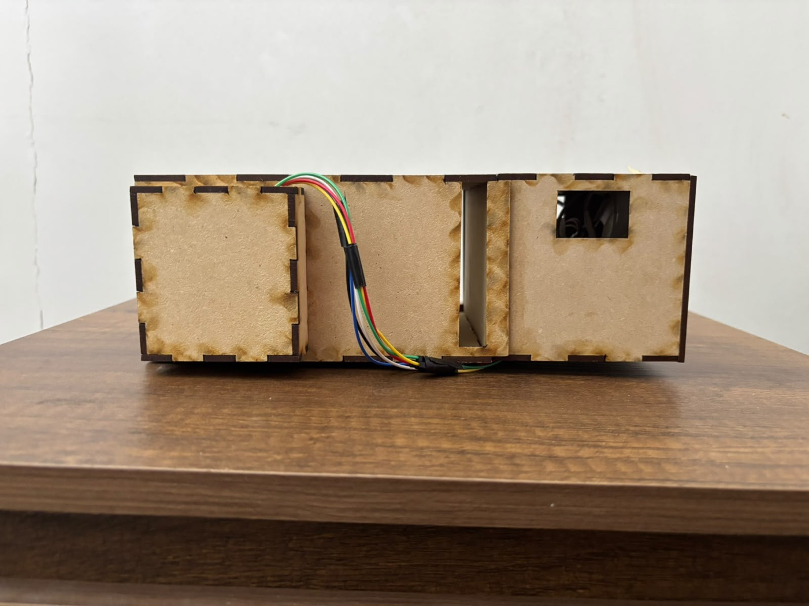           | 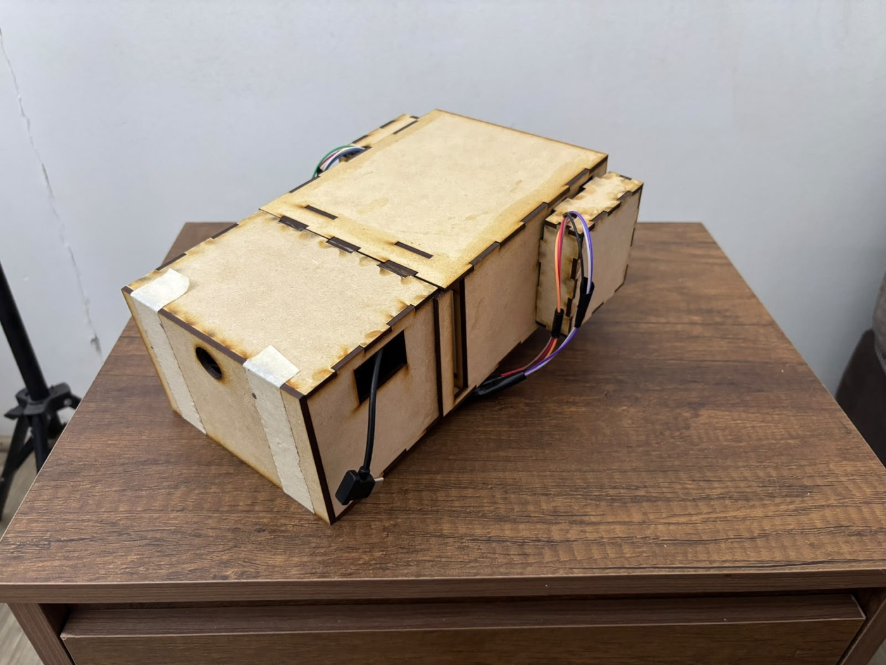 | 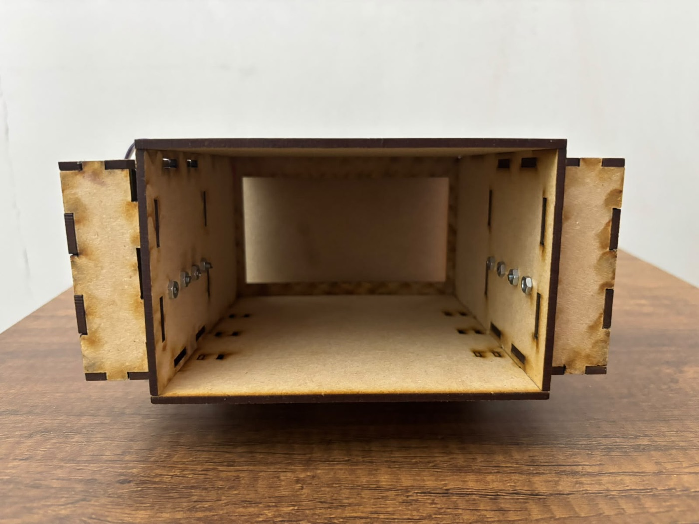 |
| :---------------------------------------------------------------: | :-----------------------------------------------------------: | :------------------------------------------: |
| De lado: las asas en los laterales, con los cables de los motores |      Desde arriba: el visor, la tapa y la mochila detrás      |  El interior, abierto del lado de los ojos   |

|    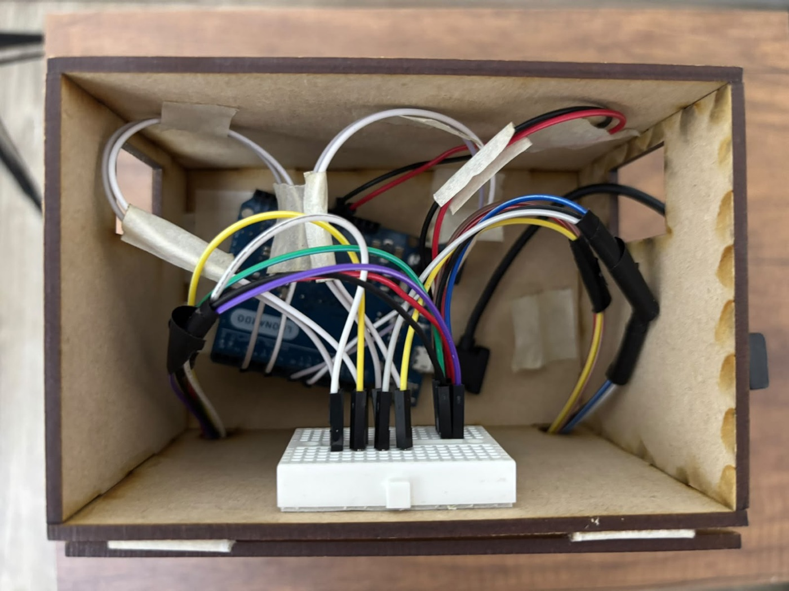     | 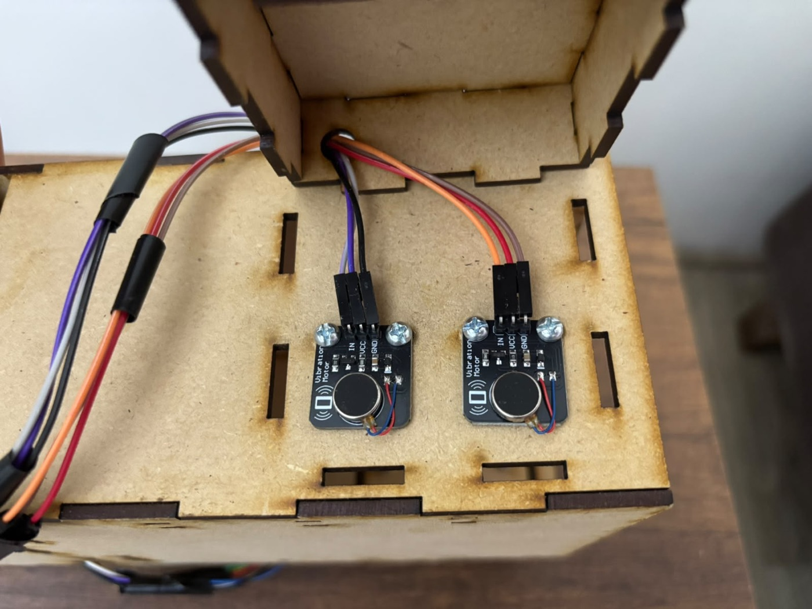 |
| :---------------------------------------------: | :----------------------------------------------: |
| La mochila abierta: el Leonardo y la protoboard | Dos motores atornillados al lateral, bajo el asa |

_Visor integrado cortado en MDF y armado (26 de noviembre de 2026)._

|  | 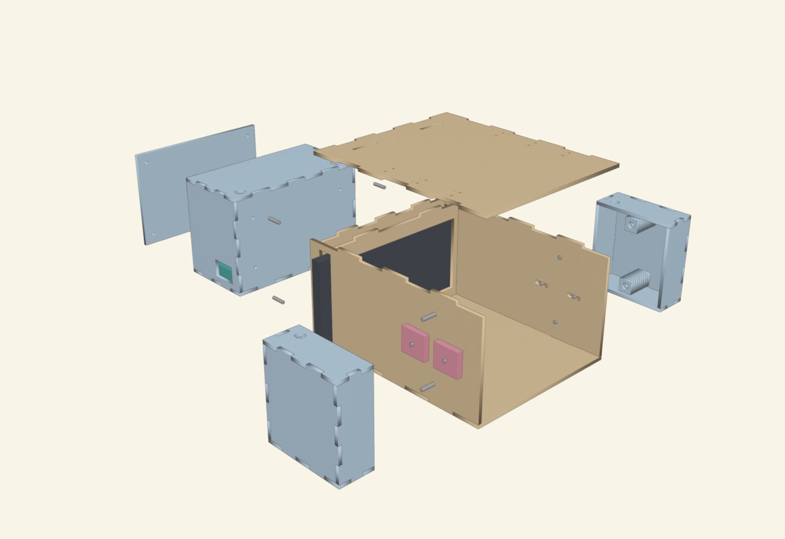 |
| :---------------------------------------------------------------------------------------: | :-------------------------------------------------------------------------------: |
|                   Ensamble 3D con las piezas exactas del plano de corte                   |               Despiece: visor, tapa, asas con los motores y mochila               |

_Modelo hecho antes de cortar (Blender), con las mismas piezas que van a la cortadora._

### Qué cambió

1.  **Visor y electrónica juntos:** sin careta, 2 cm más ancho y 5 cm más largo (`1d56049`).
2.  **Asas** que encajan con dientes en los laterales y cubren los motores atornillados (`a995416`).
3.  **Mochila** detrás del teléfono, con el Leonardo, la protoboard y el USB (`a995416`).
4.  **Modelo 3D** con las piezas exactas, antes de cortar: 31 piezas, dos planchas (`b9d8ca1`).
5.  **Bandadas legibles:** cada oleada vuela unida en V; las residentes, más quietas (`319a5b3`).
6.  **Pistas:** una flecha en el borde señala la bandada que pasa; la barra marca +N/−N (`319a5b3`).
7.  **Pestaña del prototipo** en el sitio: el video y el visor en 3D, pieza por pieza, para girarlo (`8832419`).
8.  **Indicación en el objeto:** un mensaje en la superficie donde están los binoculares dice que son de uso exploratorio.

### Por qué cambió — el rationale

- **El objeto tiene que explicarse solo (R3):** en la revisión funcionaba porque alguien lo explicaba; sobre una mesa, nadie sabría qué es ni qué hacer con él.
- **Del prototipo al objeto:** en la R3 el circuito iba en una caja de cartón encima, con los cables colgando y los motores sueltos; se veía improvisado y la vibración llegaba débil. Bajo las asas, vibran donde va la palma.
- **Ver y enfocar:** con 140 mm de ancho se ve el teléfono entero, y a unos 15 cm del ojo (antes 11) se enfoca más cómodo sin lentes.
- **Modelar antes de cortar:** el MDF alcanza para dos planchas; armar las piezas en 3D mostró el recorrido de los cables y que las 48 piezas para tornillos sobraban: bastan dientes y cola.
- **Una vibración tiene que poder atribuirse:** si no se ve qué la causa, es ruido. Las aves que vuelan juntas se leen como una sola bandada (destino común), la flecha dice hacia dónde mirar y, con las residentes quietas, la migración resalta sobre el fondo (figura y fondo).

### Qué se descartó

- La **propuesta A**, una torre de dos pisos con la electrónica arriba: cables cortos, pero el peso queda arriba y el USB sube por fuera.
- La **caja del circuito sobre la tapa** (prototipo de la R3), que alejaba los motores de las manos.
- Los **pilares y apoyos laminados** para tornillos (48 piezas) y un **tapón entero** para la mochila.

### Balance: qué mejoró desde V1 y qué decidimos no cambiar

**Qué mejoró.** De dos brazos de servo que contaban el total nacional pasamos a un lugar en primera persona: una región con sus especies, su forma y su canto, donde el pulso migratorio de 2024 se ve, se oye y se siente. La perilla abstracta se volvió el gesto de quien observa aves (levantar el visor y girar). La vibración, que en la V3 apenas se percibía o saturaba, ahora marca dónde y cuándo pasa una migración. Y el objeto pasó del cartón y una caja provisoria a un visor de MDF diseñado como un conjunto.

**Qué no cambiamos, y por qué.**

- **El mensaje de la Entrega 1** (dos avifaunas y el pulso migratorio) y su **código de color** (verde residente, naranja verano, azul invierno): es el hilo entre las dos entregas.
- **Datos y sonidos reales y verificables** (GBIF/eBird de 2024 y Xeno-canto): ninguna especie, cantidad ni canto es inventado.
- **El teléfono como única entrada**, sin botones: el Arduino solo produce la vibración.
- **La vista Explorar** (V2) no se borró: queda como segunda vista para conocer cada especie de cerca.

---

## 10. El feedback al otro grupo (dado en la R2)

**Proyecto evaluado.** Evaluamos al grupo 27 el 12 de noviembre, el mismo que nos revisó. Su fisicalización sigue el tema de su Entrega 1, la transición hacia las energías renovables: dos molinos, uno por país y uno junto al otro, que unos servos mueven según el uso de energía renovable de cada país. Los países se eligen escaneando un código QR por país. El prototipo funcionaba, con los molinos todavía de cartón.

**Feedback que dimos.** En general estaba bastante bueno: con un molino por país, uno junto al otro, la comparación se percibe de un vistazo, y les recomendamos mantenerla. Les señalamos dos cosas. Primero, escanear un QR por país resultaba confuso o innecesario: elegir el país no agrega nada al mensaje y suma un paso que la página web resuelve directamente. Lo físico debería aportar lo que la pantalla no logra, y aquí eso lo hacen los molinos, no la selección. Segundo, mejorar los molinos, que aún eran cartones: son la pieza que lleva el dato, así que es donde más rinde subir la fidelidad del prototipo, para que se reconozcan como molinos y su movimiento se lea bien.

**Lo que nos llevamos.** Nuestra V2 tenía un problema parecido: cada región se abría con su QR y cambiarla obligaba a sacar el teléfono del visor, justo lo que el grupo 27 nos señaló en la misma revisión. Desde la V3 se viaja de región sin sacarlo. Lo de los molinos, a su vez, nos confirmó pasar el visor del cartón al MDF.

---

## 11. Evaluación con usuarios — La hoja del observador

### Ronda 1 · con la V4 (26 de noviembre de 2026)

- **Quién fue el pensador y cuándo:** Lucas, 32 años, profesor de arte, externo al grupo y sin haber visto el prototipo; 26 de noviembre de 2026, con el visor dejado sobre una mesa. Observó Joaquín Bächler.

#### Bitácora de observación (`orden · cita literal · acción`)

| \#  | Cita literal                                                                                 | Acción                                                     |
| :-: | -------------------------------------------------------------------------------------------- | ---------------------------------------------------------- |
|  1  | «¿Qué tengo que hacer?»                                                                      | Mira el visor sobre la mesa sin tocarlo.                   |
|  2  | «¿Puedo tomarlo?»                                                                            | Pide permiso antes de levantarlo.                          |
|  3  | «Oo, a ver, ¿qué hay?»                                                                       | Lo levanta y mira por dentro.                              |
|  4  | «¿Cómo miro para los lados? Aaah, oye, qué bacán.»                                           | No sabe cómo recorrer la región; descubre que basta girar. |
|  5  | «Oh, y vibra. Ay, ta bueno.»                                                                 | Siente los motores en las manos cuando pasa una bandada.   |
|  6  | «Qué entrete. ¿Y cómo cambio de región?»                                                     | Busca cómo ir a otra región y no lo encuentra.             |
|  7  | «¿Lo dejo ahí nomás?»                                                                        | No sabe cómo terminar; deja el visor sobre la mesa.        |
|  8  | «Sí, está bueno, solo que no es intuitivo al principio, pero una vez ahí ya se va cachando.» | Comentario final.                                          |
|  9  | «Lo de las vibraciones está bueno, te inmerse más en la experiencia.»                        | Comentario final.                                          |

#### Qué dijo del sonido

No lo mencionó: todos sus comentarios fueron sobre mirar y la vibración. No sabemos si el coro le dijo algo sobre las aves o si quedó como fondo; en la próxima ronda hay que preguntarlo directamente.

#### Heurísticas del curso (Zuk-Carpendale) que fallaron en la sesión

- **Interacción física no descubrible:** no sabía qué hacer, si podía tomarlo, cómo mirar a los lados, cómo cambiar de región ni cómo terminar (citas 1, 2, 4, 6 y 7).
- **Falta de contexto (qué datos, qué pregunta):** nada en la sesión muestra que entendiera que veía las aves de 2024 llegando y yéndose; disfrutó la experiencia, pero no la nombró.

#### Las tres preguntas de cierre

1.  **¿Dónde se atascó?** Antes de empezar (qué es y si se puede tomar) y en los bordes de la experiencia: cómo cambiar de región y cómo terminar. Una vez adentro, girar y la vibración se entendieron solos.
2.  **¿Qué hipótesis nuestra resultó errónea?** Que el visor se explicaba solo: suponíamos que, al verlo, se tomaría y se miraría. Es lo mismo que señaló la R3.
3.  **¿Qué cambio concreto sale de esto?** La indicación en el objeto: un mensaje en la superficie donde están los binoculares que dice que son de uso exploratorio. Queda pendiente decir cómo cambiar de región y cuándo termina el año.

#### Efecto en el proceso

La sesión confirmó la observación de la R3 con una persona real: la experiencia funciona una vez adentro («ya se va cachando») y la vibración es lo que más valoró, pero la entrada no se descubre sola. Por eso la V4 suma la indicación junto al visor.

---

## Pendientes de este borrador

**Decisiones del grupo**

- [x] Indicación: un mensaje en la superficie que dice que los binoculares son de uso exploratorio.
- [ ] Decidir si hay que **reenviar el formulario** de cambio de idea: la pauta lo exige cuando cambia «la idea de fondo», y pasar de la maqueta a los binoculares puede contar como eso. Consultarlo con el profesor.
- [x] Fechas de las revisiones: R1 el 5, R2 el 12 y R3 el 19 de noviembre.

**Evidencia que falta**

- [x] Fotos de la V4: el visor integrado armado (26 de noviembre).
- [x] Evidencia de la V1: el modelo 3D de la maqueta simulada (no hubo maqueta física).
- [x] Fotos de la V2 (visor de cartón, 12 de noviembre) y de la V3 (prototipo de la R3, 19 de noviembre).
- [x] Video demostrativo publicado en YouTube y en la pestaña «Video prototipo físico» del sitio.
- [ ] **Tag** de la entrega en GitHub (p. ej. `entrega-2`) y ponerlo en la V4.

**Contenido que solo tiene el grupo**

- [x] **R1**: la maqueta no aportaba nada a lo que ya mostraba la página.
- [x] **Número de grupo:** somos el 17; en la R2 nos revisó el 27 y lo revisamos a él.
- [x] R2: se descartaron los dos tubos.
- [x] R3: no se descartó nada.
- [x] **Feedback al otro grupo** (sección 10): el QR por país y los molinos de cartón del grupo 27.
- [x] Evaluación con usuarios (sección 11): Lucas, 26 de noviembre.

**Antes de exportar el PDF**

- [ ] Revisar en el PDF los límites de líneas: «qué cambió» 8, «por qué» 12, «qué se descartó» 5, cada revisión 10, propósito 10 y procesamiento de los datos 8. Todo está escrito para caber (estimado a unos 95 caracteres por línea), pero depende del formato del PDF.
- [ ] Borrar la nota de borrador del principio y esta lista.
- [x] **Sonificación** con parámetros efectivos: el timbre identifica la especie (su canto real) y el ritmo del coro depende de cuántas especies hay ese mes; además, cada bandada canta al posarse.
