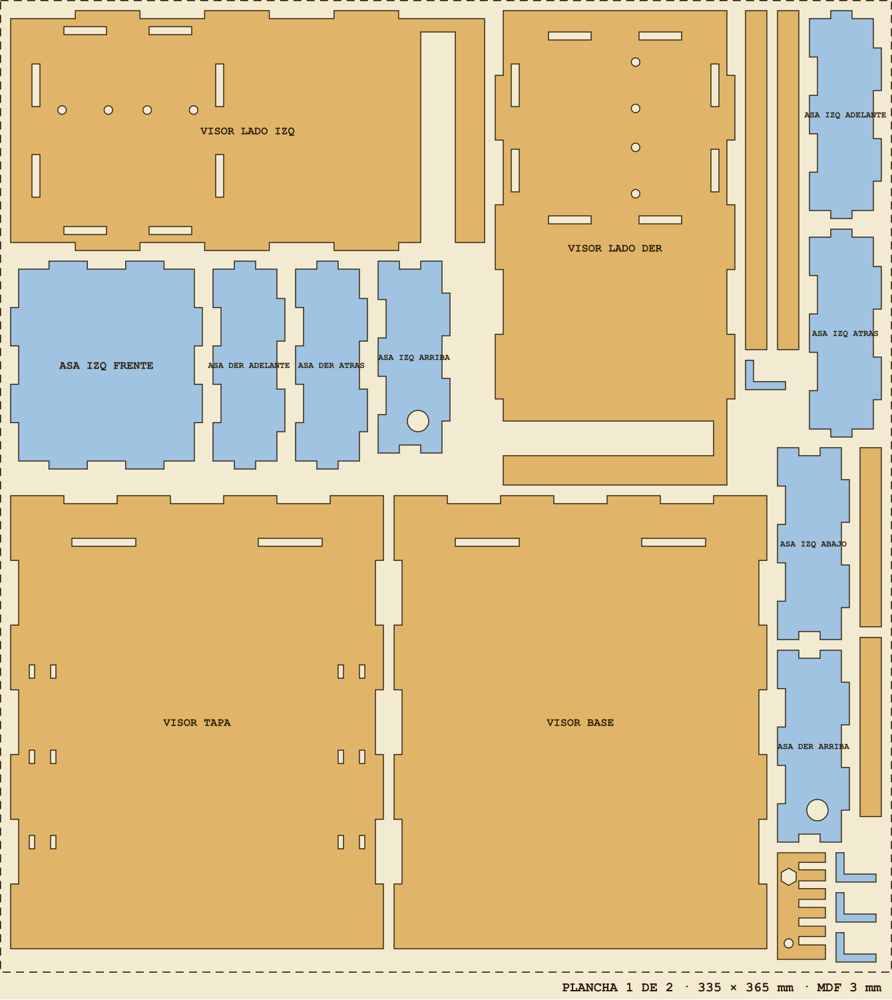
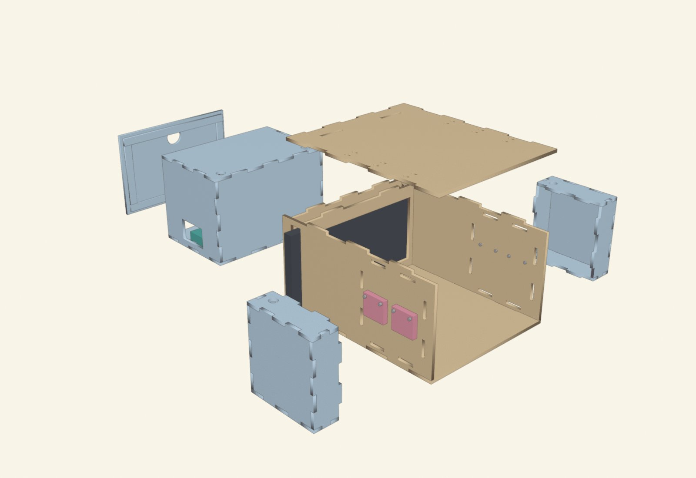
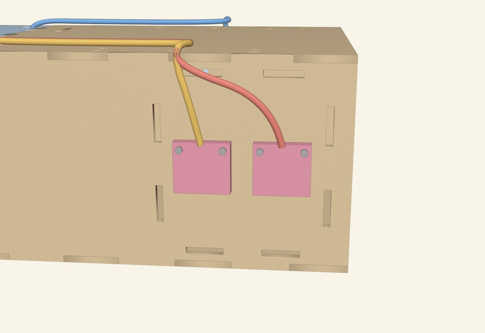

# Visor integrado (propuesta B): visor, asas con motores y mochila

Rediseño del visor de `fisico/visor_laser/` pensando juntos el visor y la electrónica de la vibración. Reemplaza
al módulo externo que iba pegado arriba (los dibujos de ese módulo quedaron como referencia fuera del repo).
Modelo 3D de las dos propuestas que se compararon: `propuestas_3d.html`. Se eligió la **B**.




| Archivo | Para qué |
| --- | --- |
| `plancha_1_corte.dxf`, `plancha_2_corte.dxf` | Los que se importan en RDWorks (mm, una capa de corte) |
| `plancha_1_corte.svg`, `plancha_2_corte.svg` | Lo mismo en SVG, de respaldo |
| `plancha_1_guia.*`, `plancha_2_guia.*` | Dibujo con el nombre de cada pieza grande (no es para cortar) |
| `generar.py` | Genera todo; las medidas están al principio y el script comprueba que calce y quepa |

## Qué cambió respecto del visor anterior

- **Sin careta:** el lado de los ojos queda abierto. Las ojeras y la ventana de dos ojos resultaron incómodas; los
  bordes delanteros de tapa, base y laterales van lisos.
- **20 mm más ancho** (140 en vez de 120), tanto en el lado del teléfono como en el de quien mira, y una ventana del
  marco de 124 mm: se ve el teléfono entero.
- **48 mm más largo** (170 en vez de 122): el teléfono queda a unos 15 cm del borde por donde se mira, antes ~11. Se
  enfoca más cómodo.
- **Los motores se atornillan a los laterales** del visor por sus dos agujeros; las asas encajan con dientes.

## Medidas

- Visor: 140 × 90 × 170 mm (los laterales sobresalen 8 mm atrás). Largo ajustable con `VISOR_Z` (cabe hasta 180).
- Asas: 72 × 78 × 24 mm, adelante en cada lateral. Encajan con **dientes** (dos por borde) en **ranuras** del lateral
  y se refuerzan con cola fría. Sin tornillos.
- Motores: dos por asa, cada uno atornillado al lateral por sus **dos agujeros** (`MOTOR_AGUJEROS`, Ø 3,2 mm). Las
  posiciones son una estimación: **medir el módulo real** y corregir el parámetro antes de cortar.
- Mochila: 134 × 90 × 90 mm, entre los aleros, **pegada** a la trasera del visor. Por dentro: 128 × 84 × 87, con el
  Leonardo (70 × 55) y la protoboard (47 × 35) en el piso, espacio para enchufar el USB y pasos de 34 × 22 mm a los
  dos costados. Tapa trasera **a presión**: cuatro listones pegados por dentro de la tapa entran en la boca de la
  mochila; un agujero de 18 mm sirve para tirarla con el dedo.
- Total: 188 × 90 × 268 mm. Dos planchas de 335 × 365 mm, 31 piezas, 12 m de corte, unos 400 g de MDF.

## Zonas y motores

Cada asa lleva dos motores, adelante y atrás. Con los cuatro se repite el orden de las zonas del Mirador:

| Motor (pin) | Dónde | Zona |
| --- | --- | --- |
| 1 (10) | asa izquierda, adelante | arriba a la izquierda |
| 2 (8) | asa derecha, adelante | arriba a la derecha |
| 3 (6) | asa izquierda, atrás | abajo a la izquierda |
| 4 (4) | asa derecha, atrás | abajo a la derecha |

## Antes de cortar

1. Medir el espesor real del MDF y ponerlo en `T` (las uniones y pilares dependen de eso). Regenerar.
2. Cortar primero la **PROBETA**: cinco ranuras de 2,8 a 3,2 mm, un hexágono para la tuerca M3 y un
   paso de 3,4 mm. La ranura de 3,0 debe aceptar el MDF sin forzar; la tuerca debe entrar en el hexágono.
3. Medir los dos agujeros del módulo de vibración (separación y distancia al borde) y ponerlos en `MOTOR_AGUJEROS`, y el ancho y grosor del
   teléfono contra la ranura.
4. En RDWorks, comprobar que la VISOR TAPA mida 140 × 170 mm al importar (escala correcta).

## Piezas chicas (sin nombre en la guía)

- **Listones de la tapa** (4): se pegan por dentro de la tapa de la mochila, a 3,4 mm del borde, formando un marco.
- **Escuadras de la cuna** (4): topes del Leonardo en el piso de la mochila.

## Tornillería y otros

- 8 tornillos M3 (o M2,5, según el agujero del módulo) × 10 mm con tuerca: dos por motor, desde dentro del visor.
- Cola fría para todo lo demás: visor, asas (dientes en las ranuras), mochila y su unión con la trasera.
- Bridas finas para los cables sobre la tapa del visor (seis pares de pasos, tres por lado).

## Armado

1. **Visor:** base, laterales, trasera y tapa con cola (adelante queda abierto); el marco entra con sus lengüetas en
   las ranuras de tapa y base y ayuda a escuadrar. Sujetar con elásticos mientras seca.
2. **Motores:** atornillarlos por fuera de cada lateral con sus dos tornillos, desde dentro del visor, con el
   conector hacia arriba.
3. **Asas:** armar cada caja (frente, arriba, abajo, adelante, atrás) con cola; queda abierta hacia el visor y con
   los dientes hacia afuera. Pasar los cables de los motores por el agujero de arriba del asa, poner cola en los
   dientes y encajarlos en las ranuras del lateral.
4. **Mochila:** armar la caja (frente, arriba, abajo, costados) con cola, abierta atrás. Pegar la protoboard y las
   escuadras de la cuna en el piso. Pegar el frente de la mochila a la trasera del visor, entre los aleros.
5. **Tapa:** pegar los cuatro listones por dentro de la tapa, formando un marco que entre justo en la boca.
6. **Cables:** los de los motores, por encima de la tapa del visor junto a cada borde, con bridas, hasta los
   agujeros de arriba de la mochila. El USB del teléfono entra por el paso del costado del lado donde sobresale.

El sketch de los motores es `arduino/vibraciones_aves/`.

## Ensamble 3D con las piezas reales

`blender_ensamble.py` lee `piezas.json` (lo escribe `generar.py`: los mismos contornos que van a la cortadora),
extruye cada pieza a 3 mm y la pone en su lugar. Teléfono, placas, motores, tornillos y cables van como referencia.

```bash
/Applications/Blender.app/Contents/MacOS/Blender --background --python blender_ensamble.py
```

Deja `ensamble.blend` (para abrir en Blender), `ensamble.glb` y `ensamble.html`, un visor en el navegador con
«Separar» y casillas para ocultar tapas, asas y cables, más las vistas fijas:





