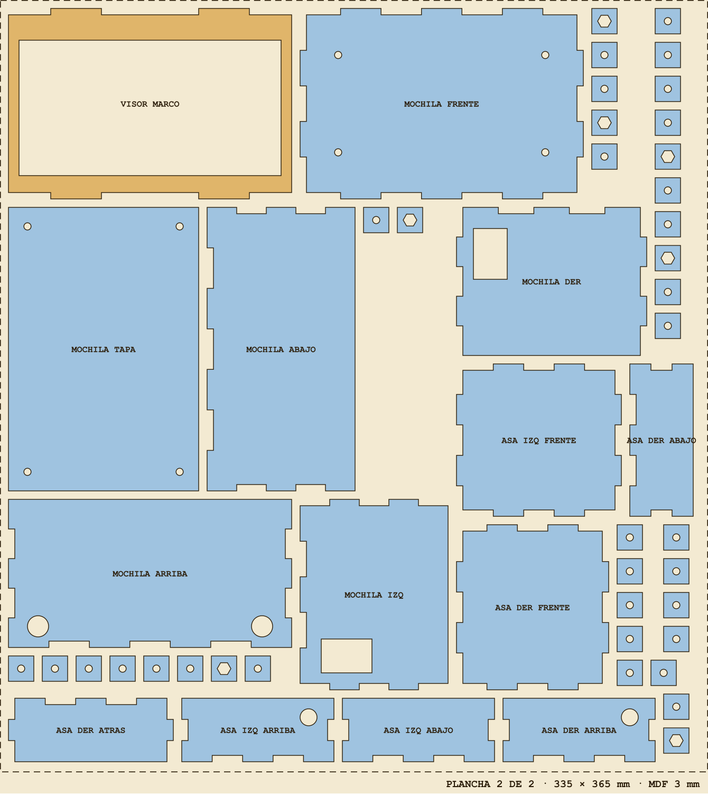
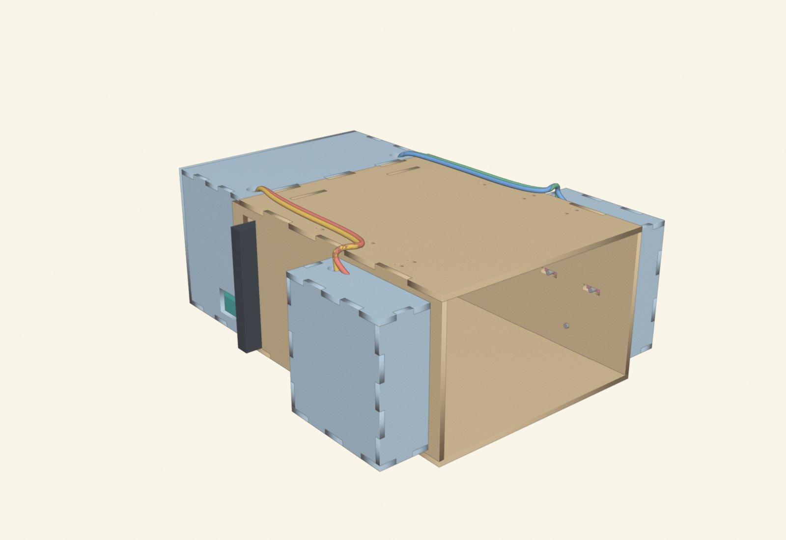
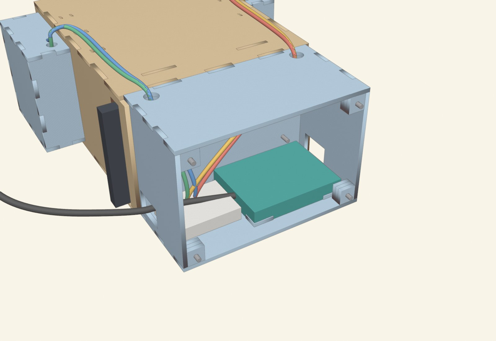

# Visor integrado (propuesta B): visor, asas con motores y mochila

Rediseño del visor de `fisico/visor_laser/` pensando juntos el visor y la electrónica de la vibración. Reemplaza
al módulo externo que iba pegado arriba (los dibujos de ese módulo quedaron como referencia fuera del repo).
Modelo 3D de las dos propuestas que se compararon: `propuestas_3d.html`. Se eligió la **B**.




| Archivo | Para qué |
| --- | --- |
| `plancha_1_corte.dxf`, `plancha_2_corte.dxf` | Los que se importan en RDWorks (mm, una capa de corte) |
| `plancha_1_corte.svg`, `plancha_2_corte.svg` | Lo mismo en SVG, de respaldo |
| `plancha_1_guia.*`, `plancha_2_guia.*` | Dibujo con el nombre de cada pieza grande (no es para cortar) |
| `generar.py` | Genera todo; las medidas están al principio y el script comprueba que calce y quepa |

## Qué cambió respecto del visor anterior

- **Sin careta:** el lado de los ojos queda abierto. Las ojeras y la ventana de dos ojos resultaron incómodas; los
  bordes delanteros de tapa, base y laterales van lisos.
- **20 mm más ancho** (140 en vez de 120), tanto en el lado del teléfono como en el de quien mira, y una ventana del
  marco de 124 mm: se ve el teléfono entero.
- **48 mm más largo** (170 en vez de 122): el teléfono queda a unos 15 cm del borde por donde se mira, antes ~11. Se
  enfoca más cómodo.
- **Los motores se atornillan a los laterales** del visor, cada uno con un M3 por un ojal de 12 mm (se ajusta la
  posición al agujero real del módulo de vibración).

## Medidas

- Visor: 140 × 90 × 170 mm (los laterales sobresalen 8 mm atrás). Largo ajustable con `VISOR_Z` (cabe hasta 180). Teléfono por la ranura lateral: hasta 78 mm de
  ancho y 12 mm de grosor con carcasa, como antes.
- Asas: 72 × 78 × 30 mm, adelante en cada lateral (empiezan a 8 mm del borde de los ojos, lejos de la ranura).
- Mochila: 134 × 90 × 70 mm, entre los aleros, detrás de la trasera. Por dentro: 134 × 84 × 67, con el Leonardo
  (70 × 55) acostado y la protoboard (47 × 35) al lado, y más de 40 mm libres sobre las placas para cables.
- Total: 200 × 90 × 240 mm. Dos planchas de 335 × 365 mm (84 % y 78 % ocupadas), 75 piezas, 13,4 m de corte, unos
  400 g de MDF.

## Zonas y motores

Cada asa lleva dos motores, adelante y atrás. Con los cuatro se repite el orden de las zonas del Mirador:

| Motor (pin) | Dónde | Zona |
| --- | --- | --- |
| 1 (10) | asa izquierda, adelante | arriba a la izquierda |
| 2 (8) | asa derecha, adelante | arriba a la derecha |
| 3 (6) | asa izquierda, atrás | abajo a la izquierda |
| 4 (4) | asa derecha, atrás | abajo a la derecha |

## Antes de cortar

1. Medir el espesor real del MDF y ponerlo en `T` (las uniones y pilares dependen de eso). Regenerar.
2. Cortar primero la **PROBETA** (plancha 1): cinco ranuras de 2,8 a 3,2 mm, un hexágono para la tuerca M3 y un
   paso de 3,4 mm. La ranura de 3,0 debe aceptar el MDF sin forzar; la tuerca debe entrar en el hexágono.
3. Comprobar el agujero de montaje del módulo de vibración contra el ojal del lateral, y el ancho y grosor del
   teléfono contra la ranura.
4. En RDWorks, comprobar que la VISOR TAPA mida 140 × 170 mm al importar (escala correcta).

## Piezas chicas (sin nombre en la guía)

- **Pilares de las asas** (36 cuadrados de 12 × 12): 9 capas por pilar, dos pilares por asa. La capa que toca el
  visor lleva el hexágono de la tuerca.
- **Apoyos de la mochila** (12 cuadrados de 12 × 12): 3 capas por apoyo, uno en cada esquina trasera interior. La
  capa del fondo (la más lejana a la tapa) lleva la tuerca.
- **Escuadras de la cuna** (4): topes del Leonardo en el piso de la mochila, en los dos extremos de su largo
  y del lado de la tapa.

## Tornillería

- 4 M3 × 10 + tuercas: motores contra los laterales (desde dentro del visor).
- 4 M3 × 16 + tuercas: asas (desde dentro del visor, a los pilares).
- 4 M3 × 12 + tuercas: mochila contra la trasera del visor (tuercas por dentro de la mochila).
- 4 M3 × 12 + tuercas: tapa trasera de la mochila (a los apoyos).
- Bridas finas para los cables sobre la tapa del visor (seis pares de pasos, tres por lado).

## Armado

1. **Visor:** base, laterales, trasera y tapa con cola (adelante queda abierto); el marco entra con sus lengüetas en
   las ranuras de tapa y base y ayuda a escuadrar la caja. Sujetar con elásticos mientras seca.
2. **Motores:** atornillarlos por fuera de cada lateral, en los ojales, con el tornillo desde dentro del visor.
3. **Asas:** armar cada caja (frente, arriba, abajo, adelante, atrás) con cola; queda abierta del lado del visor.
   Laminar los pilares con su tuerca y pegarlos por dentro del frente del asa, alineados con los agujeros del
   lateral (usar los tornillos como guía). Pasar los cables del motor por el agujero de arriba del asa y
   atornillar el asa desde dentro del visor.
4. **Mochila:** armar la caja (frente, arriba, abajo, costados) con cola, abierta atrás. Pegar los apoyos con
   tuerca en las esquinas traseras interiores. Pegar la protoboard y las escuadras de la cuna en el piso.
   Atornillar el frente de la mochila a la trasera del visor (entra entre los aleros).
5. **Cables:** los de los motores, por encima de la tapa del visor junto a cada borde, con bridas, hasta los
   agujeros de arriba de la mochila. El USB del teléfono entra por el paso del costado de la mochila del lado
   donde sobresale el teléfono.
6. Cerrar la mochila con su tapa y 4 tornillos.

El sketch de los motores es `arduino/vibraciones_aves/`.

## Ensamble 3D con las piezas reales

`blender_ensamble.py` lee `piezas.json` (lo escribe `generar.py`: los mismos contornos que van a la cortadora),
extruye cada pieza a 3 mm y la pone en su lugar. Teléfono, placas, motores, tornillos y cables van como referencia.

```bash
/Applications/Blender.app/Contents/MacOS/Blender --background --python blender_ensamble.py
```

Deja `ensamble.blend` (para abrir en Blender), `ensamble.glb` y `ensamble.html`, un visor en el navegador con
«Separar» y casillas para ocultar tapas, asas y cables, más las vistas fijas:





