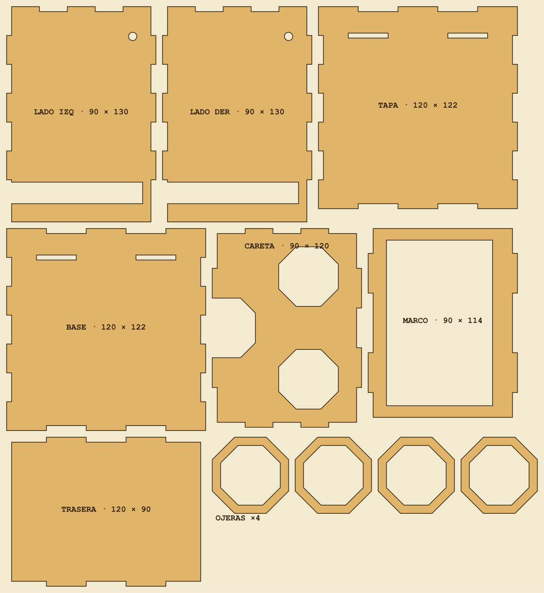

# Visor del Aviario para corte láser

Caja de MDF de 3 mm con uniones de dedos. Por un extremo se mira a través de dos ventanas octogonales; en el
otro va el teléfono, acostado, con la pantalla hacia adentro. El teléfono entra **por el costado**: hay una
ranura en cada lado y, si es más largo que la caja, sobresale. No lleva Arduino ni lentes.

| Archivo | Para qué |
| --- | --- |
| `visor_corte.dxf` | El que se importa en RDWorks (mm, una sola capa de corte) |
| `visor_corte.svg` | El mismo plano en SVG, de respaldo |
| `visor_guia.svg` / `.png` | Dibujo con los nombres y medidas de cada pieza (no es para cortar) |
| `generar.py` | Genera todo lo anterior; las medidas están al principio del archivo |

## Medidas

- Hecho para una plancha de **335 × 365 mm** (el plano ocupa 328 × 358 mm, con 4 mm de margen).
- Exterior: 120 × 90 × 122 mm (los lados sobresalen 8 mm por detrás). Pesa unos 160 g sin teléfono.
- **El largo del teléfono no importa.** Solo tiene que caber por la ranura: hasta **78 mm de ancho y 12 mm
  de grosor**, con carcasa.
- Distancia del ojo a la pantalla: **unos 12 cm**. Es lo máximo que da esta plancha y queda cerca del límite
  de enfoque: conviene probarlo antes de cortar (ver «Antes de cortar»).
- 11 piezas, 5,6 m de corte.

## Por qué una caja y no dos tubos

Sin lentes, cada ojo no puede mirar su propia imagen por un tubo separado: los ojos tendrían que apuntar en
paralelo (como mirando lejos) y a la vez enfocar a 18 cm, y eso cansa o se ve doble. En cambio, si los dos
ojos miran **la misma imagen** se comporta como mirar cualquier objeto cercano. Por eso el interior es un
solo espacio, y lo «binocular» está en la careta: dos ventanas octogonales a 62 mm con sus ojeras.

En el Mirador hay que usar **un lente** (engranaje → desmarcar «Dos lentes»).

## Antes de cortar

1. **Mide el espesor real** de tu plancha con pie de metro y ponlo en `T` (el MDF «de 3 mm» varía entre 2,8
   y 3,2). Las uniones dependen de eso.
2. **Mide el ancho y el grosor del teléfono más grande que vayan a usar, con carcasa.** Si pasa de 78 mm de
   ancho o de 12 mm de grosor, sube `RANURA_ALTO` (y `Y`) o `GAP`.
3. **Prueba la distancia:** abre el Mirador en el teléfono y sostenlo a 12 cm de los ojos. Si no logras
   enfocar cómodo, hace falta una plancha más grande para alargar la caja (`Z`) o un par de lentes.
4. Corre `python3 generar.py` y revisa `visor_guia.png`. Si las piezas no caben en `PLANCHA`, el script avisa.

## En el MakerSpace (Biblioteca San Joaquín)

- Se reserva hora en `reservadesalas.bibliotecas.uc.cl/reserve/cortadoras` y se va en persona, con credencial
  UC; el operador supervisa.
- Hay que **llevar el material**: MDF o terciado de 3 mm, de 335 × 365 mm o más. Sirve cualquiera de las
  dos máquinas (Aeon Mira 9, 900 × 600 mm; Aeon Nova 14, 1400 × 900 mm).
- La máquina recibe un archivo `.rd`, que se genera con RDWorks (solo Windows) a partir del DXF. Cualquier
  computador con Windows y RDWorks sirve: se importa `visor_corte.dxf` y se guarda con «Save to U File». Pero
  el `.rd` lleva dentro la velocidad y la potencia de corte, que dependen de la máquina: hay que pedírselas
  al operador o ajustarlas allá. Llevar siempre también el DXF y el SVG en el pendrive.
- Al importar, comprobar que la pieza BASE mida **120 × 122 mm**: así se sabe que la escala entró bien.
- Todo es corte (no hay grabado). Parámetros orientativos de su tutorial para MDF de 3 mm: 15 mm/s y
  60–70 % de potencia; el operador los confirma.

## Armado

Con cola fría. El láser se come unas décimas de milímetro, así que las uniones entran sin forzar. Conviene
armar todo una vez en seco antes de pegar.

1. Pegar las **ojeras**: dos aros apilados alrededor de cada ventana de la CARETA, por fuera.
2. Parar el **MARCO** sobre la BASE: sus dos lengüetas de abajo entran en las ranuras.
3. Poner la **TRASERA** en el borde de atrás de la BASE y la **CARETA** en el de adelante, con el hueco de la
   nariz hacia abajo.
4. Poner los dos **LADOS**: la ranura alta queda atrás, abierta hacia la base, y el agujero del cordón
   adelante y arriba. La TRASERA queda entre los dos lados.
5. Cerrar con la **TAPA** (es igual a la BASE): las lengüetas de arriba del MARCO entran en sus ranuras.
6. Sujetar con elásticos o cinta mientras seca.

El teléfono entra deslizando por la ranura de un lado, acostado y con la pantalla hacia el marco, y se
centra a ojo: si es largo, sobresale por los dos lados. Queda entre el MARCO y la TRASERA.

Para que no se resbale al inclinar el visor, pegar una tira de goma eva en la cara interior de la TRASERA
hasta que el teléfono entre apretado. Si prefieren un tope, `RANURA_AMBOS = False` deja la ranura en un solo
lado (entonces el teléfono solo puede sobresalir por ese lado).
